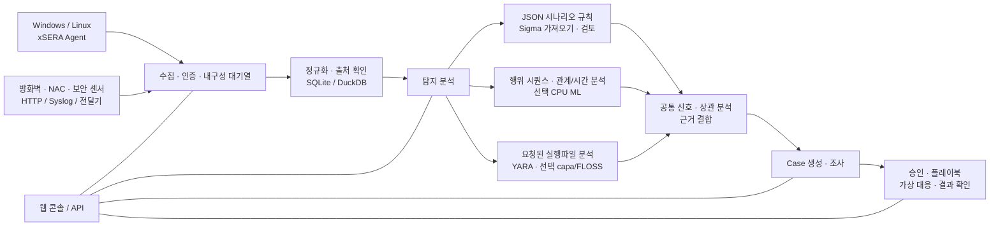

# VATEX LUMINA xSERA

**로그 수집부터 탐지, 사건 조사와 대응 워크플로까지 연결하는 CPU 기반 XDR 플랫폼**

xSERA는 Windows·Linux 엔드포인트와 보안 장비의 텔레메트리를 수집하고,
규칙·행위 분석 결과를 공통 신호와 Case로 연결하는 서버 및 에이전트 프로젝트입니다.
웹 콘솔에서 수집 설정, 탐지 콘텐츠, 조사와 대응 진행 상태를 관리합니다.

> **현재 범위:** 이 저장소는 0.20.0을 기반으로 이후 변경된 소스까지 포함합니다.
> CPU 관찰 환경을 위한 개발·검증용 소스이며 일반 상용 운영 승인을 의미하지 않습니다.
> 제공하는 시작 명령은 실제 호스트 변경 대응을 차단합니다. 자동 대응 예시는 가상 장비
> 워크플로를 뜻하며, 실제 장비 연결·호스트 조치는 별도 설정과 현장 검증이 필요합니다.

## 전체 구조



수집 확인은 내구성 대기열에 기록되었다는 뜻이며 검색 색인과 탐지 완료를
의미하지 않습니다. AI 점수와 YARA 일치는 조사 근거이며 그 자체가 악성 판정이나
실제 차단 권한을 뜻하지 않습니다.

## 저장소 구성

| 구성 | 경로 | 역할 |
| --- | --- | --- |
| 서버와 API | `sapientia/` | 수집, 인증·권한, 저장, 검색, 탐지, Case와 대응 워크플로 |
| 웹 콘솔 | `sapientia/web/` | 운영 현황, 로그 검색, 규칙·AI 자료 관리, 조사와 대응 |
| 엔드포인트 에이전트 | `sapientia/endpoint_agent/` | Windows·Linux 수집, 등록 및 서버와의 통신 |
| 기본 탐지 콘텐츠 | `sapientia/catalogs/` | 자체 JSON 규칙, ATT&CK 정보, 출처와 라이선스를 보존한 YARA·capa 규칙 |
| 운영 도구와 예시 | `tools/`, `deploy/` | 에이전트 패키징, 선택 센서 전달기, 가상 텔레메트리와 서비스 예시 |
| 문서와 검증 | `docs/`, `tests/` | 사용 계약, 콘텐츠 출처 및 회귀 시험 |

기본 라이브러리는 기존 자체 규칙 950개를 포함합니다. 선택할 수 있는 전체 탐지
라이브러리와 합성 학습 자료는 [콘솔 자료 안내](docs/console-datasets-0.15.md)를
참조하세요. **기본 콘텐츠가 포함되어도 새 설치에서 모든 정책이나 모델이 자동으로
활성화되는 것은 아닙니다.** 합성 시나리오 수는 현장 탐지 정확도를 뜻하지 않습니다.

## 빠른 시작

아래 예시는 로컬 단일 서버를 위한 시작 방법입니다. Python 3.12와 인터넷에 접근할
수 있는 패키지 설치 환경이 필요합니다. 운영 환경에서는 사용자·데이터 접근 권한,
TLS와 백업 정책을 별도로 설정하세요.

### Windows

PowerShell에서:

```powershell
git clone https://github.com/lastime1650/VateX_LUMINA_xSERA.git
cd VateX_LUMINA_xSERA
py -3.12 -m venv .venv
.\.venv\Scripts\python.exe -m pip install -r requirements-lock.txt
.\.venv\Scripts\python.exe -m pip install --no-deps -e .
.\start.cmd
```

Python Launcher가 3.12를 찾지 못하면 설치된 Python 3.12 실행 파일의 전체 경로로
`-m venv .venv`를 실행하세요.

브라우저에서 **http://127.0.0.1:8787**을 열고 첫 관리자 계정을 만듭니다.
시작 스크립트는 로컬 에이전트 TLS용 인증서를 `private/loopback-tls/`에
생성하고 로컬 전용 8788 포트를 사용합니다. 이 인증서는 원격 호스트 배포용
신뢰 체계가 아닙니다.

### Linux

```bash
git clone https://github.com/lastime1650/VateX_LUMINA_xSERA.git
cd VateX_LUMINA_xSERA
python3.12 -m venv .venv
.venv/bin/python -m pip install -r requirements-lock.txt
.venv/bin/python -m pip install --no-deps -e .
export SAPIENTIA_BLOCK_NATIVE_RESPONSE=1
.venv/bin/python -m sapientia --data ./data serve --host 127.0.0.1 --port 8787
```

Linux 예시는 웹 콘솔과 로컬 HTTP 수집을 시작합니다. 에이전트를 연결하려면
별도의 TLS 리스너·신뢰 CA·서명된 에이전트 패키지를 구성해야 합니다.
에이전트 배포에는 외부에서 안전하게 관리하는 서명 키와 별도 경로의 신뢰 공개키가
필요합니다. 설치와 등록 전 [에이전트 서명 안내](docs/agent-package-integrity.md)와
[에이전트 설명서](sapientia/endpoint_agent/README.txt)를 읽어 주세요.

서버의 데이터는 기본적으로 `data/`에 저장됩니다. 이 폴더와 `private/`, 발급한
수집 키, 인증서 개인 키는 저장소에 올리지 마세요. 로컬 HTTP 콘솔을 인터넷에
노출하지 마세요. 외부 연결에는 검증 가능한 TLS와 명시적인 접근 제어가 필요합니다.

## 로그 수집부터 대응까지

1. **수집원 연결** — 콘솔에서 인덱스와 수집 전용 키를 만들거나, 서명된 에이전트를
   등록합니다. 방화벽·NAC·센서 로그는 지원되는 입력과 파서에 맞춰 연결합니다.
2. **로그 수신** — 수집 전용 키로 `POST /api/v1/events`에 JSON 이벤트를 전송합니다.
   키는 환경 변수나 비밀 관리 도구에서 주입합니다. 아래는 로컬 예시입니다.

   ```bash
   curl -X POST http://127.0.0.1:8787/api/v1/events \
     -H "Authorization: Bearer $XSERA_INGEST_KEY" \
     -H "Content-Type: application/json" \
     --data '{"events":[{"event_id":"demo-001","index":"main","source":"demo","sourcetype":"json","host":"endpoint-01","severity":"info","message":"Example telemetry","raw":{"event":{"action":"process_created"}}}]}'
   ```

3. **탐지 설정과 분석** — JSON 시나리오를 선택해 검토·활성화합니다. Sigma 규칙은
   가져오기 → 변환 → 검증 → 독립 검토 → 활성화 과정을 거쳐 같은 JSON 규칙 엔진에서
   실행됩니다. AI 자료와 CPU 모델은 명시적으로 학습·평가·승인해야 합니다.
4. **Case 조사** — 탐지 신호, 원본 이벤트와 연결 근거를 Case에서 확인합니다.
   요청된 프로세스 실행파일은 YARA로 분석할 수 있으며 capa·FLOSS 등은 별도 설치가
   필요한 선택 엔진입니다.
5. **대응과 확인** — 플레이북의 승인, 실행 및 결과를 확인합니다. 기본 시작 프로필은
   실제 호스트 변경을 차단하며, 제공된 가상 대응 실험은 실제 장비 조치가 아닙니다.

자세한 계약: [Sigma 및 융합 분석](docs/fusion-sigma-0.18.txt) ·
[YARA](docs/yara-0.16.txt) · [CPU ML](docs/CPU_ML_RUNTIME.md) ·
[가상 대응](docs/VIRTUAL_RESPONSE_OPERATIONAL_QUALIFICATION.md) ·
[보안 경계](SECURITY.md)

## 선택 기능과 검증 범위

기본 서버는 PyTorch 없이 실행됩니다. CPU ML, Sigma YAML 변환, capa/FLOSS와
외부 센서는 선택 의존성 또는 별도 설치가 필요합니다. 해당 기능을 설치·설정한 뒤
각 문서의 검증과 독립 승인 절차를 따르세요.

이전 0.20.0 배포 스냅샷의 합성 부하 시험에서 약 50 EPS 기준 탐지 P95 35.95초,
Case 생성 P95 25.95초로 당시 목표를 충족하지 못했습니다. 현재 저장소는 그 이후의
소스 변경을 포함하므로 과거 전체 회귀 결과를 이 커밋의 인증으로 간주하지 않습니다.
실제 고객 환경의 탐지율, 오탐률, 지속 부하 및 실제 대응은 별도 현장 검증이 필요합니다.

## 라이선스와 보안

프로젝트 자체 코드와 권리가 확인된 원본 규칙·에이전트 코드는
[Apache-2.0](LICENSE)으로 제공합니다. 외부 규칙, ATT&CK 자료 및 라이브러리는
각자의 조건을 유지합니다. [NOTICE](NOTICE)와
[제3자 라이선스 고지](THIRD_PARTY_NOTICES.md)를 함께 확인하세요.
취약점 제보 시 공개 이슈에 자격 증명이나 실제 고객 데이터를 올리지 말고
[보안 안내](SECURITY.md)의 비공개 제보 경로를 이용해 주세요.

문서의 구조와 빠른 시작 방식은 공개 프로젝트의
[Wazuh 아키텍처 문서](https://github.com/wazuh/wazuh-documentation/blob/main/source/getting-started/architecture.rst)와
[Velociraptor README](https://github.com/Velocidex/velociraptor/blob/master/README.md)를
참고했습니다. 제품 간 기능이나 성능 동등성을 의미하지 않습니다.
