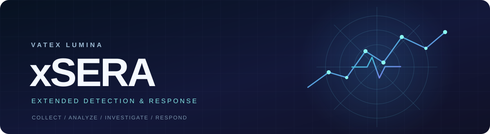
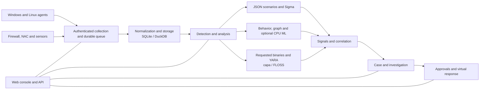

<p align="center"></p>

# VATEX LUMINA xSERA

<p align="center"><strong>See the signal. Understand the story. Coordinate the response.</strong></p>

<p align="center">
  <a href="LICENSE"></a>
  
  
  
</p>

<details open><summary><strong>🌐 Languages</strong></summary>

[English](docs/i18n/README.en.md) · [한국어](docs/i18n/README.ko.md) · [Español](docs/i18n/README.es.md) · [Português (Brasil)](docs/i18n/README.pt-BR.md) · [Français](docs/i18n/README.fr.md) · [Deutsch](docs/i18n/README.de.md) · [Italiano](docs/i18n/README.it.md) · [Nederlands](docs/i18n/README.nl.md) · [Polski](docs/i18n/README.pl.md) · [Türkçe](docs/i18n/README.tr.md) · [Русский](docs/i18n/README.ru.md) · [Українська](docs/i18n/README.uk.md) · [العربية](docs/i18n/README.ar.md) · [हिन्दी](docs/i18n/README.hi.md) · [বাংলা](docs/i18n/README.bn.md) · [Bahasa Indonesia](docs/i18n/README.id.md) · [Tiếng Việt](docs/i18n/README.vi.md) · [ไทย](docs/i18n/README.th.md) · [日本語](docs/i18n/README.ja.md) · [简体中文](docs/i18n/README.zh-CN.md)

</details>

xSERA is a CPU-oriented XDR server and endpoint agent project that connects telemetry collection, detection, investigation and response workflows. The web console brings operations, search, detection content and cases together.

> **Development and validation status**
>
> This repository contains source based on version 0.20.0 and subsequent changes. It is intended for development and evaluation, not a declaration of general availability. The launch instructions below block actions that modify actual hosts. The response examples use virtual devices; real integrations and host actions need separate configuration and field validation.

## 🧭 Architecture

From independent events to evidence and an actionable case:



An ingestion acknowledgment means the event reached the durable queue; it does not mean indexing or detection is complete. ML scores and YARA matches are evidence for investigation, not proof of maliciousness or authority to block a host.

## 🧩 What is in this repository

| Component | Path | Purpose |
| --- | --- | --- |
| Server and API | `sapientia/` | Ingestion, authentication, storage, search, detection, cases and response workflows. |
| Web console | `sapientia/web/` | Operations, event search, rules, ML data, investigations and response. |
| Endpoint agent | `sapientia/endpoint_agent/` | Windows and Linux collection, enrollment and server communication. |
| Detection content | `sapientia/catalogs/` | Native JSON rules, ATT&CK information and YARA/capa content with provenance and licenses. |
| Tools and deployment examples | `tools/`, `deploy/` | Agent packaging, optional sensor forwarders, virtual telemetry and service examples. |
| Documentation and tests | `docs/`, `tests/` | Operating contracts, content provenance and regression tests. |

The bundled library includes 950 original scenario rules. Inclusion does not mean every policy is enabled on a fresh install. Synthetic training examples do not establish real-world detection accuracy. [Datasets](docs/console-datasets-0.15.md)

## 🚀 Quick start

The examples below start a local single-server instance. They require Python 3.12 and network access to install packages. For production planning, configure access controls, TLS and backups separately.

### Windows

Run in PowerShell:

```powershell
git clone https://github.com/lastime1650/VateX_LUMINA_xSERA.git
cd VateX_LUMINA_xSERA
py -3.12 -m venv .venv
.\.venv\Scripts\python.exe -m pip install -r requirements-lock.txt
.\.venv\Scripts\python.exe -m pip install --no-deps -e .
.\start.cmd
```

If the Python launcher cannot find version 3.12, use the full path to the installed Python 3.12 executable to create the virtual environment. Open the local console and create the first administrator account: **http://127.0.0.1:8787**

The Windows launch script creates local agent TLS certificates in private/loopback-tls/ and uses local-only port 8788. These certificates are not a trust system for remote deployment.

### Linux

```bash
git clone https://github.com/lastime1650/VateX_LUMINA_xSERA.git
cd VateX_LUMINA_xSERA
python3.12 -m venv .venv
.venv/bin/python -m pip install -r requirements-lock.txt
.venv/bin/python -m pip install --no-deps -e .
export SAPIENTIA_BLOCK_NATIVE_RESPONSE=1
.venv/bin/python -m sapientia --data ./data serve --host 127.0.0.1 --port 8787
```

The Linux example starts the console and local HTTP ingestion; it does not start a TLS agent listener. Remote agents require an explicitly configured TLS listener, trusted CA, signed packages, an externally managed signing key and a separate trusted public key. Read the agent documentation before deployment. [Agent signing](docs/agent-package-integrity.md) · [Agent](sapientia/endpoint_agent/README.txt)

Open the local console and create the first administrator account: **http://127.0.0.1:8787**

Data is stored in data/ by default. Do not commit data/, private/, ingestion keys or certificate private keys. Do not expose the local HTTP console to the internet; external access requires validated TLS and explicit access control.

## 🔎 From telemetry to response

1. Connect sources. Create an index and a restricted ingestion key in the console, or enroll a signed agent. Configure supported inputs and parsers for firewall, NAC and sensor logs.
2. Ingest events. Send JSON to the events endpoint using the restricted key. Supply secrets through an environment variable or a secret manager. This example is local:

   ```bash
   curl -X POST http://127.0.0.1:8787/api/v1/events \
     -H "Authorization: Bearer $XSERA_INGEST_KEY" \
     -H "Content-Type: application/json" \
     --data '{"events":[{"event_id":"demo-001","index":"main","source":"demo","sourcetype":"json","host":"endpoint-01","severity":"info","message":"Example telemetry","raw":{"event":{"action":"process_created"}}}]}'
   ```

   Replace the environment variable with a valid restricted ingestion key. A successful queue response does not guarantee that this sample will produce a detection or case.

3. Configure detection. Review and enable native JSON scenario rules. Sigma rules follow import, conversion, validation, independent review and activation, then run in the same native JSON rule engine. CPU ML datasets and models require explicit training, evaluation and approval.
4. Investigate cases. Examine the detection signals, source events and correlation evidence. Requested process binaries can be analyzed with YARA; capa and FLOSS are optional engines installed separately.
5. Review response. Inspect playbook approvals, execution and results. The launch profile blocks actual host-modifying actions, and the included virtual response is not a real device action.

## 🧪 Optional engines and validation limits

The base server runs without PyTorch. CPU ML, Sigma YAML conversion, capa/FLOSS and external sensors require optional dependencies or separate installation and configuration. Follow their verification and independent approval procedures.

In a previous 0.20.0 release snapshot, a synthetic load of about 50 events per second produced detection P95 of 35.95 seconds and case-creation P95 of 25.95 seconds, missing the respective targets of 2 and 5 seconds. This repository contains subsequent source changes, so the earlier full regression does not certify this commit. Detection accuracy, false positives, sustained load and actual responses require separate field validation.

## 📚 Further documentation

These linked documents may be available only in Korean or English.

[Sigma / fusion](docs/fusion-sigma-0.18.txt) · [YARA](docs/yara-0.16.txt) · [CPU ML](docs/CPU_ML_RUNTIME.md) · [Datasets](docs/console-datasets-0.15.md) · [Virtual response](docs/VIRTUAL_RESPONSE_OPERATIONAL_QUALIFICATION.md) · [Agent signing](docs/agent-package-integrity.md) · [Agent](sapientia/endpoint_agent/README.txt) · [Security](SECURITY.md)

## ⚖️ License and security

Project-owned code and the original rules and agent code for which redistribution rights were confirmed are provided under Apache-2.0. Third-party rules, ATT&CK materials and libraries retain their own terms. Review the notices and third-party license information.

[Apache-2.0](LICENSE) · [NOTICE](NOTICE) · [Third-party notices](THIRD_PARTY_NOTICES.md) · [SECURITY](SECURITY.md)

Report vulnerabilities through the private reporting channel described in the security policy. Do not publish credentials or customer data in public issues.

README design references: [Wazuh](https://github.com/wazuh/wazuh/blob/main/README.md) · [Velociraptor](https://github.com/Velocidex/velociraptor/blob/master/README.md)
