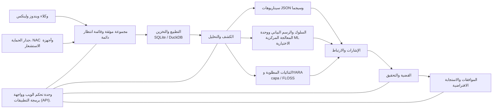

<p align="center"></p>

# VATEX LUMINA xSERA

<p align="center"><strong>انظر الإشارة. فهم القصة. تنسيق الرد.</strong></p>

<p align="center">
  <a href="../../LICENSE"></a>
  
  
  
</p>

<details open><summary><strong>🌐 اللغات</strong></summary>

[English](README.en.md) · [한국어](README.ko.md) · [Español](README.es.md) · [Português (Brasil)](README.pt-BR.md) · [Français](README.fr.md) · [Deutsch](README.de.md) · [Italiano](README.it.md) · [Nederlands](README.nl.md) · [Polski](README.pl.md) · [Türkçe](README.tr.md) · [Русский](README.ru.md) · [Українська](README.uk.md) · [العربية](README.ar.md) · [हिन्दी](README.hi.md) · [বাংলা](README.bn.md) · [Bahasa Indonesia](README.id.md) · [Tiếng Việt](README.vi.md) · [ไทย](README.th.md) · [日本語](README.ja.md) · [简体中文](README.zh-CN.md)

</details>

xSERA هو خادم XDR موجه نحو وحدة المعالجة المركزية ومشروع وكيل نقطة النهاية الذي يربط عمليات سير عمل القياس عن بعد والكشف والتحقيق والاستجابة. تقوم وحدة تحكم الويب بجمع العمليات والبحث والكشف عن المحتوى والحالات معًا.

> **حالة التطوير والتحقق**
>
> يحتوي هذا المستودع على المصدر بناءً على الإصدار 0.20.0 والتغييرات اللاحقة. إنه مخصص للتطوير والتقييم، وليس إعلانًا عن التوفر العام. تعليمات التشغيل أدناه تحظر الإجراءات التي تعدل المضيفين الفعليين. تستخدم أمثلة الاستجابة الأجهزة الافتراضية؛ تحتاج عمليات التكامل الحقيقية وإجراءات المضيف إلى تكوين منفصل والتحقق من صحة الحقل.

> 🌐 تم إنشاء هذا الملف التمهيدي المترجم باستخدام ترجمة آلية ولم تتم مراجعته بواسطة مترجم محترف. يعد الملف التمهيدي باللغة الإنجليزية هو المرجع في حالة اختلاف الصياغة. لا تتوفر بالضرورة واجهة المنتج والوثائق الأخرى بهذه اللغة.

## 🧭 الهندسة المعمارية

من الأحداث المستقلة إلى الأدلة وقضية قابلة للتنفيذ:



يعني إقرار العرض أن الحدث وصل إلى قائمة الانتظار الدائمة؛ وهذا لا يعني اكتمال الفهرسة أو الكشف. تعد نتائج ML ومطابقات YARA دليلاً على التحقيق، وليست دليلاً على الضرر أو سلطة حظر المضيف.

## 🧩 ما هو موجود في هذا المستودع

| مكون | المسار | الغرض |
| --- | --- | --- |
| الخادم وواجهة برمجة التطبيقات | `sapientia/` | الاستيعاب والمصادقة والتخزين والبحث والكشف والحالات وسير عمل الاستجابة. |
| وحدة تحكم الويب | `sapientia/web/` | العمليات والبحث عن الأحداث والقواعد وبيانات تعلم الآلة والتحقيقات والاستجابة. |
| وكيل نقطة النهاية | `sapientia/endpoint_agent/` | التجميع والتسجيل والاتصال بالخادم لنظامي التشغيل Windows وLinux. |
| محتوى الكشف | `sapientia/catalogs/` | قواعد JSON الأصلية ومعلومات ATT&CK ومحتوى YARA/capa مع المصدر والتراخيص. |
| الأدوات وأمثلة النشر | `tools/`, `deploy/` | تعبئة الوكيل، ووكلاء أجهزة الاستشعار الاختيارية، والقياس عن بعد الافتراضي، وأمثلة الخدمة. |
| التوثيق والاختبارات | `docs/`, `tests/` | عقود التشغيل ومصدر المحتوى واختبارات الانحدار. |

تتضمن المكتبة المجمعة 950 قاعدة سيناريو أصلية. لا يعني التضمين أن كل سياسة ممكّنة عند التثبيت الجديد. لا تثبت أمثلة التدريب الاصطناعي دقة الكشف في العالم الحقيقي. [Datasets](../../docs/console-datasets-0.15.md)

## 🚀 بداية سريعة

تبدأ الأمثلة أدناه مثيلًا محليًا لخادم واحد. أنها تتطلب Python 3.12 والوصول إلى الشبكة لتثبيت الحزم. لتخطيط الإنتاج، قم بتكوين عناصر التحكم في الوصول وTLS والنسخ الاحتياطية بشكل منفصل.

### ويندوز

تشغيل في PowerShell:

```powershell
git clone https://github.com/lastime1650/VateX_LUMINA_xSERA.git
cd VateX_LUMINA_xSERA
py -3.12 -m venv .venv
.\.venv\Scripts\python.exe -m pip install -r requirements-lock.txt
.\.venv\Scripts\python.exe -m pip install --no-deps -e .
.\start.cmd
```

إذا لم يتمكن مشغل Python من العثور على الإصدار 3.12، فاستخدم المسار الكامل إلى إصدار Python 3.12 المثبت القابل للتنفيذ لإنشاء البيئة الافتراضية. افتح وحدة التحكم المحلية وأنشئ حساب المسؤول الأول: **http://127.0.0.1:8787**

يقوم البرنامج النصي لإطلاق Windows بإنشاء شهادات TLS للوكيل المحلي في Private/loopback-tls/ ويستخدم المنفذ المحلي 8788. هذه الشهادات ليست نظام ثقة للنشر عن بعد.

### لينكس

```bash
git clone https://github.com/lastime1650/VateX_LUMINA_xSERA.git
cd VateX_LUMINA_xSERA
python3.12 -m venv .venv
.venv/bin/python -m pip install -r requirements-lock.txt
.venv/bin/python -m pip install --no-deps -e .
export SAPIENTIA_BLOCK_NATIVE_RESPONSE=1
.venv/bin/python -m sapientia --data ./data serve --host 127.0.0.1 --port 8787
```

يبدأ مثال Linux وحدة التحكم واستيعاب HTTP المحلي؛ لا يبدأ مستمع وكيل TLS. يتطلب الوكلاء البعيدون مستمع TLS تم تكوينه بشكل صريح، ومرجع مصدق موثوق به، وحزم موقعة، ومفتاح توقيع مُدار خارجيًا، ومفتاح عام منفصل موثوق به. اقرأ وثائق الوكيل قبل النشر. [Agent signing](../../docs/agent-package-integrity.md) · [Agent](../../sapientia/endpoint_agent/README.txt)

افتح وحدة التحكم المحلية وأنشئ حساب المسؤول الأول: **http://127.0.0.1:8787**

يتم تخزين البيانات في data/ بشكل افتراضي. لا تلتزم بمفاتيح البيانات/ أو الخاصة/ أو مفاتيح الإدخال أو مفاتيح الشهادة الخاصة. لا تعرض وحدة تحكم HTTP المحلية للإنترنت؛ يتطلب الوصول الخارجي TLS التحقق من صحته والتحكم الصريح في الوصول.

## 🔎 من القياس عن بعد إلى الاستجابة

1. ربط المصادر. قم بإنشاء فهرس ومفتاح استيعاب مقيد في وحدة التحكم، أو قم بتسجيل وكيل موقّع. قم بتكوين المدخلات والموزعات المدعومة لجدار الحماية وسجلات NAC وأجهزة الاستشعار.
2. استيعاب الأحداث. أرسل JSON إلى نقطة نهاية الأحداث باستخدام المفتاح المقيد. توفير الأسرار من خلال متغير البيئة أو المدير السري. هذا المثال محلي:

   ```bash
   curl -X POST http://127.0.0.1:8787/api/v1/events \
     -H "Authorization: Bearer $XSERA_INGEST_KEY" \
     -H "Content-Type: application/json" \
     --data '{"events":[{"event_id":"demo-001","index":"main","source":"demo","sourcetype":"json","host":"endpoint-01","severity":"info","message":"Example telemetry","raw":{"event":{"action":"process_created"}}}]}'
   ```

   استبدل متغير البيئة بمفتاح عرض مقيد صالح. لا تضمن الاستجابة الناجحة لقائمة الانتظار أن هذه العينة ستنتج اكتشافًا أو حالة.

3. تكوين الكشف. قم بمراجعة وتمكين قواعد سيناريو JSON الأصلية. تتبع قواعد Sigma عمليات الاستيراد والتحويل والتحقق والمراجعة المستقلة والتنشيط، ثم يتم تشغيلها في نفس محرك قواعد JSON الأصلي. تتطلب مجموعات بيانات ونماذج CPU ML تدريبًا وتقييمًا وموافقة صريحة.
4. التحقيق في الحالات. فحص إشارات الكشف وأحداث المصدر وأدلة الارتباط. يمكن تحليل ثنائيات العملية المطلوبة باستخدام YARA؛ capa وFLOSS هما محركان اختياريان يتم تركيبهما بشكل منفصل.
5. مراجعة الرد. فحص موافقات قواعد اللعبة والتنفيذ والنتائج. يحظر ملف تعريف التشغيل إجراءات تعديل المضيف الفعلية، والاستجابة الافتراضية المضمنة ليست إجراءً حقيقيًا للجهاز.

## 🧪 المحركات الاختيارية وحدود التحقق من الصحة

يعمل الخادم الأساسي بدون PyTorch. تتطلب وحدة المعالجة المركزية CPU ML وتحويل Sigma YAML وcapa/FLOSS وأجهزة الاستشعار الخارجية تبعيات اختيارية أو تثبيت وتكوين منفصلين. اتبع إجراءات التحقق والموافقة المستقلة.

في لقطة إصدار سابقة 0.20.0، أدى الحمل الاصطناعي الذي يبلغ حوالي 50 حدثًا في الثانية إلى اكتشاف P95 لمدة 35.95 ثانية وإنشاء الحالة P95 لمدة 25.95 ثانية، مما أدى إلى فقدان الأهداف المعنية البالغة 2 و5 ثوانٍ. يحتوي هذا المستودع على تغييرات لاحقة في المصدر، وبالتالي فإن الانحدار الكامل السابق لا يؤكد هذا الالتزام. تتطلب دقة الكشف والإيجابيات الكاذبة والحمل المستمر والاستجابات الفعلية التحقق من صحة المجال بشكل منفصل.

## 📚 مزيد من الوثائق

قد تكون هذه المستندات المرتبطة متاحة باللغة الكورية أو الإنجليزية فقط.

[Sigma / fusion](../../docs/fusion-sigma-0.18.txt) · [YARA](../../docs/yara-0.16.txt) · [CPU ML](../../docs/CPU_ML_RUNTIME.md) · [Datasets](../../docs/console-datasets-0.15.md) · [Virtual response](../../docs/VIRTUAL_RESPONSE_OPERATIONAL_QUALIFICATION.md) · [Agent signing](../../docs/agent-package-integrity.md) · [Agent](../../sapientia/endpoint_agent/README.txt) · [Security](../../SECURITY.md)

## ⚖️ الترخيص والأمن

يتم توفير الكود المملوك للمشروع والقواعد الأصلية ورمز الوكيل الذي تم تأكيد حقوق إعادة التوزيع له ضمن Apache-2.0. تحتفظ قواعد الطرف الثالث ومواد ومكتبات ATT&CK بشروطها الخاصة. قم بمراجعة الإشعارات ومعلومات ترخيص الطرف الثالث.

[Apache-2.0](../../LICENSE) · [NOTICE](../../NOTICE) · [Third-party notices](../../THIRD_PARTY_NOTICES.md) · [SECURITY](../../SECURITY.md)

قم بالإبلاغ عن نقاط الضعف من خلال قناة الإبلاغ الخاصة الموضحة في السياسة الأمنية. لا تنشر بيانات الاعتماد أو بيانات العملاء في القضايا العامة.

مراجع تصميم README: [Wazuh](https://github.com/wazuh/wazuh/blob/main/README.md) · [Velociraptor](https://github.com/Velocidex/velociraptor/blob/master/README.md)
