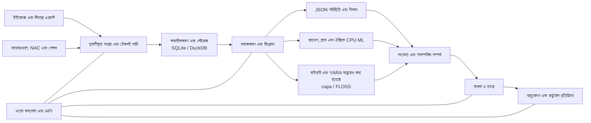

<p align="center"></p>

# VATEX LUMINA xSERA

<p align="center"><strong>সংকেত দেখুন। গল্পটা বুঝুন। প্রতিক্রিয়া সমন্বয়.</strong></p>

<p align="center">
  <a href="../../LICENSE"></a>
  
  
  
</p>

<details open><summary><strong>🌐 ভাষা</strong></summary>

[English](README.en.md) · [한국어](README.ko.md) · [Español](README.es.md) · [Português (Brasil)](README.pt-BR.md) · [Français](README.fr.md) · [Deutsch](README.de.md) · [Italiano](README.it.md) · [Nederlands](README.nl.md) · [Polski](README.pl.md) · [Türkçe](README.tr.md) · [Русский](README.ru.md) · [Українська](README.uk.md) · [العربية](README.ar.md) · [हिन्दी](README.hi.md) · [বাংলা](README.bn.md) · [Bahasa Indonesia](README.id.md) · [Tiếng Việt](README.vi.md) · [ไทย](README.th.md) · [日本語](README.ja.md) · [简体中文](README.zh-CN.md)

</details>

xSERA হল একটি CPU-ভিত্তিক XDR সার্ভার এবং এন্ডপয়েন্ট এজেন্ট প্রকল্প যা টেলিমেট্রি সংগ্রহ, সনাক্তকরণ, তদন্ত এবং প্রতিক্রিয়া কর্মপ্রবাহকে সংযুক্ত করে। ওয়েব কনসোল অপারেশন, অনুসন্ধান, সনাক্তকরণ বিষয়বস্তু এবং কেস একসাথে নিয়ে আসে।

> **উন্নয়ন এবং বৈধতা অবস্থা**
>
> এই সংগ্রহস্থলে 0.20.0 সংস্করণ এবং পরবর্তী পরিবর্তনের উপর ভিত্তি করে উৎস রয়েছে। এটি উন্নয়ন এবং মূল্যায়নের উদ্দেশ্যে, সাধারণ প্রাপ্যতার ঘোষণা নয়। নিচের লঞ্চের নির্দেশাবলী ব্লক অ্যাকশনগুলি যা প্রকৃত হোস্টগুলিকে সংশোধন করে। প্রতিক্রিয়া উদাহরণ ভার্চুয়াল ডিভাইস ব্যবহার করে; বাস্তব ইন্টিগ্রেশন এবং হোস্ট অ্যাকশনের জন্য আলাদা কনফিগারেশন এবং ফিল্ড ভ্যালিডেশন প্রয়োজন।

> 🌐 এই অনূদিত README মেশিন অনুবাদের মাধ্যমে তৈরি করা হয়েছে এবং পেশাদার অনুবাদক দ্বারা পর্যালোচনা করা হয়নি। ইংরেজি README হল রেফারেন্স যদি শব্দের পার্থক্য হয়। পণ্য ইন্টারফেস এবং অন্যান্য ডকুমেন্টেশন অগত্যা এই ভাষায় উপলব্ধ নয়.

## 🧭 স্থাপত্য

স্বাধীন ঘটনা থেকে প্রমাণ এবং একটি কার্যকর মামলা:



একটি ইনজেশন স্বীকৃতি মানে ইভেন্টটি টেকসই সারিতে পৌঁছেছে; এর মানে এই নয় যে ইন্ডেক্সিং বা সনাক্তকরণ সম্পূর্ণ হয়েছে। ML স্কোর এবং YARA ম্যাচগুলি তদন্তের প্রমাণ, কোনো হোস্টকে ব্লক করার জন্য দূষিততা বা কর্তৃত্বের প্রমাণ নয়।

## 🧩 কি আছে এই ভান্ডারে

| কম্পোনেন্ট | পথ | উদ্দেশ্য |
| --- | --- | --- |
| সার্ভার এবং API | `sapientia/` | ইনজেশন, প্রমাণীকরণ, স্টোরেজ, অনুসন্ধান, সনাক্তকরণ, কেস এবং প্রতিক্রিয়া কর্মপ্রবাহ। |
| ওয়েব কনসোল | `sapientia/web/` | অপারেশন, ইভেন্ট অনুসন্ধান, নিয়ম, এমএল ডেটা, তদন্ত এবং প্রতিক্রিয়া। |
| এন্ডপয়েন্ট এজেন্ট | `sapientia/endpoint_agent/` | উইন্ডোজ এবং লিনাক্স সংগ্রহ, তালিকাভুক্তি এবং সার্ভার যোগাযোগ। |
| সনাক্তকরণ সামগ্রী | `sapientia/catalogs/` | নেটিভ JSON নিয়ম, ATT&CK তথ্য এবং YARA/capa বিষয়বস্তু উদ্ভব এবং লাইসেন্স সহ। |
| সরঞ্জাম এবং স্থাপনার উদাহরণ | `tools/`, `deploy/` | এজেন্ট প্যাকেজিং, ঐচ্ছিক সেন্সর ফরওয়ার্ডার, ভার্চুয়াল টেলিমেট্রি এবং পরিষেবা উদাহরণ। |
| ডকুমেন্টেশন এবং পরীক্ষা | `docs/`, `tests/` | অপারেটিং চুক্তি, বিষয়বস্তুর উদ্ভব এবং রিগ্রেশন পরীক্ষা। |

বান্ডিল করা লাইব্রেরিতে 950টি মূল দৃশ্যের নিয়ম রয়েছে। অন্তর্ভুক্তির অর্থ এই নয় যে প্রতিটি নীতি একটি নতুন ইনস্টলে সক্ষম করা হয়েছে৷ কৃত্রিম প্রশিক্ষণের উদাহরণ বাস্তব-বিশ্ব সনাক্তকরণের নির্ভুলতা প্রতিষ্ঠা করে না। [Datasets](../../docs/console-datasets-0.15.md)

## 🚀 দ্রুত শুরু

নীচের উদাহরণগুলি একটি স্থানীয় একক-সার্ভার উদাহরণ শুরু করে। প্যাকেজ ইনস্টল করার জন্য তাদের পাইথন 3.12 এবং নেটওয়ার্ক অ্যাক্সেস প্রয়োজন। উত্পাদন পরিকল্পনার জন্য, অ্যাক্সেস নিয়ন্ত্রণ, TLS এবং ব্যাকআপগুলি আলাদাভাবে কনফিগার করুন।

### উইন্ডোজ

পাওয়ারশেলে চালান:

```powershell
git clone https://github.com/lastime1650/VateX_LUMINA_xSERA.git
cd VateX_LUMINA_xSERA
py -3.12 -m venv .venv
.\.venv\Scripts\python.exe -m pip install -r requirements-lock.txt
.\.venv\Scripts\python.exe -m pip install --no-deps -e .
.\start.cmd
```

পাইথন লঞ্চার 3.12 সংস্করণ খুঁজে না পেলে, ভার্চুয়াল পরিবেশ তৈরি করতে ইনস্টল করা পাইথন 3.12 এক্সিকিউটেবলের সম্পূর্ণ পাথ ব্যবহার করুন। স্থানীয় কনসোল খুলুন এবং প্রথম প্রশাসক অ্যাকাউন্ট তৈরি করুন: **http://127.0.0.1:8787**

Windows লঞ্চ স্ক্রিপ্ট ব্যক্তিগত/loopback-tls/-এ স্থানীয় এজেন্ট TLS শংসাপত্র তৈরি করে এবং স্থানীয়-শুধুমাত্র পোর্ট 8788 ব্যবহার করে। এই শংসাপত্রগুলি দূরবর্তী স্থাপনার জন্য একটি বিশ্বস্ত সিস্টেম নয়।

### লিনাক্স

```bash
git clone https://github.com/lastime1650/VateX_LUMINA_xSERA.git
cd VateX_LUMINA_xSERA
python3.12 -m venv .venv
.venv/bin/python -m pip install -r requirements-lock.txt
.venv/bin/python -m pip install --no-deps -e .
export SAPIENTIA_BLOCK_NATIVE_RESPONSE=1
.venv/bin/python -m sapientia --data ./data serve --host 127.0.0.1 --port 8787
```

Linux উদাহরণ কনসোল এবং স্থানীয় HTTP ইনজেশন শুরু করে; এটি একটি TLS এজেন্ট শ্রোতা শুরু করে না। দূরবর্তী এজেন্টদের একটি স্পষ্টভাবে কনফিগার করা TLS শ্রোতা, বিশ্বস্ত CA, স্বাক্ষরিত প্যাকেজ, একটি বাহ্যিকভাবে পরিচালিত সাইনিং কী এবং একটি পৃথক বিশ্বস্ত পাবলিক কী প্রয়োজন। স্থাপনার আগে এজেন্ট ডকুমেন্টেশন পড়ুন। [Agent signing](../../docs/agent-package-integrity.md) · [Agent](../../sapientia/endpoint_agent/README.txt)

স্থানীয় কনসোল খুলুন এবং প্রথম প্রশাসক অ্যাকাউন্ট তৈরি করুন: **http://127.0.0.1:8787**

ডেটা ডেটাতে/ ডিফল্টরূপে সংরক্ষণ করা হয়। ডেটা/, প্রাইভেট/, ইনজেশন কী বা সার্টিফিকেট প্রাইভেট কী কমিট করবেন না। স্থানীয় HTTP কনসোল ইন্টারনেটে প্রকাশ করবেন না; বাহ্যিক অ্যাক্সেসের জন্য বৈধ TLS এবং স্পষ্ট অ্যাক্সেস নিয়ন্ত্রণ প্রয়োজন।

## 🔎 টেলিমেট্রি থেকে প্রতিক্রিয়া পর্যন্ত

1. সূত্র সংযুক্ত করুন। কনসোলে একটি সূচী এবং একটি সীমাবদ্ধ ইনজেশন কী তৈরি করুন বা একটি স্বাক্ষরিত এজেন্ট নথিভুক্ত করুন৷ ফায়ারওয়াল, NAC এবং সেন্সর লগের জন্য সমর্থিত ইনপুট এবং পার্সার কনফিগার করুন।
2. ইভেন্টগুলি গ্রহণ করুন। সীমাবদ্ধ কী ব্যবহার করে ইভেন্ট এন্ডপয়েন্টে JSON পাঠান। একটি পরিবেশ পরিবর্তনশীল বা একটি গোপন পরিচালকের মাধ্যমে গোপনীয়তা সরবরাহ করুন। এই উদাহরণ স্থানীয়:

   ```bash
   curl -X POST http://127.0.0.1:8787/api/v1/events \
     -H "Authorization: Bearer $XSERA_INGEST_KEY" \
     -H "Content-Type: application/json" \
     --data '{"events":[{"event_id":"demo-001","index":"main","source":"demo","sourcetype":"json","host":"endpoint-01","severity":"info","message":"Example telemetry","raw":{"event":{"action":"process_created"}}}]}'
   ```

   একটি বৈধ সীমাবদ্ধ ইনজেশন কী দিয়ে এনভায়রনমেন্ট ভেরিয়েবল প্রতিস্থাপন করুন। একটি সফল সারি প্রতিক্রিয়া গ্যারান্টি দেয় না যে এই নমুনা একটি সনাক্তকরণ বা কেস তৈরি করবে।

3. সনাক্তকরণ কনফিগার করুন। নেটিভ JSON দৃশ্যের নিয়মগুলি পর্যালোচনা করুন এবং সক্ষম করুন৷ সিগমা নিয়মগুলি আমদানি, রূপান্তর, বৈধতা, স্বাধীন পর্যালোচনা এবং সক্রিয়করণ অনুসরণ করে, তারপর একই স্থানীয় JSON নিয়ম ইঞ্জিনে চালিত হয়। CPU ML ডেটাসেট এবং মডেলগুলির জন্য সুস্পষ্ট প্রশিক্ষণ, মূল্যায়ন এবং অনুমোদন প্রয়োজন।
4. মামলা তদন্ত. সনাক্তকরণ সংকেত, উত্স ঘটনা এবং পারস্পরিক সম্পর্ক প্রমাণ পরীক্ষা করুন. অনুরোধকৃত প্রক্রিয়া বাইনারিগুলি YARA দিয়ে বিশ্লেষণ করা যেতে পারে; capa এবং FLOSS আলাদাভাবে ইনস্টল করা ঐচ্ছিক ইঞ্জিন।
5. প্রতিক্রিয়া পর্যালোচনা করুন। প্লেবুক অনুমোদন, নির্বাহ এবং ফলাফল পরিদর্শন করুন। লঞ্চ প্রোফাইল প্রকৃত হোস্ট-সংশোধন ক্রিয়াগুলিকে অবরুদ্ধ করে, এবং অন্তর্ভুক্ত ভার্চুয়াল প্রতিক্রিয়া একটি বাস্তব ডিভাইস ক্রিয়া নয়।

## 🧪 ঐচ্ছিক ইঞ্জিন এবং বৈধতা সীমা

বেস সার্ভার PyTorch ছাড়া চলে। CPU ML, Sigma YAML রূপান্তর, capa/FLOSS এবং বাহ্যিক সেন্সরগুলির জন্য ঐচ্ছিক নির্ভরতা বা পৃথক ইনস্টলেশন এবং কনফিগারেশন প্রয়োজন। তাদের যাচাইকরণ এবং স্বাধীন অনুমোদন পদ্ধতি অনুসরণ করুন।

পূর্ববর্তী 0.20.0 রিলিজ স্ন্যাপশটে, প্রতি সেকেন্ডে প্রায় 50টি ইভেন্টের একটি সিন্থেটিক লোড 35.95 সেকেন্ডের সনাক্তকরণ P95 এবং 25.95 সেকেন্ডের কেস-সৃষ্টি P95 তৈরি করে, 2 এবং 5 সেকেন্ডের সংশ্লিষ্ট লক্ষ্যগুলি অনুপস্থিত। এই সংগ্রহস্থলে পরবর্তী উত্স পরিবর্তনগুলি রয়েছে, তাই পূর্বের সম্পূর্ণ রিগ্রেশন এই প্রতিশ্রুতিকে প্রত্যয়িত করে না। সনাক্তকরণের নির্ভুলতা, মিথ্যা ইতিবাচক, টেকসই লোড এবং প্রকৃত প্রতিক্রিয়াগুলির জন্য পৃথক ক্ষেত্রের বৈধতা প্রয়োজন।

## 📚 আরও ডকুমেন্টেশন

এই সংযুক্ত নথিগুলি শুধুমাত্র কোরিয়ান বা ইংরেজিতে পাওয়া যেতে পারে।

[Sigma / fusion](../../docs/fusion-sigma-0.18.txt) · [YARA](../../docs/yara-0.16.txt) · [CPU ML](../../docs/CPU_ML_RUNTIME.md) · [Datasets](../../docs/console-datasets-0.15.md) · [Virtual response](../../docs/VIRTUAL_RESPONSE_OPERATIONAL_QUALIFICATION.md) · [Agent signing](../../docs/agent-package-integrity.md) · [Agent](../../sapientia/endpoint_agent/README.txt) · [Security](../../SECURITY.md)

## ⚖️ লাইসেন্স এবং নিরাপত্তা

প্রকল্পের মালিকানাধীন কোড এবং মূল নিয়ম এবং এজেন্ট কোড যার জন্য পুনর্বন্টন অধিকার নিশ্চিত করা হয়েছে তা Apache-2.0-এর অধীনে প্রদান করা হয়েছে। তৃতীয় পক্ষের নিয়ম, ATT&CK উপকরণ এবং লাইব্রেরি তাদের নিজস্ব শর্তাবলী বজায় রাখে। বিজ্ঞপ্তি এবং তৃতীয় পক্ষের লাইসেন্স তথ্য পর্যালোচনা করুন.

[Apache-2.0](../../LICENSE) · [NOTICE](../../NOTICE) · [Third-party notices](../../THIRD_PARTY_NOTICES.md) · [SECURITY](../../SECURITY.md)

নিরাপত্তা নীতিতে বর্ণিত ব্যক্তিগত রিপোর্টিং চ্যানেলের মাধ্যমে দুর্বলতাগুলি রিপোর্ট করুন। পাবলিক ইস্যুতে শংসাপত্র বা গ্রাহকের ডেটা প্রকাশ করবেন না।

README ডিজাইনের রেফারেন্স: [Wazuh](https://github.com/wazuh/wazuh/blob/main/README.md) · [Velociraptor](https://github.com/Velocidex/velociraptor/blob/master/README.md)
