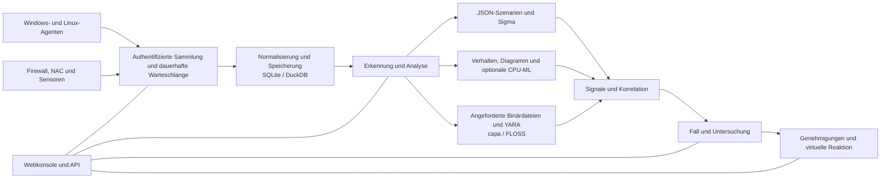

<p align="center"></p>

# VATEX LUMINA xSERA

<p align="center"><strong>Sehen Sie das Signal. Verstehe die Geschichte. Koordinieren Sie die Reaktion.</strong></p>

<p align="center">
  <a href="../../LICENSE"></a>
  
  
  
</p>

<details open><summary><strong>🌐 Sprachen</strong></summary>

[English](README.en.md) · [한국어](README.ko.md) · [Español](README.es.md) · [Português (Brasil)](README.pt-BR.md) · [Français](README.fr.md) · [Deutsch](README.de.md) · [Italiano](README.it.md) · [Nederlands](README.nl.md) · [Polski](README.pl.md) · [Türkçe](README.tr.md) · [Русский](README.ru.md) · [Українська](README.uk.md) · [العربية](README.ar.md) · [हिन्दी](README.hi.md) · [বাংলা](README.bn.md) · [Bahasa Indonesia](README.id.md) · [Tiếng Việt](README.vi.md) · [ไทย](README.th.md) · [日本語](README.ja.md) · [简体中文](README.zh-CN.md)

</details>

xSERA ist ein CPU-orientiertes XDR-Server- und Endpoint-Agent-Projekt, das Arbeitsabläufe zur Telemetrieerfassung, -erkennung, -untersuchung und -reaktion verbindet. Die Webkonsole führt Vorgänge, Suche, Erkennungsinhalte und Fälle zusammen.

> **Entwicklungs- und Validierungsstatus**
>
> Dieses Repository enthält Quellen basierend auf Version 0.20.0 und nachfolgenden Änderungen. Es ist für die Entwicklung und Evaluierung gedacht und stellt keine Erklärung der allgemeinen Verfügbarkeit dar. Die folgenden Startanweisungen blockieren Aktionen, die tatsächliche Hosts ändern. Die Antwortbeispiele verwenden virtuelle Geräte; Echte Integrationen und Host-Aktionen erfordern eine separate Konfiguration und Feldvalidierung.

> 🌐 Diese übersetzte README-Datei wurde mit maschineller Übersetzung erstellt und nicht von einem professionellen Übersetzer überprüft. Bei abweichenden Formulierungen dient die englische README-Datei als Referenz. Die Produktoberfläche und andere Dokumentation sind nicht unbedingt in dieser Sprache verfügbar.

## 🧭 Architektur

Von unabhängigen Ereignissen über Beweise bis hin zu einem strafbaren Fall:



Eine Aufnahmebestätigung bedeutet, dass das Ereignis die dauerhafte Warteschlange erreicht hat. Dies bedeutet nicht, dass die Indizierung oder Erkennung abgeschlossen ist. ML-Ergebnisse und YARA-Übereinstimmungen sind Beweise für eine Untersuchung, kein Beweis für Böswilligkeit oder die Befugnis, einen Host zu blockieren.

## 🧩 Was ist in diesem Repository?

| Komponente | Pfad | Zweck |
| --- | --- | --- |
| Server und API | `sapientia/` | Aufnahme-, Authentifizierungs-, Speicher-, Such-, Erkennungs-, Fall- und Antwort-Workflows. |
| Webkonsole | `sapientia/web/` | Operationen, Ereignissuche, Regeln, ML-Daten, Untersuchungen und Reaktion. |
| Endpunkt-Agent | `sapientia/endpoint_agent/` | Windows- und Linux-Erfassung, Registrierung und Serverkommunikation. |
| Erkennungsinhalt | `sapientia/catalogs/` | Native JSON-Regeln, ATT&CK-Informationen und YARA/Capa-Inhalte mit Herkunft und Lizenzen. |
| Tools und Bereitstellungsbeispiele | `tools/`, `deploy/` | Agentenpaketierung, optionale Sensorweiterleitungen, virtuelle Telemetrie und Servicebeispiele. |
| Dokumentation und Tests | `docs/`, `tests/` | Betriebsverträge, Inhaltsherkunft und Regressionstests. |

Die mitgelieferte Bibliothek enthält 950 Original-Szenarioregeln. Die Aufnahme bedeutet nicht, dass jede Richtlinie bei einer Neuinstallation aktiviert ist. Synthetische Trainingsbeispiele belegen keine reale Erkennungsgenauigkeit. [Datasets](../../docs/console-datasets-0.15.md)

## 🚀 Schnellstart

Die folgenden Beispiele starten eine lokale Einzelserverinstanz. Sie benötigen Python 3.12 und Netzwerkzugriff, um Pakete zu installieren. Konfigurieren Sie für die Produktionsplanung Zugriffskontrollen, TLS und Backups separat.

### Windows

In PowerShell ausführen:

```powershell
git clone https://github.com/lastime1650/VateX_LUMINA_xSERA.git
cd VateX_LUMINA_xSERA
py -3.12 -m venv .venv
.\.venv\Scripts\python.exe -m pip install -r requirements-lock.txt
.\.venv\Scripts\python.exe -m pip install --no-deps -e .
.\start.cmd
```

Wenn der Python-Launcher Version 3.12 nicht finden kann, verwenden Sie den vollständigen Pfad zur installierten ausführbaren Python 3.12-Datei, um die virtuelle Umgebung zu erstellen. Öffnen Sie die lokale Konsole und erstellen Sie das erste Administratorkonto: **http://127.0.0.1:8787**

Das Windows-Startskript erstellt lokale Agent-TLS-Zertifikate in private/loopback-tls/ und verwendet nur den lokalen Port 8788. Diese Zertifikate sind kein Vertrauenssystem für die Remote-Bereitstellung.

### Linux

```bash
git clone https://github.com/lastime1650/VateX_LUMINA_xSERA.git
cd VateX_LUMINA_xSERA
python3.12 -m venv .venv
.venv/bin/python -m pip install -r requirements-lock.txt
.venv/bin/python -m pip install --no-deps -e .
export SAPIENTIA_BLOCK_NATIVE_RESPONSE=1
.venv/bin/python -m sapientia --data ./data serve --host 127.0.0.1 --port 8787
```

Das Linux-Beispiel startet die Konsole und die lokale HTTP-Aufnahme; Es wird kein TLS-Agent-Listener gestartet. Remote-Agents erfordern einen explizit konfigurierten TLS-Listener, eine vertrauenswürdige Zertifizierungsstelle, signierte Pakete, einen extern verwalteten Signaturschlüssel und einen separaten vertrauenswürdigen öffentlichen Schlüssel. Lesen Sie vor der Bereitstellung die Agentendokumentation. [Agent signing](../../docs/agent-package-integrity.md) · [Agent](../../sapientia/endpoint_agent/README.txt)

Öffnen Sie die lokale Konsole und erstellen Sie das erste Administratorkonto: **http://127.0.0.1:8787**

Daten werden standardmäßig in data/ gespeichert. Übertragen Sie keine Daten/, privaten/, Aufnahmeschlüssel oder privaten Schlüssel für Zertifikate. Setzen Sie die lokale HTTP-Konsole nicht dem Internet aus; Der externe Zugriff erfordert validiertes TLS und explizite Zugriffskontrolle.

## 🔎 Von der Telemetrie bis zur Reaktion

1. Quellen verbinden. Erstellen Sie einen Index und einen eingeschränkten Aufnahmeschlüssel in der Konsole oder registrieren Sie einen signierten Agenten. Konfigurieren Sie unterstützte Eingaben und Parser für Firewall-, NAC- und Sensorprotokolle.
2. Ereignisse aufnehmen. Senden Sie JSON mit dem eingeschränkten Schlüssel an den Ereignisendpunkt. Geben Sie Geheimnisse über eine Umgebungsvariable oder einen Geheimmanager an. Dieses Beispiel ist lokal:

   ```bash
   curl -X POST http://127.0.0.1:8787/api/v1/events \
     -H "Authorization: Bearer $XSERA_INGEST_KEY" \
     -H "Content-Type: application/json" \
     --data '{"events":[{"event_id":"demo-001","index":"main","source":"demo","sourcetype":"json","host":"endpoint-01","severity":"info","message":"Example telemetry","raw":{"event":{"action":"process_created"}}}]}'
   ```

   Ersetzen Sie die Umgebungsvariable durch einen gültigen eingeschränkten Aufnahmeschlüssel. Eine erfolgreiche Warteschlangenantwort garantiert nicht, dass dieses Beispiel zu einer Erkennung oder einem Fall führt.

3. Erkennung konfigurieren. Überprüfen und aktivieren Sie native JSON-Szenarioregeln. Sigma-Regeln folgen dem Import, der Konvertierung, der Validierung, der unabhängigen Überprüfung und der Aktivierung und werden dann in derselben nativen JSON-Regel-Engine ausgeführt. CPU-ML-Datensätze und -Modelle erfordern eine explizite Schulung, Bewertung und Genehmigung.
4. Untersuchen Sie Fälle. Untersuchen Sie die Erkennungssignale, Quellereignisse und Korrelationsnachweise. Angeforderte Prozessbinärdateien können mit YARA analysiert werden; capa und FLOSS sind optionale Motoren, die separat installiert werden.
5. Überprüfen Sie die Antwort. Überprüfen Sie die Genehmigungen, Ausführung und Ergebnisse von Playbooks. Das Startprofil blockiert tatsächliche Host-Änderungsaktionen und die enthaltene virtuelle Antwort ist keine echte Geräteaktion.

## 🧪 Optionale Engines und Validierungsgrenzen

Der Basisserver läuft ohne PyTorch. CPU ML, Sigma YAML-Konvertierung, capa/FLOSS und externe Sensoren erfordern optionale Abhängigkeiten oder separate Installation und Konfiguration. Befolgen Sie deren Überprüfungs- und unabhängige Genehmigungsverfahren.

In einem Snapshot einer früheren Version 0.20.0 führte eine synthetische Belastung von etwa 50 Ereignissen pro Sekunde zu einer Erkennungs-P95 von 35,95 Sekunden und einer Fallerstellungs-P95 von 25,95 Sekunden, wobei die jeweiligen Ziele von 2 und 5 Sekunden verfehlt wurden. Dieses Repository enthält nachfolgende Quelländerungen, sodass die frühere vollständige Regression diesen Commit nicht zertifiziert. Erkennungsgenauigkeit, Fehlalarme, anhaltende Belastung und tatsächliche Reaktionen erfordern eine separate Feldvalidierung.

## 📚 Weitere Dokumentation

Diese verlinkten Dokumente sind möglicherweise nur auf Koreanisch oder Englisch verfügbar.

[Sigma / fusion](../../docs/fusion-sigma-0.18.txt) · [YARA](../../docs/yara-0.16.txt) · [CPU ML](../../docs/CPU_ML_RUNTIME.md) · [Datasets](../../docs/console-datasets-0.15.md) · [Virtual response](../../docs/VIRTUAL_RESPONSE_OPERATIONAL_QUALIFICATION.md) · [Agent signing](../../docs/agent-package-integrity.md) · [Agent](../../sapientia/endpoint_agent/README.txt) · [Security](../../SECURITY.md)

## ⚖️ Lizenz und Sicherheit

Projekteigener Code sowie die ursprünglichen Regeln und Agentencodes, für die die Weiterverbreitungsrechte bestätigt wurden, werden unter Apache-2.0 bereitgestellt. Die Regeln Dritter, ATT&CK-Materialien und Bibliotheken behalten ihre eigenen Bedingungen. Lesen Sie die Hinweise und Lizenzinformationen Dritter.

[Apache-2.0](../../LICENSE) · [NOTICE](../../NOTICE) · [Third-party notices](../../THIRD_PARTY_NOTICES.md) · [SECURITY](../../SECURITY.md)

Melden Sie Schwachstellen über den in der Sicherheitsrichtlinie beschriebenen privaten Meldekanal. Veröffentlichen Sie keine Anmeldeinformationen oder Kundendaten in öffentlichen Ausgaben.

README-Designreferenzen: [Wazuh](https://github.com/wazuh/wazuh/blob/main/README.md) · [Velociraptor](https://github.com/Velocidex/velociraptor/blob/master/README.md)
