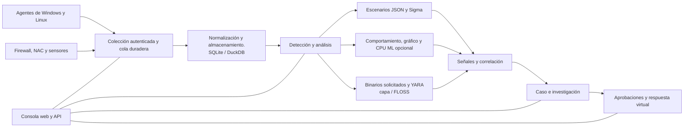

<p align="center"></p>

# VATEX LUMINA xSERA

<p align="center"><strong>Ver la señal. Comprende la historia. Coordinar la respuesta.</strong></p>

<p align="center">
  <a href="../../LICENSE"></a>
  
  
  
</p>

<details open><summary><strong>🌐 Idiomas</strong></summary>

[English](README.en.md) · [한국어](README.ko.md) · [Español](README.es.md) · [Português (Brasil)](README.pt-BR.md) · [Français](README.fr.md) · [Deutsch](README.de.md) · [Italiano](README.it.md) · [Nederlands](README.nl.md) · [Polski](README.pl.md) · [Türkçe](README.tr.md) · [Русский](README.ru.md) · [Українська](README.uk.md) · [العربية](README.ar.md) · [हिन्दी](README.hi.md) · [বাংলা](README.bn.md) · [Bahasa Indonesia](README.id.md) · [Tiếng Việt](README.vi.md) · [ไทย](README.th.md) · [日本語](README.ja.md) · [简体中文](README.zh-CN.md)

</details>

xSERA es un proyecto de agente de punto final y servidor XDR orientado a CPU que conecta flujos de trabajo de recopilación, detección, investigación y respuesta de telemetría. La consola web reúne operaciones, búsqueda, contenido de detección y casos.

> **Estado de desarrollo y validación.**
>
> Este repositorio contiene fuente basada en la versión 0.20.0 y cambios posteriores. Está destinado al desarrollo y la evaluación, no a una declaración de disponibilidad general. Las instrucciones de inicio a continuación bloquean acciones que modifican los hosts reales. Los ejemplos de respuesta utilizan dispositivos virtuales; Las integraciones reales y las acciones del host necesitan una configuración y validación de campo independientes.

> 🌐 Este archivo README traducido se generó con traducción automática y no ha sido revisado por un traductor profesional. El archivo README en inglés es la referencia si la redacción difiere. La interfaz del producto y otra documentación no están necesariamente disponibles en este idioma.

## 🧭 Arquitectura

Desde eventos independientes hasta evidencia y un caso procesable:



Una confirmación de ingesta significa que el evento llegó a la cola duradera; no significa que la indexación o la detección estén completas. Las puntuaciones de ML y las coincidencias de YARA son pruebas para la investigación, no pruebas de malicia o autoridad para bloquear un host.

## 🧩 ¿Qué hay en este repositorio?

| Componente | Camino | Propósito |
| --- | --- | --- |
| Servidor y API | `sapientia/` | Ingestión, autenticación, almacenamiento, búsqueda, detección, casos y flujos de trabajo de respuesta. |
| consola web | `sapientia/web/` | Operaciones, búsqueda de eventos, reglas, datos de ML, investigaciones y respuesta. |
| Agente de punto final | `sapientia/endpoint_agent/` | Recopilación, inscripción y comunicación con el servidor de Windows y Linux. |
| Contenido de detección | `sapientia/catalogs/` | Reglas JSON nativas, información ATT&CK y contenido YARA/capa con procedencia y licencias. |
| Herramientas y ejemplos de implementación | `tools/`, `deploy/` | Empaquetado de agentes, reenviadores de sensores opcionales, telemetría virtual y ejemplos de servicios. |
| Documentación y pruebas. | `docs/`, `tests/` | Contratos operativos, procedencia de contenidos y pruebas de regresión. |

La biblioteca incluida incluye 950 reglas de escenarios originales. La inclusión no significa que todas las políticas estén habilitadas en una instalación nueva. Los ejemplos de entrenamiento sintético no establecen una precisión de detección en el mundo real. [Datasets](../../docs/console-datasets-0.15.md)

## 🚀 Inicio rápido

Los ejemplos siguientes inician una instancia de servidor único local. Requieren Python 3.12 y acceso a la red para instalar paquetes. Para la planificación de la producción, configure los controles de acceso, TLS y las copias de seguridad por separado.

### ventanas

Ejecutar en PowerShell:

```powershell
git clone https://github.com/lastime1650/VateX_LUMINA_xSERA.git
cd VateX_LUMINA_xSERA
py -3.12 -m venv .venv
.\.venv\Scripts\python.exe -m pip install -r requirements-lock.txt
.\.venv\Scripts\python.exe -m pip install --no-deps -e .
.\start.cmd
```

Si el iniciador de Python no puede encontrar la versión 3.12, utilice la ruta completa al ejecutable de Python 3.12 instalado para crear el entorno virtual. Abra la consola local y cree la primera cuenta de administrador: **http://127.0.0.1:8787**

El script de inicio de Windows crea certificados TLS de agente local en private/loopback-tls/ y utiliza el puerto 8788 solo local. Estos certificados no son un sistema de confianza para la implementación remota.

### linux

```bash
git clone https://github.com/lastime1650/VateX_LUMINA_xSERA.git
cd VateX_LUMINA_xSERA
python3.12 -m venv .venv
.venv/bin/python -m pip install -r requirements-lock.txt
.venv/bin/python -m pip install --no-deps -e .
export SAPIENTIA_BLOCK_NATIVE_RESPONSE=1
.venv/bin/python -m sapientia --data ./data serve --host 127.0.0.1 --port 8787
```

El ejemplo de Linux inicia la consola y la ingesta HTTP local; no inicia un agente de escucha TLS. Los agentes remotos requieren un escucha TLS configurado explícitamente, una CA confiable, paquetes firmados, una clave de firma administrada externamente y una clave pública confiable separada. Lea la documentación del agente antes de la implementación. [Agent signing](../../docs/agent-package-integrity.md) · [Agent](../../sapientia/endpoint_agent/README.txt)

Abra la consola local y cree la primera cuenta de administrador: **http://127.0.0.1:8787**

Los datos se almacenan en data/ de forma predeterminada. No confirme claves de datos/, privadas/, de ingestión ni de certificados privados. No exponga la consola HTTP local a Internet; El acceso externo requiere TLS validado y control de acceso explícito.

## 🔎 De la telemetría a la respuesta

1. Conectar fuentes. Cree un índice y una clave de ingesta restringida en la consola o inscriba a un agente firmado. Configure entradas y analizadores compatibles para firewall, NAC y registros de sensores.
2. Ingerir eventos. Envíe JSON al punto final de eventos utilizando la clave restringida. Suministre secretos a través de una variable de entorno o un administrador de secretos. Este ejemplo es local:

   ```bash
   curl -X POST http://127.0.0.1:8787/api/v1/events \
     -H "Authorization: Bearer $XSERA_INGEST_KEY" \
     -H "Content-Type: application/json" \
     --data '{"events":[{"event_id":"demo-001","index":"main","source":"demo","sourcetype":"json","host":"endpoint-01","severity":"info","message":"Example telemetry","raw":{"event":{"action":"process_created"}}}]}'
   ```

   Reemplace la variable de entorno con una clave de ingesta restringida válida. Una respuesta de cola exitosa no garantiza que esta muestra produzca una detección o un caso.

3. Configurar la detección. Revise y habilite reglas de escenario JSON nativas. Las reglas de Sigma siguen la importación, conversión, validación, revisión independiente y activación, y luego se ejecutan en el mismo motor de reglas JSON nativo. Los conjuntos de datos y modelos de CPU ML requieren capacitación, evaluación y aprobación explícitas.
4. Investigar casos. Examine las señales de detección, los eventos fuente y la evidencia de correlación. Los binarios de proceso solicitados se pueden analizar con YARA; capa y FLOSS son motores opcionales que se instalan por separado.
5. Revisar la respuesta. Inspeccionar las aprobaciones, la ejecución y los resultados del libro de jugadas. El perfil de inicio bloquea las acciones reales de modificación del host y la respuesta virtual incluida no es una acción real del dispositivo.

## 🧪 Motores opcionales y límites de validación

El servidor base se ejecuta sin PyTorch. CPU ML, conversión Sigma YAML, capa/FLOSS y sensores externos requieren dependencias opcionales o instalación y configuración separadas. Siga sus procedimientos de verificación y aprobación independiente.

En una instantánea de la versión 0.20.0 anterior, una carga sintética de aproximadamente 50 eventos por segundo produjo una detección P95 de 35,95 segundos y una creación de casos P95 de 25,95 segundos, sin alcanzar los objetivos respectivos de 2 y 5 segundos. Este repositorio contiene cambios de fuente posteriores, por lo que la regresión completa anterior no certifica esta confirmación. La precisión de la detección, los falsos positivos, la carga sostenida y las respuestas reales requieren una validación de campo separada.

## 📚 Documentación adicional

Es posible que estos documentos vinculados solo estén disponibles en coreano o inglés.

[Sigma / fusion](../../docs/fusion-sigma-0.18.txt) · [YARA](../../docs/yara-0.16.txt) · [CPU ML](../../docs/CPU_ML_RUNTIME.md) · [Datasets](../../docs/console-datasets-0.15.md) · [Virtual response](../../docs/VIRTUAL_RESPONSE_OPERATIONAL_QUALIFICATION.md) · [Agent signing](../../docs/agent-package-integrity.md) · [Agent](../../sapientia/endpoint_agent/README.txt) · [Security](../../SECURITY.md)

## ⚖️ Licencia y seguridad

El código propiedad del proyecto y las reglas originales y el código de agente para los cuales se confirmaron los derechos de redistribución se proporcionan en Apache-2.0. Las reglas de terceros, los materiales de ATT&CK y las bibliotecas conservan sus propios términos. Revise los avisos y la información de licencias de terceros.

[Apache-2.0](../../LICENSE) · [NOTICE](../../NOTICE) · [Third-party notices](../../THIRD_PARTY_NOTICES.md) · [SECURITY](../../SECURITY.md)

Reportar vulnerabilidades a través del canal de reporte privado descrito en la política de seguridad. No publique credenciales ni datos de clientes en publicaciones públicas.

Referencias de diseño LÉAME: [Wazuh](https://github.com/wazuh/wazuh/blob/main/README.md) · [Velociraptor](https://github.com/Velocidex/velociraptor/blob/master/README.md)
