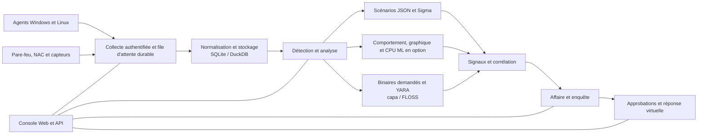

<p align="center"></p>

# VATEX LUMINA xSERA

<p align="center"><strong>Voir le signal. Comprenez l'histoire. Coordonner la réponse.</strong></p>

<p align="center">
  <a href="../../LICENSE"></a>
  
  
  
</p>

<details open><summary><strong>🌐 Langues</strong></summary>

[English](README.en.md) · [한국어](README.ko.md) · [Español](README.es.md) · [Português (Brasil)](README.pt-BR.md) · [Français](README.fr.md) · [Deutsch](README.de.md) · [Italiano](README.it.md) · [Nederlands](README.nl.md) · [Polski](README.pl.md) · [Türkçe](README.tr.md) · [Русский](README.ru.md) · [Українська](README.uk.md) · [العربية](README.ar.md) · [हिन्दी](README.hi.md) · [বাংলা](README.bn.md) · [Bahasa Indonesia](README.id.md) · [Tiếng Việt](README.vi.md) · [ไทย](README.th.md) · [日本語](README.ja.md) · [简体中文](README.zh-CN.md)

</details>

xSERA est un projet de serveur XDR et d'agent de point de terminaison orienté CPU qui connecte les workflows de collecte de télémétrie, de détection, d'investigation et de réponse. La console Web rassemble les opérations, la recherche, le contenu de détection et les cas.

> **Statut de développement et de validation**
>
> Ce référentiel contient des sources basées sur la version 0.20.0 et les modifications ultérieures. Il est destiné au développement et à l’évaluation, et non à une déclaration de disponibilité générale. Les instructions de lancement ci-dessous bloquent les actions qui modifient les hôtes réels. Les exemples de réponses utilisent des appareils virtuels ; les intégrations réelles et les actions de l'hôte nécessitent une configuration et une validation sur le terrain distinctes.

> 🌐 Ce README traduit a été généré avec une traduction automatique et n’a pas été révisé par un traducteur professionnel. Le README anglais constitue la référence si le libellé diffère. L'interface du produit et les autres documentations ne sont pas nécessairement disponibles dans cette langue.

## 🧭 Architecture

Des événements indépendants aux preuves et à une affaire pouvant donner lieu à une action :



Un accusé de réception d’ingestion signifie que l’événement a atteint la file d’attente durable ; cela ne signifie pas que l'indexation ou la détection est terminée. Les scores ML et les correspondances YARA sont des preuves d'enquête, et non une preuve de malveillance ou d'autorité pour bloquer un hôte.

## 🧩 Qu'y a-t-il dans ce référentiel

| Composant | Chemin | Objectif |
| --- | --- | --- |
| Serveur et API | `sapientia/` | Workflows d’ingestion, d’authentification, de stockage, de recherche, de détection, de cas et de réponse. |
| Console Web | `sapientia/web/` | Opérations, recherche d'événements, règles, données ML, enquêtes et réponse. |
| Agent de point de terminaison | `sapientia/endpoint_agent/` | Collecte Windows et Linux, inscription et communication serveur. |
| Contenu de détection | `sapientia/catalogs/` | Règles JSON natives, informations ATT&CK et contenu YARA/capa avec provenance et licences. |
| Outils et exemples de déploiement | `tools/`, `deploy/` | Package d'agents, transmetteurs de capteurs en option, télémétrie virtuelle et exemples de services. |
| Documentation et tests | `docs/`, `tests/` | Contrats d'exploitation, provenance des contenus et tests de régression. |

La bibliothèque fournie comprend 950 règles de scénario originales. L'inclusion ne signifie pas que chaque stratégie est activée lors d'une nouvelle installation. Les exemples de formation synthétiques n’établissent pas la précision de détection dans le monde réel. [Datasets](../../docs/console-datasets-0.15.md)

## 🚀 Démarrage rapide

Les exemples ci-dessous démarrent une instance locale à serveur unique. Ils nécessitent Python 3.12 et un accès réseau pour installer les packages. Pour la planification de la production, configurez les contrôles d'accès, TLS et les sauvegardes séparément.

### Fenêtres

Exécuter dans PowerShell :

```powershell
git clone https://github.com/lastime1650/VateX_LUMINA_xSERA.git
cd VateX_LUMINA_xSERA
py -3.12 -m venv .venv
.\.venv\Scripts\python.exe -m pip install -r requirements-lock.txt
.\.venv\Scripts\python.exe -m pip install --no-deps -e .
.\start.cmd
```

Si le lanceur Python ne trouve pas la version 3.12, utilisez le chemin complet de l'exécutable Python 3.12 installé pour créer l'environnement virtuel. Ouvrez la console locale et créez le premier compte administrateur : **http://127.0.0.1:8787**

Le script de lancement Windows crée des certificats TLS d'agent local dans private/loopback-tls/ et utilise le port 8788 uniquement local. Ces certificats ne constituent pas un système de confiance pour le déploiement à distance.

### Linux

```bash
git clone https://github.com/lastime1650/VateX_LUMINA_xSERA.git
cd VateX_LUMINA_xSERA
python3.12 -m venv .venv
.venv/bin/python -m pip install -r requirements-lock.txt
.venv/bin/python -m pip install --no-deps -e .
export SAPIENTIA_BLOCK_NATIVE_RESPONSE=1
.venv/bin/python -m sapientia --data ./data serve --host 127.0.0.1 --port 8787
```

L'exemple Linux démarre la console et l'ingestion HTTP locale ; il ne démarre pas un écouteur d'agent TLS. Les agents distants nécessitent un écouteur TLS explicitement configuré, une autorité de certification approuvée, des packages signés, une clé de signature gérée en externe et une clé publique approuvée distincte. Lisez la documentation de l'agent avant le déploiement. [Agent signing](../../docs/agent-package-integrity.md) · [Agent](../../sapientia/endpoint_agent/README.txt)

Ouvrez la console locale et créez le premier compte administrateur : **http://127.0.0.1:8787**

Les données sont stockées dans data/ par défaut. Ne validez pas les clés de données/, privées/, d’ingestion ou les clés privées de certificat. N'exposez pas la console HTTP locale à Internet ; l'accès externe nécessite un TLS validé et un contrôle d'accès explicite.

## 🔎 De la télémétrie à la réponse

1. Connectez les sources. Créez un index et une clé d'ingestion restreinte dans la console, ou inscrivez un agent signé. Configurez les entrées et les analyseurs pris en charge pour les journaux de pare-feu, de NAC et de capteur.
2. Ingérer des événements. Envoyez JSON au point de terminaison des événements à l’aide de la clé restreinte. Fournissez des secrets via une variable d'environnement ou un gestionnaire de secrets. Cet exemple est local :

   ```bash
   curl -X POST http://127.0.0.1:8787/api/v1/events \
     -H "Authorization: Bearer $XSERA_INGEST_KEY" \
     -H "Content-Type: application/json" \
     --data '{"events":[{"event_id":"demo-001","index":"main","source":"demo","sourcetype":"json","host":"endpoint-01","severity":"info","message":"Example telemetry","raw":{"event":{"action":"process_created"}}}]}'
   ```

   Remplacez la variable d'environnement par une clé d'ingestion restreinte valide. Une réponse réussie dans la file d'attente ne garantit pas que cet échantillon produira une détection ou un cas.

3. Configurez la détection. Examinez et activez les règles de scénario JSON natives. Les règles Sigma suivent l'importation, la conversion, la validation, l'examen indépendant et l'activation, puis s'exécutent dans le même moteur de règles JSON natif. Les ensembles de données et modèles CPU ML nécessitent une formation, une évaluation et une approbation explicites.
4. Enquêter sur les cas. Examinez les signaux de détection, les événements sources et les preuves de corrélation. Les binaires de processus demandés peuvent être analysés avec YARA ; capa et FLOSS sont des moteurs optionnels installés séparément.
5. Examinez la réponse. Inspectez les approbations, l’exécution et les résultats du playbook. Le profil de lancement bloque les actions réelles de modification de l'hôte et la réponse virtuelle incluse n'est pas une action réelle du périphérique.

## 🧪 Moteurs optionnels et limites de validation

Le serveur de base fonctionne sans PyTorch. CPU ML, conversion Sigma YAML, capa/FLOSS et capteurs externes nécessitent des dépendances facultatives ou une installation et une configuration séparées. Suivez leurs procédures de vérification et d’approbation indépendantes.

Dans un instantané de la version 0.20.0 précédente, une charge synthétique d'environ 50 événements par seconde produisait une détection P95 de 35,95 secondes et une création de cas P95 de 25,95 secondes, manquant les cibles respectives de 2 et 5 secondes. Ce référentiel contient les modifications de source ultérieures, donc la régression complète précédente ne certifie pas cette validation. La précision de la détection, les faux positifs, la charge soutenue et les réponses réelles nécessitent une validation sur le terrain distincte.

## 📚 Documentation complémentaire

Ces documents liés peuvent être disponibles uniquement en coréen ou en anglais.

[Sigma / fusion](../../docs/fusion-sigma-0.18.txt) · [YARA](../../docs/yara-0.16.txt) · [CPU ML](../../docs/CPU_ML_RUNTIME.md) · [Datasets](../../docs/console-datasets-0.15.md) · [Virtual response](../../docs/VIRTUAL_RESPONSE_OPERATIONAL_QUALIFICATION.md) · [Agent signing](../../docs/agent-package-integrity.md) · [Agent](../../sapientia/endpoint_agent/README.txt) · [Security](../../SECURITY.md)

## ⚖️ Licence et sécurité

Le code appartenant au projet ainsi que les règles d'origine et le code de l'agent pour lesquels les droits de redistribution ont été confirmés sont fournis sous Apache-2.0. Les règles tierces, les documents ATT&CK et les bibliothèques conservent leurs propres conditions. Consultez les avis et les informations sur les licences tierces.

[Apache-2.0](../../LICENSE) · [NOTICE](../../NOTICE) · [Third-party notices](../../THIRD_PARTY_NOTICES.md) · [SECURITY](../../SECURITY.md)

Signalez les vulnérabilités via le canal de signalement privé décrit dans la politique de sécurité. Ne publiez pas d’informations d’identification ou de données client dans des numéros publics.

Références de conception README: [Wazuh](https://github.com/wazuh/wazuh/blob/main/README.md) · [Velociraptor](https://github.com/Velocidex/velociraptor/blob/master/README.md)
