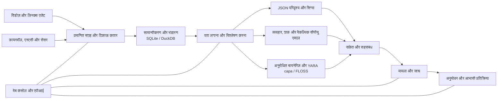

<p align="center"></p>

# VATEX LUMINA xSERA

<p align="center"><strong>संकेत देखें. कहानी समझिए. प्रतिक्रिया का समन्वय करें.</strong></p>

<p align="center">
  <a href="../../LICENSE"></a>
  
  
  
</p>

<details open><summary><strong>🌐 भाषाएँ</strong></summary>

[English](README.en.md) · [한국어](README.ko.md) · [Español](README.es.md) · [Português (Brasil)](README.pt-BR.md) · [Français](README.fr.md) · [Deutsch](README.de.md) · [Italiano](README.it.md) · [Nederlands](README.nl.md) · [Polski](README.pl.md) · [Türkçe](README.tr.md) · [Русский](README.ru.md) · [Українська](README.uk.md) · [العربية](README.ar.md) · [हिन्दी](README.hi.md) · [বাংলা](README.bn.md) · [Bahasa Indonesia](README.id.md) · [Tiếng Việt](README.vi.md) · [ไทย](README.th.md) · [日本語](README.ja.md) · [简体中文](README.zh-CN.md)

</details>

xSERA एक सीपीयू-उन्मुख XDR सर्वर और एंडपॉइंट एजेंट प्रोजेक्ट है जो टेलीमेट्री संग्रह, पता लगाने, जांच और प्रतिक्रिया वर्कफ़्लो को जोड़ता है। वेब कंसोल संचालन, खोज, पता लगाने वाली सामग्री और मामलों को एक साथ लाता है।

> **विकास और सत्यापन की स्थिति**
>
> इस रिपॉजिटरी में संस्करण 0.20.0 और उसके बाद के परिवर्तनों पर आधारित स्रोत शामिल हैं। इसका उद्देश्य विकास और मूल्यांकन करना है, न कि सामान्य उपलब्धता की घोषणा करना। नीचे दिए गए लॉन्च निर्देश उन क्रियाओं को रोकते हैं जो वास्तविक होस्ट को संशोधित करती हैं। प्रतिक्रिया उदाहरण आभासी उपकरणों का उपयोग करते हैं; वास्तविक एकीकरण और होस्ट क्रियाओं के लिए अलग कॉन्फ़िगरेशन और फ़ील्ड सत्यापन की आवश्यकता होती है।

> 🌐 यह अनुवादित README मशीनी अनुवाद के साथ तैयार किया गया था और किसी पेशेवर अनुवादक द्वारा इसकी समीक्षा नहीं की गई है। यदि शब्दांकन भिन्न है तो अंग्रेजी README संदर्भ है। उत्पाद इंटरफ़ेस और अन्य दस्तावेज़ आवश्यक रूप से इस भाषा में उपलब्ध नहीं हैं।

## 🧭 वास्तुकला

स्वतंत्र घटनाओं से लेकर साक्ष्य और कार्रवाई योग्य मामले तक:



अंतर्ग्रहण पावती का मतलब है कि घटना टिकाऊ कतार तक पहुंच गई है; इसका मतलब यह नहीं है कि अनुक्रमण या पता लगाना पूरा हो गया है। एमएल स्कोर और YARA मैच जांच के लिए सबूत हैं, न कि दुर्भावनापूर्णता या किसी होस्ट को ब्लॉक करने के अधिकार का सबूत।

## 🧩 इस भंडार में क्या है

| घटक | पथ | प्रयोजन |
| --- | --- | --- |
| सर्वर और एपीआई | `sapientia/` | अंतर्ग्रहण, प्रमाणीकरण, भंडारण, खोज, पता लगाना, मामले और प्रतिक्रिया वर्कफ़्लो। |
| वेब कंसोल | `sapientia/web/` | संचालन, घटना खोज, नियम, एमएल डेटा, जांच और प्रतिक्रिया। |
| समापन बिंदु एजेंट | `sapientia/endpoint_agent/` | विंडोज़ और लिनक्स संग्रह, नामांकन और सर्वर संचार। |
| पता लगाने की सामग्री | `sapientia/catalogs/` | मूल JSON नियम, ATT&CK जानकारी और उत्पत्ति और लाइसेंस के साथ YARA/capa सामग्री। |
| उपकरण और परिनियोजन उदाहरण | `tools/`, `deploy/` | एजेंट पैकेजिंग, वैकल्पिक सेंसर फारवर्डर, वर्चुअल टेलीमेट्री और सेवा उदाहरण। |
| दस्तावेज़ीकरण और परीक्षण | `docs/`, `tests/` | परिचालन अनुबंध, सामग्री उद्गम और प्रतिगमन परीक्षण। |

बंडल लाइब्रेरी में 950 मूल परिदृश्य नियम शामिल हैं। समावेशन का मतलब यह नहीं है कि प्रत्येक नीति नए इंस्टॉल पर सक्षम है। सिंथेटिक प्रशिक्षण उदाहरण वास्तविक दुनिया का पता लगाने की सटीकता स्थापित नहीं करते हैं। [Datasets](../../docs/console-datasets-0.15.md)

## 🚀 त्वरित शुरुआत

नीचे दिए गए उदाहरण एक स्थानीय एकल-सर्वर उदाहरण शुरू करते हैं। पैकेज स्थापित करने के लिए उन्हें Python 3.12 और नेटवर्क एक्सेस की आवश्यकता होती है। उत्पादन योजना के लिए, एक्सेस नियंत्रण, टीएलएस और बैकअप को अलग से कॉन्फ़िगर करें।

### खिड़कियाँ

पॉवरशेल में चलाएँ:

```powershell
git clone https://github.com/lastime1650/VateX_LUMINA_xSERA.git
cd VateX_LUMINA_xSERA
py -3.12 -m venv .venv
.\.venv\Scripts\python.exe -m pip install -r requirements-lock.txt
.\.venv\Scripts\python.exe -m pip install --no-deps -e .
.\start.cmd
```

यदि पायथन लॉन्चर संस्करण 3.12 नहीं ढूंढ पाता है, तो वर्चुअल वातावरण बनाने के लिए स्थापित पायथन 3.12 निष्पादन योग्य के पूर्ण पथ का उपयोग करें। स्थानीय कंसोल खोलें और पहला व्यवस्थापक खाता बनाएं: **http://127.0.0.1:8787**

विंडोज़ लॉन्च स्क्रिप्ट प्राइवेट/लूपबैक-टीएलएस/ में स्थानीय एजेंट टीएलएस प्रमाणपत्र बनाती है और स्थानीय-केवल पोर्ट 8788 का उपयोग करती है। ये प्रमाणपत्र दूरस्थ तैनाती के लिए एक ट्रस्ट सिस्टम नहीं हैं।

### लिनक्स

```bash
git clone https://github.com/lastime1650/VateX_LUMINA_xSERA.git
cd VateX_LUMINA_xSERA
python3.12 -m venv .venv
.venv/bin/python -m pip install -r requirements-lock.txt
.venv/bin/python -m pip install --no-deps -e .
export SAPIENTIA_BLOCK_NATIVE_RESPONSE=1
.venv/bin/python -m sapientia --data ./data serve --host 127.0.0.1 --port 8787
```

लिनक्स उदाहरण कंसोल और स्थानीय HTTP अंतर्ग्रहण शुरू करता है; यह टीएलएस एजेंट श्रोता प्रारंभ नहीं करता है। दूरस्थ एजेंटों को एक स्पष्ट रूप से कॉन्फ़िगर किए गए टीएलएस श्रोता, विश्वसनीय सीए, हस्ताक्षरित पैकेज, एक बाहरी रूप से प्रबंधित हस्ताक्षर कुंजी और एक अलग विश्वसनीय सार्वजनिक कुंजी की आवश्यकता होती है। तैनाती से पहले एजेंट दस्तावेज़ पढ़ें। [Agent signing](../../docs/agent-package-integrity.md) · [Agent](../../sapientia/endpoint_agent/README.txt)

स्थानीय कंसोल खोलें और पहला व्यवस्थापक खाता बनाएं: **http://127.0.0.1:8787**

डेटा को डेटा/डिफ़ॉल्ट रूप से संग्रहीत किया जाता है। डेटा/, निजी/, अंतर्ग्रहण कुंजी या प्रमाणपत्र निजी कुंजी प्रतिबद्ध न करें। स्थानीय HTTP कंसोल को इंटरनेट के संपर्क में न लाएँ; बाहरी पहुंच के लिए मान्य टीएलएस और स्पष्ट पहुंच नियंत्रण की आवश्यकता होती है।

## 🔎 टेलीमेट्री से प्रतिक्रिया तक

1. स्रोत कनेक्ट करें. कंसोल में एक इंडेक्स और एक प्रतिबंधित अंतर्ग्रहण कुंजी बनाएं, या एक हस्ताक्षरित एजेंट को नामांकित करें। फ़ायरवॉल, एनएसी और सेंसर लॉग के लिए समर्थित इनपुट और पार्सर कॉन्फ़िगर करें।
2. घटनाओं को निगलना. प्रतिबंधित कुंजी का उपयोग करके ईवेंट समापन बिंदु पर JSON भेजें। एक पर्यावरण चर या एक गुप्त प्रबंधक के माध्यम से रहस्यों की आपूर्ति करें। यह उदाहरण स्थानीय है:

   ```bash
   curl -X POST http://127.0.0.1:8787/api/v1/events \
     -H "Authorization: Bearer $XSERA_INGEST_KEY" \
     -H "Content-Type: application/json" \
     --data '{"events":[{"event_id":"demo-001","index":"main","source":"demo","sourcetype":"json","host":"endpoint-01","severity":"info","message":"Example telemetry","raw":{"event":{"action":"process_created"}}}]}'
   ```

   पर्यावरण चर को वैध प्रतिबंधित अंतर्ग्रहण कुंजी से बदलें। एक सफल कतार प्रतिक्रिया यह गारंटी नहीं देती है कि यह नमूना एक पहचान या मामला उत्पन्न करेगा।

3. पहचान कॉन्फ़िगर करें. मूल JSON परिदृश्य नियमों की समीक्षा करें और सक्षम करें। सिग्मा नियम आयात, रूपांतरण, सत्यापन, स्वतंत्र समीक्षा और सक्रियण का पालन करते हैं, फिर उसी मूल JSON नियम इंजन में चलते हैं। सीपीयू एमएल डेटासेट और मॉडल को स्पष्ट प्रशिक्षण, मूल्यांकन और अनुमोदन की आवश्यकता होती है।
4. मामलों की जांच करें. पता लगाने के संकेतों, स्रोत घटनाओं और सहसंबंध साक्ष्य की जांच करें। अनुरोधित प्रक्रिया बायनेरिज़ का विश्लेषण YARA के साथ किया जा सकता है; कैपा और फ्लॉस वैकल्पिक इंजन हैं जिन्हें अलग से स्थापित किया गया है।
5. प्रतिक्रिया की समीक्षा करें. प्लेबुक अनुमोदन, निष्पादन और परिणामों का निरीक्षण करें। लॉन्च प्रोफ़ाइल वास्तविक होस्ट-संशोधित क्रियाओं को अवरुद्ध करती है, और शामिल वर्चुअल प्रतिक्रिया वास्तविक डिवाइस क्रिया नहीं है।

## 🧪 वैकल्पिक इंजन और सत्यापन सीमाएँ

बेस सर्वर PyTorch के बिना चलता है। सीपीयू एमएल, सिग्मा वाईएएमएल रूपांतरण, कैपा/फ्लॉस और बाहरी सेंसर को वैकल्पिक निर्भरता या अलग इंस्टॉलेशन और कॉन्फ़िगरेशन की आवश्यकता होती है। उनके सत्यापन और स्वतंत्र अनुमोदन प्रक्रियाओं का पालन करें।

पिछले 0.20.0 रिलीज़ स्नैपशॉट में, प्रति सेकंड लगभग 50 इवेंट के सिंथेटिक लोड ने 35.95 सेकंड का डिटेक्शन P95 और 25.95 सेकंड का केस-निर्माण P95 उत्पन्न किया, जिससे 2 और 5 सेकंड के संबंधित लक्ष्य गायब हो गए। इस रिपॉजिटरी में बाद के स्रोत परिवर्तन शामिल हैं, इसलिए पहले वाला पूर्ण प्रतिगमन इस प्रतिबद्धता को प्रमाणित नहीं करता है। पता लगाने की सटीकता, झूठी सकारात्मकता, निरंतर लोड और वास्तविक प्रतिक्रियाओं के लिए अलग-अलग फ़ील्ड सत्यापन की आवश्यकता होती है।

## 📚 आगे का दस्तावेज़ीकरण

ये लिंक किए गए दस्तावेज़ केवल कोरियाई या अंग्रेज़ी में उपलब्ध हो सकते हैं।

[Sigma / fusion](../../docs/fusion-sigma-0.18.txt) · [YARA](../../docs/yara-0.16.txt) · [CPU ML](../../docs/CPU_ML_RUNTIME.md) · [Datasets](../../docs/console-datasets-0.15.md) · [Virtual response](../../docs/VIRTUAL_RESPONSE_OPERATIONAL_QUALIFICATION.md) · [Agent signing](../../docs/agent-package-integrity.md) · [Agent](../../sapientia/endpoint_agent/README.txt) · [Security](../../SECURITY.md)

## ⚖️ लाइसेंस और सुरक्षा

प्रोजेक्ट-स्वामित्व वाला कोड और मूल नियम और एजेंट कोड जिसके लिए पुनर्वितरण अधिकारों की पुष्टि की गई थी, अपाचे-2.0 के तहत प्रदान किए गए हैं। तृतीय-पक्ष नियम, ATT&CK सामग्री और लाइब्रेरी अपनी शर्तों को बनाए रखते हैं। नोटिस और तृतीय-पक्ष लाइसेंस जानकारी की समीक्षा करें।

[Apache-2.0](../../LICENSE) · [NOTICE](../../NOTICE) · [Third-party notices](../../THIRD_PARTY_NOTICES.md) · [SECURITY](../../SECURITY.md)

सुरक्षा नीति में वर्णित निजी रिपोर्टिंग चैनल के माध्यम से कमजोरियों की रिपोर्ट करें। सार्वजनिक मुद्दों में क्रेडेंशियल्स या ग्राहक डेटा प्रकाशित न करें।

README डिज़ाइन संदर्भ: [Wazuh](https://github.com/wazuh/wazuh/blob/main/README.md) · [Velociraptor](https://github.com/Velocidex/velociraptor/blob/master/README.md)
