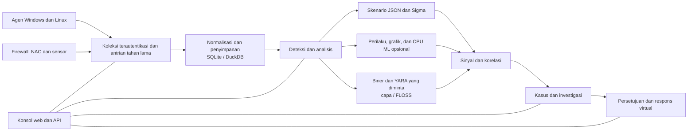

<p align="center"></p>

# VATEX LUMINA xSERA

<p align="center"><strong>Lihat sinyalnya. Pahami ceritanya. Koordinasikan responsnya.</strong></p>

<p align="center">
  <a href="../../LICENSE"></a>
  
  
  
</p>

<details open><summary><strong>🌐 Bahasa</strong></summary>

[English](README.en.md) · [한국어](README.ko.md) · [Español](README.es.md) · [Português (Brasil)](README.pt-BR.md) · [Français](README.fr.md) · [Deutsch](README.de.md) · [Italiano](README.it.md) · [Nederlands](README.nl.md) · [Polski](README.pl.md) · [Türkçe](README.tr.md) · [Русский](README.ru.md) · [Українська](README.uk.md) · [العربية](README.ar.md) · [हिन्दी](README.hi.md) · [বাংলা](README.bn.md) · [Bahasa Indonesia](README.id.md) · [Tiếng Việt](README.vi.md) · [ไทย](README.th.md) · [日本語](README.ja.md) · [简体中文](README.zh-CN.md)

</details>

xSERA adalah server XDR berorientasi CPU dan proyek agen titik akhir yang menghubungkan pengumpulan telemetri, deteksi, investigasi, dan alur kerja respons. Konsol web menyatukan operasi, pencarian, deteksi konten, dan kasus.

> **Status pengembangan dan validasi**
>
> Repositori ini berisi sumber berdasarkan versi 0.20.0 dan perubahan selanjutnya. Hal ini dimaksudkan untuk pengembangan dan evaluasi, bukan deklarasi ketersediaan umum. Petunjuk peluncuran di bawah memblokir tindakan yang mengubah host sebenarnya. Contoh respons menggunakan perangkat virtual; integrasi nyata dan tindakan host memerlukan konfigurasi terpisah dan validasi lapangan.

> 🌐 README terjemahan ini dihasilkan dengan terjemahan mesin dan belum ditinjau oleh penerjemah profesional. README bahasa Inggris adalah referensi jika kata-katanya berbeda. Antarmuka produk dan dokumentasi lainnya belum tentu tersedia dalam bahasa ini.

## 🧭 Arsitektur

Dari peristiwa independen hingga bukti dan kasus yang dapat ditindaklanjuti:



Pengakuan penyerapan berarti peristiwa tersebut mencapai antrean tahan lama; itu tidak berarti pengindeksan atau deteksi selesai. Skor ML dan kecocokan YARA adalah bukti untuk penyelidikan, bukan bukti kejahatan atau wewenang untuk memblokir host.

## 🧩 Apa yang ada di repositori ini

| Komponen | Jalan | Tujuan |
| --- | --- | --- |
| Server dan API | `sapientia/` | Alur kerja penyerapan, autentikasi, penyimpanan, pencarian, deteksi, kasus, dan respons. |
| Konsol web | `sapientia/web/` | Operasi, pencarian acara, aturan, data ML, investigasi, dan respons. |
| Agen titik akhir | `sapientia/endpoint_agent/` | Pengumpulan Windows dan Linux, pendaftaran dan komunikasi server. |
| Konten deteksi | `sapientia/catalogs/` | Aturan JSON asli, informasi ATT&CK, dan konten YARA/capa dengan asal dan lisensi. |
| Contoh alat dan penerapan | `tools/`, `deploy/` | Pengemasan agen, penerus sensor opsional, telemetri virtual, dan contoh layanan. |
| Dokumentasi dan tes | `docs/`, `tests/` | Kontrak operasi, asal konten, dan uji regresi. |

Pustaka yang dibundel mencakup 950 aturan skenario asli. Penyertaan tidak berarti setiap kebijakan diaktifkan pada instalasi baru. Contoh pelatihan sintetis tidak menghasilkan akurasi deteksi di dunia nyata. [Datasets](../../docs/console-datasets-0.15.md)

## 🚀 Mulai cepat

Contoh di bawah ini memulai instance server tunggal lokal. Mereka memerlukan Python 3.12 dan akses jaringan untuk menginstal paket. Untuk perencanaan produksi, konfigurasikan kontrol akses, TLS, dan pencadangan secara terpisah.

### jendela

Jalankan di PowerShell:

```powershell
git clone https://github.com/lastime1650/VateX_LUMINA_xSERA.git
cd VateX_LUMINA_xSERA
py -3.12 -m venv .venv
.\.venv\Scripts\python.exe -m pip install -r requirements-lock.txt
.\.venv\Scripts\python.exe -m pip install --no-deps -e .
.\start.cmd
```

Jika peluncur Python tidak dapat menemukan versi 3.12, gunakan jalur lengkap ke executable Python 3.12 yang diinstal untuk membuat lingkungan virtual. Buka konsol lokal dan buat akun administrator pertama: **http://127.0.0.1:8787**

Skrip peluncuran Windows membuat sertifikat TLS agen lokal di private/loopback-tls/ dan menggunakan port lokal saja 8788. Sertifikat ini bukan sistem kepercayaan untuk penerapan jarak jauh.

### Linux

```bash
git clone https://github.com/lastime1650/VateX_LUMINA_xSERA.git
cd VateX_LUMINA_xSERA
python3.12 -m venv .venv
.venv/bin/python -m pip install -r requirements-lock.txt
.venv/bin/python -m pip install --no-deps -e .
export SAPIENTIA_BLOCK_NATIVE_RESPONSE=1
.venv/bin/python -m sapientia --data ./data serve --host 127.0.0.1 --port 8787
```

Contoh Linux memulai konsol dan penyerapan HTTP lokal; itu tidak memulai pendengar agen TLS. Agen jarak jauh memerlukan pendengar TLS yang dikonfigurasi secara eksplisit, CA tepercaya, paket bertanda tangan, kunci penandatanganan yang dikelola secara eksternal, dan kunci publik tepercaya terpisah. Baca dokumentasi agen sebelum penerapan. [Agent signing](../../docs/agent-package-integrity.md) · [Agent](../../sapientia/endpoint_agent/README.txt)

Buka konsol lokal dan buat akun administrator pertama: **http://127.0.0.1:8787**

Data disimpan dalam data/ secara default. Jangan memasukkan kunci data/, pribadi/, penyerapan, atau kunci pribadi sertifikat. Jangan memaparkan konsol HTTP lokal ke internet; akses eksternal memerlukan TLS yang divalidasi dan kontrol akses eksplisit.

## 🔎 Dari telemetri hingga respons

1. Connect sources. Buat indeks dan kunci penyerapan terbatas di konsol, atau daftarkan agen yang ditandatangani. Konfigurasikan input dan parser yang didukung untuk firewall, NAC, dan log sensor.
2. Ingest events. Kirim JSON ke titik akhir peristiwa menggunakan kunci terbatas. Berikan rahasia melalui variabel lingkungan atau manajer rahasia. This example is local:

   ```bash
   curl -X POST http://127.0.0.1:8787/api/v1/events \
     -H "Authorization: Bearer $XSERA_INGEST_KEY" \
     -H "Content-Type: application/json" \
     --data '{"events":[{"event_id":"demo-001","index":"main","source":"demo","sourcetype":"json","host":"endpoint-01","severity":"info","message":"Example telemetry","raw":{"event":{"action":"process_created"}}}]}'
   ```

   Ganti variabel lingkungan dengan kunci penyerapan terbatas yang valid. Respons antrean yang berhasil tidak menjamin bahwa sampel ini akan menghasilkan deteksi atau kasus.

3. Configure detection. Tinjau dan aktifkan aturan skenario JSON asli. Aturan Sigma mengikuti impor, konversi, validasi, tinjauan independen, dan aktivasi, lalu dijalankan di mesin aturan JSON asli yang sama. Kumpulan data dan model CPU ML memerlukan pelatihan, evaluasi, dan persetujuan eksplisit.
4. Investigate cases. Periksa sinyal deteksi, sumber kejadian, dan bukti korelasi. Biner proses yang diminta dapat dianalisis dengan YARA; capa dan FLOSS adalah mesin opsional yang dipasang secara terpisah.
5. Review response. Periksa persetujuan, pelaksanaan, dan hasil pedoman. Profil peluncuran memblokir tindakan modifikasi host yang sebenarnya, dan respons virtual yang disertakan bukanlah tindakan perangkat yang sebenarnya.

## 🧪 Mesin opsional dan batas validasi

Server dasar berjalan tanpa PyTorch. CPU ML, konversi Sigma YAML, capa/FLOSS, dan sensor eksternal memerlukan dependensi opsional atau instalasi dan konfigurasi terpisah. Ikuti prosedur verifikasi dan persetujuan independen mereka.

Dalam snapshot rilis 0.20.0 sebelumnya, beban sintetis sekitar 50 peristiwa per detik menghasilkan deteksi P95 selama 35,95 detik dan P95 pembuatan kasus selama 25,95 detik, meleset dari target masing-masing sebesar 2 dan 5 detik. Repositori ini berisi perubahan sumber selanjutnya, sehingga regresi penuh sebelumnya tidak mengesahkan penerapan ini. Akurasi deteksi, positif palsu, beban berkelanjutan, dan respons aktual memerlukan validasi lapangan terpisah.

## 📚 Further documentation

Dokumen tertaut ini mungkin hanya tersedia dalam bahasa Korea atau Inggris.

[Sigma / fusion](../../docs/fusion-sigma-0.18.txt) · [YARA](../../docs/yara-0.16.txt) · [CPU ML](../../docs/CPU_ML_RUNTIME.md) · [Datasets](../../docs/console-datasets-0.15.md) · [Virtual response](../../docs/VIRTUAL_RESPONSE_OPERATIONAL_QUALIFICATION.md) · [Agent signing](../../docs/agent-package-integrity.md) · [Agent](../../sapientia/endpoint_agent/README.txt) · [Security](../../SECURITY.md)

## ⚖️ License and security

Kode milik proyek dan aturan asli serta kode agen yang hak redistribusinya dikonfirmasi disediakan di bawah Apache-2.0. Aturan pihak ketiga, materi dan perpustakaan ATT&CK mempertahankan ketentuannya sendiri. Tinjau pemberitahuan dan informasi lisensi pihak ketiga.

[Apache-2.0](../../LICENSE) · [NOTICE](../../NOTICE) · [Third-party notices](../../THIRD_PARTY_NOTICES.md) · [SECURITY](../../SECURITY.md)

Laporkan kerentanan melalui saluran pelaporan pribadi yang dijelaskan dalam kebijakan keamanan. Jangan publikasikan kredensial atau data pelanggan di isu publik.

Referensi desain README: [Wazuh](https://github.com/wazuh/wazuh/blob/main/README.md) · [Velociraptor](https://github.com/Velocidex/velociraptor/blob/master/README.md)
