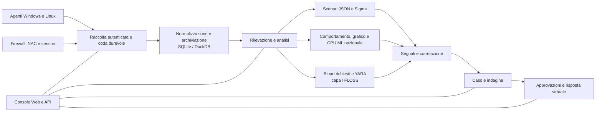

<p align="center"></p>

# VATEX LUMINA xSERA

<p align="center"><strong>Vedi il segnale. Comprendi la storia. Coordinare la risposta.</strong></p>

<p align="center">
  <a href="../../LICENSE"></a>
  
  
  
</p>

<details open><summary><strong>🌐 Lingue</strong></summary>

[English](README.en.md) · [한국어](README.ko.md) · [Español](README.es.md) · [Português (Brasil)](README.pt-BR.md) · [Français](README.fr.md) · [Deutsch](README.de.md) · [Italiano](README.it.md) · [Nederlands](README.nl.md) · [Polski](README.pl.md) · [Türkçe](README.tr.md) · [Русский](README.ru.md) · [Українська](README.uk.md) · [العربية](README.ar.md) · [हिन्दी](README.hi.md) · [বাংলা](README.bn.md) · [Bahasa Indonesia](README.id.md) · [Tiếng Việt](README.vi.md) · [ไทย](README.th.md) · [日本語](README.ja.md) · [简体中文](README.zh-CN.md)

</details>

xSERA è un progetto di server XDR e agente endpoint orientato alla CPU che collega i flussi di lavoro di raccolta, rilevamento, indagine e risposta della telemetria. La console web riunisce operazioni, ricerca, rilevamento di contenuti e casi.

> **Stato di sviluppo e validazione**
>
> Questo repository contiene sorgenti basati sulla versione 0.20.0 e successive modifiche. È inteso per lo sviluppo e la valutazione, non una dichiarazione di disponibilità generale. Le istruzioni di avvio riportate di seguito bloccano le azioni che modificano gli host effettivi. Gli esempi di risposta utilizzano dispositivi virtuali; le integrazioni reali e le azioni host richiedono una configurazione separata e una convalida sul campo.

> 🌐 Questo README tradotto è stato generato con una traduzione automatica e non è stato rivisto da un traduttore professionista. Il README inglese è il riferimento se la formulazione è diversa. L'interfaccia del prodotto e altra documentazione non sono necessariamente disponibili in questa lingua.

## 🧭 Architettura

Dagli eventi indipendenti alle prove e al caso perseguibile:



Un riconoscimento dell'acquisizione indica che l'evento ha raggiunto la coda durevole; ciò non significa che l'indicizzazione o il rilevamento siano completi. I punteggi ML e le corrispondenze YARA costituiscono prova per indagini, non prova di cattiveria o autorità per bloccare un host.

## 🧩 Cosa c'è in questo repository

| Componente | Percorso | Scopo |
| --- | --- | --- |
| Server e API | `sapientia/` | Flussi di lavoro di acquisizione, autenticazione, archiviazione, ricerca, rilevamento, casi e risposta. |
| Consolle web | `sapientia/web/` | Operazioni, ricerca di eventi, regole, dati ML, indagini e risposta. |
| Agente dell'endpoint | `sapientia/endpoint_agent/` | Raccolta, registrazione e comunicazione server Windows e Linux. |
| Contenuto del rilevamento | `sapientia/catalogs/` | Regole JSON native, informazioni ATT&CK e contenuti YARA/capa con provenienza e licenze. |
| Strumenti ed esempi di distribuzione | `tools/`, `deploy/` | Pacchetti di agenti, spedizionieri di sensori opzionali, telemetria virtuale ed esempi di servizi. |
| Documentazione e test | `docs/`, `tests/` | Contratti operativi, provenienza dei contenuti e test di regressione. |

La libreria in bundle include 950 regole di scenario originali. L'inclusione non significa che tutti i criteri siano abilitati in una nuova installazione. Gli esempi di training sintetico non stabiliscono la precisione di rilevamento nel mondo reale. [Datasets](../../docs/console-datasets-0.15.md)

## 🚀 Avvio rapido

Gli esempi seguenti avviano un'istanza locale a server singolo. Richiedono Python 3.12 e l'accesso alla rete per installare i pacchetti. Per la pianificazione della produzione, configurare separatamente controlli di accesso, TLS e backup.

### Finestre

Esegui in PowerShell:

```powershell
git clone https://github.com/lastime1650/VateX_LUMINA_xSERA.git
cd VateX_LUMINA_xSERA
py -3.12 -m venv .venv
.\.venv\Scripts\python.exe -m pip install -r requirements-lock.txt
.\.venv\Scripts\python.exe -m pip install --no-deps -e .
.\start.cmd
```

Se il programma di avvio Python non riesce a trovare la versione 3.12, utilizzare il percorso completo dell'eseguibile Python 3.12 installato per creare l'ambiente virtuale. Apri la console locale e crea il primo account amministratore: **http://127.0.0.1:8787**

Lo script di avvio di Windows crea certificati TLS dell'agente locale in private/loopback-tls/ e utilizza la porta 8788 solo locale. Questi certificati non sono un sistema sicuro per la distribuzione remota.

### Linux

```bash
git clone https://github.com/lastime1650/VateX_LUMINA_xSERA.git
cd VateX_LUMINA_xSERA
python3.12 -m venv .venv
.venv/bin/python -m pip install -r requirements-lock.txt
.venv/bin/python -m pip install --no-deps -e .
export SAPIENTIA_BLOCK_NATIVE_RESPONSE=1
.venv/bin/python -m sapientia --data ./data serve --host 127.0.0.1 --port 8787
```

L'esempio Linux avvia la console e l'acquisizione HTTP locale; non avvia un listener dell'agente TLS. Gli agenti remoti richiedono un ascoltatore TLS configurato in modo esplicito, una CA attendibile, pacchetti firmati, una chiave di firma gestita esternamente e una chiave pubblica attendibile separata. Leggere la documentazione dell'agente prima della distribuzione. [Agent signing](../../docs/agent-package-integrity.md) · [Agent](../../sapientia/endpoint_agent/README.txt)

Apri la console locale e crea il primo account amministratore: **http://127.0.0.1:8787**

I dati vengono archiviati in data/ per impostazione predefinita. Non eseguire il commit di chiavi data/, private/, di acquisizione o chiavi private certificate. Non esporre la console HTTP locale a Internet; l'accesso esterno richiede TLS convalidato e controllo di accesso esplicito.

## 🔎 Dalla telemetria alla risposta

1. Connetti le fonti. Crea un indice e una chiave di acquisizione limitata nella console oppure iscrivi un agente firmato. Configura input e parser supportati per firewall, NAC e log dei sensori.
2. Importa eventi. Invia JSON all'endpoint degli eventi utilizzando la chiave limitata. Fornire segreti tramite una variabile di ambiente o un gestore di segreti. Questo esempio è locale:

   ```bash
   curl -X POST http://127.0.0.1:8787/api/v1/events \
     -H "Authorization: Bearer $XSERA_INGEST_KEY" \
     -H "Content-Type: application/json" \
     --data '{"events":[{"event_id":"demo-001","index":"main","source":"demo","sourcetype":"json","host":"endpoint-01","severity":"info","message":"Example telemetry","raw":{"event":{"action":"process_created"}}}]}'
   ```

   Sostituisci la variabile di ambiente con una chiave di acquisizione limitata valida. Una risposta della coda riuscita non garantisce che questo campione produrrà un rilevamento o un caso.

3. Configura il rilevamento. Esamina e abilita le regole dello scenario JSON nativo. Le regole Sigma seguono l'importazione, la conversione, la convalida, la revisione e l'attivazione indipendenti, quindi vengono eseguite nello stesso motore di regole JSON nativo. I set di dati e i modelli CPU ML richiedono formazione, valutazione e approvazione esplicite.
4. Indagare sui casi. Esaminare i segnali di rilevamento, gli eventi sorgente e le prove di correlazione. I binari del processo richiesti possono essere analizzati con YARA; capa e FLOSS sono motori opzionali installati separatamente.
5. Esaminare la risposta. Ispeziona le approvazioni, l'esecuzione e i risultati del playbook. Il profilo di avvio blocca le effettive azioni di modifica dell'host e la risposta virtuale inclusa non è un'azione del dispositivo reale.

## 🧪 Motori opzionali e limiti di convalida

Il server di base funziona senza PyTorch. CPU ML, conversione Sigma YAML, capa/FLOSS e sensori esterni richiedono dipendenze opzionali o installazione e configurazione separate. Seguire le loro procedure di verifica e approvazione indipendenti.

In un'istantanea della versione precedente 0.20.0, un carico sintetico di circa 50 eventi al secondo ha prodotto il rilevamento P95 di 35,95 secondi e la creazione del caso P95 di 25,95 secondi, mancando i rispettivi obiettivi di 2 e 5 secondi. Questo repository contiene successive modifiche all'origine, quindi la precedente regressione completa non certifica questo commit. L'accuratezza del rilevamento, i falsi positivi, il carico sostenuto e le risposte effettive richiedono una convalida sul campo separata.

## 📚 Ulteriore documentazione

Questi documenti collegati potrebbero essere disponibili solo in coreano o inglese.

[Sigma / fusion](../../docs/fusion-sigma-0.18.txt) · [YARA](../../docs/yara-0.16.txt) · [CPU ML](../../docs/CPU_ML_RUNTIME.md) · [Datasets](../../docs/console-datasets-0.15.md) · [Virtual response](../../docs/VIRTUAL_RESPONSE_OPERATIONAL_QUALIFICATION.md) · [Agent signing](../../docs/agent-package-integrity.md) · [Agent](../../sapientia/endpoint_agent/README.txt) · [Security](../../SECURITY.md)

## ⚖️ Licenza e sicurezza

Il codice di proprietà del progetto, le regole originali e il codice agente per i quali sono stati confermati i diritti di ridistribuzione sono forniti in Apache-2.0. Le regole di terze parti, i materiali e le librerie ATT&CK mantengono i propri termini. Esaminare gli avvisi e le informazioni sulla licenza di terze parti.

[Apache-2.0](../../LICENSE) · [NOTICE](../../NOTICE) · [Third-party notices](../../THIRD_PARTY_NOTICES.md) · [SECURITY](../../SECURITY.md)

Segnalare le vulnerabilità attraverso il canale di segnalazione privato descritto nella politica di sicurezza. Non pubblicare credenziali o dati dei clienti in questioni pubbliche.

Riferimenti di progettazione README: [Wazuh](https://github.com/wazuh/wazuh/blob/main/README.md) · [Velociraptor](https://github.com/Velocidex/velociraptor/blob/master/README.md)
