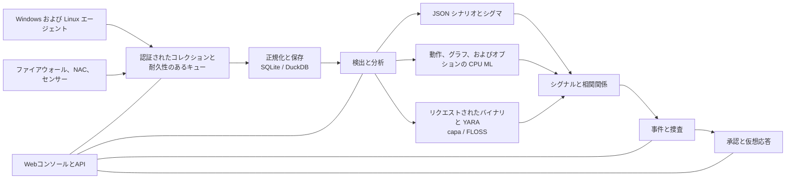

<p align="center"></p>

# VATEX LUMINA xSERA

<p align="center"><strong>信号を参照してください。話を理解してください。対応を調整します。</strong></p>

<p align="center">
  <a href="../../LICENSE"></a>
  
  
  
</p>

<details open><summary><strong>🌐 言語</strong></summary>

[English](README.en.md) · [한국어](README.ko.md) · [Español](README.es.md) · [Português (Brasil)](README.pt-BR.md) · [Français](README.fr.md) · [Deutsch](README.de.md) · [Italiano](README.it.md) · [Nederlands](README.nl.md) · [Polski](README.pl.md) · [Türkçe](README.tr.md) · [Русский](README.ru.md) · [Українська](README.uk.md) · [العربية](README.ar.md) · [हिन्दी](README.hi.md) · [বাংলা](README.bn.md) · [Bahasa Indonesia](README.id.md) · [Tiếng Việt](README.vi.md) · [ไทย](README.th.md) · [日本語](README.ja.md) · [简体中文](README.zh-CN.md)

</details>

xSERA は、テレメトリの収集、検出、調査、対応のワークフローを接続する CPU 指向の XDR サーバーおよびエンドポイント エージェント プロジェクトです。 Web コンソールには、操作、検索、検出のコンテンツとケースがまとめられています。

> **開発・検証状況**
>
> このリポジトリには、バージョン 0.20.0 以降の変更に基づくソースが含まれています。これは開発と評価を目的としたものであり、一般提供を宣言するものではありません。以下の起動手順は、実際のホストを変更するアクションをブロックします。応答例では仮想デバイスを使用しています。実際の統合とホスト アクションには、個別の構成とフィールド検証が必要です。

> 🌐 この翻訳された README は機械翻訳で生成されており、プロの翻訳者によるレビューは受けていません。表現が異なる場合は英語の README を参照してください。製品インターフェイスやその他のドキュメントは、必ずしもこの言語で利用できるとは限りません。

## 🧭 システム構成

独立した出来事から証拠、そして実用的な事件まで:



取り込み確認は、イベントが永続キューに到達したことを意味します。インデックス作成や検出が完了したことを意味するものではありません。 ML スコアと YARA の一致は調査の証拠であり、悪意やホストをブロックする権限の証拠ではありません。

## 🧩 このリポジトリの内容

| コンポーネント | パス | 目的 |
| --- | --- | --- |
| サーバーとAPI | `sapientia/` | 取り込み、認証、ストレージ、検索、検出、ケースおよび対応のワークフロー。 |
| Webコンソール | `sapientia/web/` | 操作、イベント検索、ルール、ML データ、調査と対応。 |
| エンドポイントエージェント | `sapientia/endpoint_agent/` | Windows および Linux の収集、登録、およびサーバー通信。 |
| 検出内容 | `sapientia/catalogs/` | ネイティブ JSON ルール、ATT&CK 情報、出所とライセンスを含む YARA/capa コンテンツ。 |
| ツールと導入例 | `tools/`, `deploy/` | エージェントのパッケージ化、オプションのセンサー フォワーダー、仮想テレメトリ、およびサービスの例。 |
| ドキュメントとテスト | `docs/`, `tests/` | 運用契約、コンテンツの出所および回帰テスト。 |

同梱ライブラリには950のオリジナルシナリオルールが収録されています。含めることは、すべてのポリシーが新規インストールで有効になることを意味するわけではありません。合成トレーニングの例は、現実世界の検出精度を確立するものではありません。 [Datasets](../../docs/console-datasets-0.15.md)

## 🚀 クイックスタート

以下の例では、ローカルの単一サーバー インスタンスを起動します。パッケージをインストールするには、Python 3.12 とネットワーク アクセスが必要です。運用計画では、アクセス制御、TLS、バックアップを個別に構成します。

### 窓

PowerShell で実行します。

```powershell
git clone https://github.com/lastime1650/VateX_LUMINA_xSERA.git
cd VateX_LUMINA_xSERA
py -3.12 -m venv .venv
.\.venv\Scripts\python.exe -m pip install -r requirements-lock.txt
.\.venv\Scripts\python.exe -m pip install --no-deps -e .
.\start.cmd
```

Python ランチャーがバージョン 3.12 を見つけられない場合は、インストールされている Python 3.12 実行可能ファイルへのフルパスを使用して仮想環境を作成します。ローカル コンソールを開き、最初の管理者アカウントを作成します。 **http://127.0.0.1:8787**

Windows 起動スクリプトは、private/loopback-tls/ にローカル エージェント TLS 証明書を作成し、ローカル専用ポート 8788 を使用します。これらの証明書は、リモート展開用の信頼システムではありません。

### Linux

```bash
git clone https://github.com/lastime1650/VateX_LUMINA_xSERA.git
cd VateX_LUMINA_xSERA
python3.12 -m venv .venv
.venv/bin/python -m pip install -r requirements-lock.txt
.venv/bin/python -m pip install --no-deps -e .
export SAPIENTIA_BLOCK_NATIVE_RESPONSE=1
.venv/bin/python -m sapientia --data ./data serve --host 127.0.0.1 --port 8787
```

Linux の例では、コンソールとローカル HTTP インジェストを開始します。 TLS エージェント リスナーは開始されません。リモート エージェントには、明示的に構成された TLS リスナー、信頼できる CA、署名済みパッケージ、外部管理の署名キー、および別個の信頼できる公開キーが必要です。導入前にエージェントのドキュメントをお読みください。 [Agent signing](../../docs/agent-package-integrity.md) · [Agent](../../sapientia/endpoint_agent/README.txt)

ローカル コンソールを開き、最初の管理者アカウントを作成します。 **http://127.0.0.1:8787**

デフォルトでは、データは data/ に保存されます。 data/、private/、取り込みキー、または証明書の秘密キーをコミットしないでください。ローカル HTTP コンソールをインターネットに公開しないでください。外部アクセスには、検証された TLS と明示的なアクセス制御が必要です。

## 🔎 テレメトリーからレスポンスまで

1. ソースを接続します。コンソールでインデックスと制限付き取り込みキーを作成するか、署名されたエージェントを登録します。ファイアウォール、NAC、センサー ログ用にサポートされている入力とパーサーを構成します。
2. イベントを取り込みます。制限付きキーを使用して JSON をイベント エンドポイントに送信します。環境変数またはシークレット マネージャーを通じてシークレットを指定します。この例はローカルです。

   ```bash
   curl -X POST http://127.0.0.1:8787/api/v1/events \
     -H "Authorization: Bearer $XSERA_INGEST_KEY" \
     -H "Content-Type: application/json" \
     --data '{"events":[{"event_id":"demo-001","index":"main","source":"demo","sourcetype":"json","host":"endpoint-01","severity":"info","message":"Example telemetry","raw":{"event":{"action":"process_created"}}}]}'
   ```

   環境変数を有効な制限付き取り込みキーに置き換えます。キューの応答が成功しても、このサンプルが検出またはケースを生成することは保証されません。

3. 検出を構成します。ネイティブ JSON シナリオ ルールを確認して有効にします。シグマ ルールは、インポート、変換、検証、独立したレビュー、アクティブ化の後に、同じネイティブ JSON ルール エンジンで実行されます。 CPU ML データセットとモデルには、明示的なトレーニング、評価、承認が必要です。
4. 事件を調査します。検出信号、ソースイベント、相関関係の証拠を調べます。要求されたプロセス バイナリは YARA で分析できます。 capa と FLOSS は個別にインストールされるオプションのエンジンです。
5. 返答をレビューします。プレイブックの承認、実行、結果を検査します。起動プロファイルは実際のホスト変更アクションをブロックし、含まれる仮想応答は実際のデバイス アクションではありません。

## 🧪 オプションのエンジンと検証制限

基本サーバーは PyTorch なしで実行されます。 CPU ML、Sigma YAML 変換、capa/FLOSS、および外部センサーには、オプションの依存関係、または個別のインストールと構成が必要です。その検証および独立した承認手順に従ってください。

以前の 0.20.0 リリースのスナップショットでは、1 秒あたり約 50 イベントの合成負荷により、検出 P95 が 35.95 秒、ケース作成 P95 が 25.95 秒となり、それぞれの目標である 2 秒と 5 秒を達成できませんでした。このリポジトリには後続のソース変更が含まれているため、以前の完全な回帰はこのコミットを証明しません。検出精度、誤検知、持続的な負荷、および実際の応答については、個別のフィールド検証が必要です。

## 📚 さらなるドキュメント

これらのリンクされたドキュメントは、韓国語または英語でのみ利用できる場合があります。

[Sigma / fusion](../../docs/fusion-sigma-0.18.txt) · [YARA](../../docs/yara-0.16.txt) · [CPU ML](../../docs/CPU_ML_RUNTIME.md) · [Datasets](../../docs/console-datasets-0.15.md) · [Virtual response](../../docs/VIRTUAL_RESPONSE_OPERATIONAL_QUALIFICATION.md) · [Agent signing](../../docs/agent-package-integrity.md) · [Agent](../../sapientia/endpoint_agent/README.txt) · [Security](../../SECURITY.md)

## ⚖️ ライセンスとセキュリティ

Project-owned code and the original rules and agent code for which redistribution rights were confirmed are provided under Apache-2.0. Third-party rules, ATT&CK materials and libraries retain their own terms. Review the notices and third-party license information.

[Apache-2.0](../../LICENSE) · [NOTICE](../../NOTICE) · [Third-party notices](../../THIRD_PARTY_NOTICES.md) · [SECURITY](../../SECURITY.md)

Report vulnerabilities through the private reporting channel described in the security policy. Do not publish credentials or customer data in public issues.

README 設計リファレンス: [Wazuh](https://github.com/wazuh/wazuh/blob/main/README.md) · [Velociraptor](https://github.com/Velocidex/velociraptor/blob/master/README.md)
