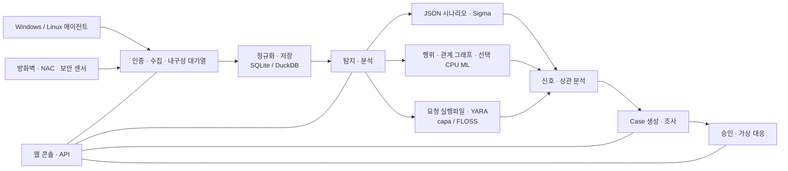

<p align="center"></p>

# VATEX LUMINA xSERA

<p align="center"><strong>신호를 포착하고, 사건을 이해하고, 대응을 연결합니다.</strong></p>

<p align="center">
  <a href="../../LICENSE"></a>
  
  
  
</p>

<details open><summary><strong>🌐 언어 선택</strong></summary>

[English](README.en.md) · [한국어](README.ko.md) · [Español](README.es.md) · [Português (Brasil)](README.pt-BR.md) · [Français](README.fr.md) · [Deutsch](README.de.md) · [Italiano](README.it.md) · [Nederlands](README.nl.md) · [Polski](README.pl.md) · [Türkçe](README.tr.md) · [Русский](README.ru.md) · [Українська](README.uk.md) · [العربية](README.ar.md) · [हिन्दी](README.hi.md) · [বাংলা](README.bn.md) · [Bahasa Indonesia](README.id.md) · [Tiếng Việt](README.vi.md) · [ไทย](README.th.md) · [日本語](README.ja.md) · [简体中文](README.zh-CN.md)

</details>

xSERA는 로그 수집부터 탐지, 조사와 대응 워크플로까지 연결하는 CPU 기반 XDR 서버 및 엔드포인트 에이전트 프로젝트입니다. 웹 콘솔에서 운영 현황과 검색, 탐지 콘텐츠 및 Case를 관리합니다.

> **개발 및 검증 상태**
>
> 이 저장소에는 0.20.0을 기반으로 이후 변경된 소스가 포함되어 있습니다. 개발과 평가를 위한 소스이며 일반 상용 운영 승인을 의미하지 않습니다. 아래 시작 명령은 실제 호스트를 변경하는 대응을 차단합니다. 대응 예시는 가상 장치를 사용하며 실제 장비 연결과 호스트 조치는 별도 설정과 현장 검증이 필요합니다.

> 🌐 이 문서의 다른 언어 버전은 자동 번역을 포함하며 전문 번역가의 검수를 거치지 않았습니다. 표현이 다를 때에는 영어 README를 기준으로 확인해 주세요. 제품 UI와 다른 문서가 이 언어로 제공된다는 뜻은 아닙니다.

## 🧭 전체 구조

개별 이벤트를 근거와 조사 가능한 Case로 연결합니다.



수집 응답은 이벤트가 내구성 대기열에 기록되었다는 뜻이며 색인이나 탐지 완료를 의미하지 않습니다. ML 점수와 YARA 일치는 조사 근거이며 그 자체가 악성 판정이나 실제 호스트 차단 권한을 뜻하지 않습니다.

## 🧩 저장소 구성

| 구성 요소 | 경로 | 역할 |
| --- | --- | --- |
| 서버와 API | `sapientia/` | 수집, 인증, 저장, 검색, 탐지, Case 및 대응 워크플로 |
| 웹 콘솔 | `sapientia/web/` | 운영 현황, 이벤트 검색, 규칙, ML 자료, 조사와 대응 |
| 엔드포인트 에이전트 | `sapientia/endpoint_agent/` | Windows·Linux 수집, 등록 및 서버 통신 |
| 탐지 콘텐츠 | `sapientia/catalogs/` | 자체 JSON 규칙, ATT&CK 정보, 출처와 라이선스를 보존한 YARA·capa 콘텐츠 |
| 운영 도구와 배포 예시 | `tools/`, `deploy/` | 에이전트 패키징, 선택 센서 전달기, 가상 텔레메트리 및 서비스 예시 |
| 문서와 테스트 | `docs/`, `tests/` | 운영 계약, 콘텐츠 출처 및 회귀 테스트 |

기본 라이브러리에는 기존 자체 시나리오 규칙 950개가 포함됩니다. 포함된 모든 정책이 새 설치에서 자동 활성화되는 것은 아닙니다. 합성 학습 자료의 수는 현장 탐지 정확도를 의미하지 않습니다. [Datasets](../../docs/console-datasets-0.15.md)

## 🚀 빠른 시작

아래 예시는 로컬 단일 서버를 시작합니다. Python 3.12와 패키지를 설치할 수 있는 네트워크 환경이 필요합니다. 운영 환경의 접근 제어, TLS와 백업은 별도로 구성하세요.

### Windows

PowerShell에서 실행합니다.

```powershell
git clone https://github.com/lastime1650/VateX_LUMINA_xSERA.git
cd VateX_LUMINA_xSERA
py -3.12 -m venv .venv
.\.venv\Scripts\python.exe -m pip install -r requirements-lock.txt
.\.venv\Scripts\python.exe -m pip install --no-deps -e .
.\start.cmd
```

Python Launcher가 3.12를 찾지 못하면 설치된 Python 3.12 실행 파일의 전체 경로로 가상 환경을 생성하세요. 다음 주소를 열어 첫 관리자 계정을 만듭니다. **http://127.0.0.1:8787**

Windows 시작 스크립트는 private/loopback-tls/에 로컬 에이전트 TLS 인증서를 생성하고 로컬 전용 포트 8788을 사용합니다. 이 인증서는 원격 배포를 위한 신뢰 체계가 아닙니다.

### Linux

```bash
git clone https://github.com/lastime1650/VateX_LUMINA_xSERA.git
cd VateX_LUMINA_xSERA
python3.12 -m venv .venv
.venv/bin/python -m pip install -r requirements-lock.txt
.venv/bin/python -m pip install --no-deps -e .
export SAPIENTIA_BLOCK_NATIVE_RESPONSE=1
.venv/bin/python -m sapientia --data ./data serve --host 127.0.0.1 --port 8787
```

Linux 예시는 웹 콘솔과 로컬 HTTP 수집을 시작하며 에이전트 TLS 리스너는 시작하지 않습니다. 원격 에이전트에는 별도 TLS 리스너, 신뢰 CA, 서명된 패키지, 외부에서 관리하는 서명 키와 별도 신뢰 공개키가 필요합니다. 배포 전 에이전트 문서를 확인하세요. [Agent signing](../../docs/agent-package-integrity.md) · [Agent](../../sapientia/endpoint_agent/README.txt)

다음 주소를 열어 첫 관리자 계정을 만듭니다. **http://127.0.0.1:8787**

데이터는 기본적으로 data/에 저장됩니다. data/, private/, 수집 키와 인증서 개인 키를 저장소에 올리지 마세요. 로컬 HTTP 콘솔을 인터넷에 노출하지 마세요. 외부 연결에는 검증 가능한 TLS와 명시적인 접근 제어가 필요합니다.

## 🔎 로그 수집부터 대응까지

1. 수집원 연결: 콘솔에서 인덱스와 수집 전용 키를 만들거나 서명된 에이전트를 등록합니다. 방화벽, NAC 및 센서 로그에는 지원되는 입력과 파서를 구성합니다.
2. 이벤트 수신: 수집 전용 키를 사용해 이벤트 엔드포인트에 JSON을 전송합니다. 키는 환경 변수나 비밀 관리 도구로 주입합니다. 다음은 로컬 예시입니다.

   ```bash
   curl -X POST http://127.0.0.1:8787/api/v1/events \
     -H "Authorization: Bearer $XSERA_INGEST_KEY" \
     -H "Content-Type: application/json" \
     --data '{"events":[{"event_id":"demo-001","index":"main","source":"demo","sourcetype":"json","host":"endpoint-01","severity":"info","message":"Example telemetry","raw":{"event":{"action":"process_created"}}}]}'
   ```

   환경 변수에 유효한 수집 전용 키를 설정하세요. 수집 성공 응답이 이 예시의 탐지 또는 Case 생성을 보장하지는 않습니다.

3. 탐지 설정: 자체 JSON 시나리오를 검토하고 활성화합니다. Sigma 규칙은 가져오기 → 변환 → 검증 → 독립 검토 → 활성화 과정을 거쳐 같은 자체 JSON 규칙 엔진에서 실행됩니다. CPU ML 자료와 모델은 명시적인 학습, 평가 및 승인이 필요합니다.
4. Case 조사: 탐지 신호와 원본 이벤트, 상관 분석 근거를 확인합니다. 요청된 프로세스 실행파일을 YARA로 분석할 수 있으며 capa와 FLOSS는 별도 설치하는 선택 엔진입니다.
5. 대응 확인: 플레이북 승인, 실행 및 결과를 확인합니다. 시작 프로필은 실제 호스트 변경을 차단하며 제공된 가상 대응은 실제 장비 조치가 아닙니다.

## 🧪 선택 기능과 검증 범위

기본 서버는 PyTorch 없이 실행됩니다. CPU ML, Sigma YAML 변환, capa/FLOSS와 외부 센서는 선택 의존성 또는 별도 설치와 설정이 필요합니다. 각 기능의 검증과 독립 승인 절차를 따르세요.

이전 0.20.0 배포 스냅샷의 합성 부하 시험에서 약 50 EPS 기준 탐지 P95는 35.95초, Case 생성 P95는 25.95초로 각각 목표인 2초와 5초를 충족하지 못했습니다. 현재 저장소는 이후 변경된 소스를 포함하므로 과거 전체 회귀 결과가 이 커밋을 인증하지는 않습니다. 탐지율, 오탐률, 지속 부하 및 실제 대응은 별도 현장 검증이 필요합니다.

## 📚 관련 문서

연결된 문서는 한국어 또는 영어로만 제공될 수 있습니다.

[Sigma / fusion](../../docs/fusion-sigma-0.18.txt) · [YARA](../../docs/yara-0.16.txt) · [CPU ML](../../docs/CPU_ML_RUNTIME.md) · [Datasets](../../docs/console-datasets-0.15.md) · [Virtual response](../../docs/VIRTUAL_RESPONSE_OPERATIONAL_QUALIFICATION.md) · [Agent signing](../../docs/agent-package-integrity.md) · [Agent](../../sapientia/endpoint_agent/README.txt) · [Security](../../SECURITY.md)

## ⚖️ 라이선스와 보안

프로젝트 자체 코드와 재배포 권한이 확인된 원본 규칙·에이전트 코드는 Apache-2.0으로 제공합니다. 제3자 규칙, ATT&CK 자료 및 라이브러리는 각자의 조건을 유지합니다. 고지와 제3자 라이선스 정보를 함께 확인하세요.

[Apache-2.0](../../LICENSE) · [NOTICE](../../NOTICE) · [Third-party notices](../../THIRD_PARTY_NOTICES.md) · [SECURITY](../../SECURITY.md)

취약점은 보안 정책에서 안내하는 비공개 제보 경로로 보고해 주세요. 공개 이슈에 자격 증명이나 고객 데이터를 게시하지 마세요.

README 구성 참고 자료: [Wazuh](https://github.com/wazuh/wazuh/blob/main/README.md) · [Velociraptor](https://github.com/Velocidex/velociraptor/blob/master/README.md)
