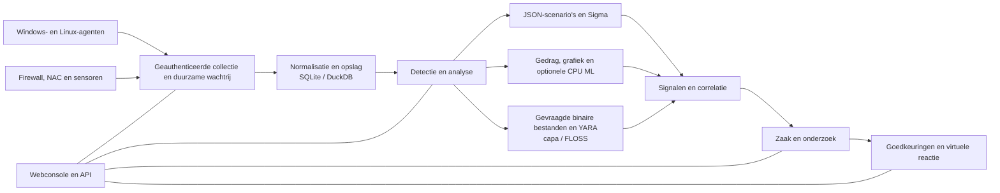

<p align="center"></p>

# VATEX LUMINA xSERA

<p align="center"><strong>Zie het signaal. Begrijp het verhaal. Coördineer de reactie.</strong></p>

<p align="center">
  <a href="../../LICENSE"></a>
  
  
  
</p>

<details open><summary><strong>🌐 Talen</strong></summary>

[English](README.en.md) · [한국어](README.ko.md) · [Español](README.es.md) · [Português (Brasil)](README.pt-BR.md) · [Français](README.fr.md) · [Deutsch](README.de.md) · [Italiano](README.it.md) · [Nederlands](README.nl.md) · [Polski](README.pl.md) · [Türkçe](README.tr.md) · [Русский](README.ru.md) · [Українська](README.uk.md) · [العربية](README.ar.md) · [हिन्दी](README.hi.md) · [বাংলা](README.bn.md) · [Bahasa Indonesia](README.id.md) · [Tiếng Việt](README.vi.md) · [ไทย](README.th.md) · [日本語](README.ja.md) · [简体中文](README.zh-CN.md)

</details>

xSERA is een CPU-georiënteerd XDR-server- en eindpuntagentproject dat workflows voor het verzamelen, detecteren, onderzoeken en reageren van telemetrie met elkaar verbindt. De webconsole brengt bewerkingen, zoeken, detectiecontent en cases samen.

> **Ontwikkelings- en validatiestatus**
>
> Deze repository bevat broncode gebaseerd op versie 0.20.0 en daaropvolgende wijzigingen. Het is bedoeld voor ontwikkeling en evaluatie, niet voor een verklaring van algemene beschikbaarheid. De onderstaande startinstructies blokkeren acties die daadwerkelijke hosts wijzigen. In de antwoordvoorbeelden worden virtuele apparaten gebruikt; echte integraties en hostacties vereisen afzonderlijke configuratie en veldvalidatie.

> 🌐 Deze vertaalde README is gegenereerd met automatische vertaling en is niet beoordeeld door een professionele vertaler. De Engelse README is de referentie als de formulering verschilt. De productinterface en andere documentatie zijn niet noodzakelijkerwijs beschikbaar in deze taal.

## 🧭 Architectuur

Van onafhankelijke gebeurtenissen tot bewijsmateriaal en een actiegerichte zaak:



Een opnamebevestiging betekent dat de gebeurtenis de duurzame wachtrij heeft bereikt; dit betekent niet dat de indexering of detectie voltooid is. ML-scores en YARA-matches zijn bewijsmateriaal voor onderzoek, geen bewijs van kwaadwilligheid of autoriteit om een ​​host te blokkeren.

## 🧩 Wat zit er in deze repository

| Onderdeel | Pad | Doel |
| --- | --- | --- |
| Server en API | `sapientia/` | Workflows voor opname, authenticatie, opslag, zoeken, detectie, cases en reacties. |
| Webconsole | `sapientia/web/` | Bewerkingen, zoeken naar gebeurtenissen, regels, ML-gegevens, onderzoeken en reacties. |
| Eindpuntagent | `sapientia/endpoint_agent/` | Windows- en Linux-verzameling, inschrijving en servercommunicatie. |
| Detectie-inhoud | `sapientia/catalogs/` | Native JSON-regels, ATT&CK-informatie en YARA/capa-inhoud met herkomst en licenties. |
| Tools en implementatievoorbeelden | `tools/`, `deploy/` | Agentverpakkingen, optionele sensorforwarders, virtuele telemetrie en servicevoorbeelden. |
| Documentatie en tests | `docs/`, `tests/` | Exploitatiecontracten, herkomst van inhoud en regressietests. |

De gebundelde bibliotheek bevat 950 originele scenarioregels. Opname betekent niet dat elk beleid wordt ingeschakeld bij een nieuwe installatie. Synthetische trainingsvoorbeelden bieden geen detectienauwkeurigheid in de echte wereld. [Datasets](../../docs/console-datasets-0.15.md)

## 🚀 Snel beginnen

In de onderstaande voorbeelden wordt een lokaal exemplaar met één server gestart. Ze vereisen Python 3.12 en netwerktoegang om pakketten te installeren. Voor productieplanning configureert u toegangscontroles, TLS en back-ups afzonderlijk.

### Ramen

Uitvoeren in PowerShell:

```powershell
git clone https://github.com/lastime1650/VateX_LUMINA_xSERA.git
cd VateX_LUMINA_xSERA
py -3.12 -m venv .venv
.\.venv\Scripts\python.exe -m pip install -r requirements-lock.txt
.\.venv\Scripts\python.exe -m pip install --no-deps -e .
.\start.cmd
```

Als het Python-opstartprogramma versie 3.12 niet kan vinden, gebruik dan het volledige pad naar het geïnstalleerde uitvoerbare bestand Python 3.12 om de virtuele omgeving te creëren. Open de lokale console en maak het eerste beheerdersaccount aan: **http://127.0.0.1:8787**

Het Windows-startscript maakt TLS-certificaten voor lokale agenten in private/loopback-tls/ en gebruikt alleen lokale poort 8788. Deze certificaten zijn geen vertrouwenssysteem voor implementatie op afstand.

### Linux

```bash
git clone https://github.com/lastime1650/VateX_LUMINA_xSERA.git
cd VateX_LUMINA_xSERA
python3.12 -m venv .venv
.venv/bin/python -m pip install -r requirements-lock.txt
.venv/bin/python -m pip install --no-deps -e .
export SAPIENTIA_BLOCK_NATIVE_RESPONSE=1
.venv/bin/python -m sapientia --data ./data serve --host 127.0.0.1 --port 8787
```

Het Linux-voorbeeld start de console en de lokale HTTP-opname; er wordt geen TLS-agentlistener gestart. Agenten op afstand vereisen een expliciet geconfigureerde TLS-listener, vertrouwde CA, ondertekende pakketten, een extern beheerde ondertekeningssleutel en een afzonderlijke vertrouwde openbare sleutel. Lees de agentdocumentatie voordat u deze implementeert. [Agent signing](../../docs/agent-package-integrity.md) · [Agent](../../sapientia/endpoint_agent/README.txt)

Open de lokale console en maak het eerste beheerdersaccount aan: **http://127.0.0.1:8787**

Gegevens worden standaard opgeslagen in data/. Leg geen gegevens-, privé-, opnamesleutels of privésleutels van certificaten vast. Stel de lokale HTTP-console niet bloot aan internet; externe toegang vereist gevalideerde TLS en expliciete toegangscontrole.

## 🔎 Van telemetrie tot respons

1. Verbind bronnen. Maak een index en een sleutel voor beperkte opname in de console, of schrijf een ondertekende agent in. Configureer ondersteunde ingangen en parsers voor firewall-, NAC- en sensorlogboeken.
2. Gebeurtenissen opnemen. Stuur JSON naar het gebeurtenisseneindpunt met behulp van de beperkte sleutel. Geef geheimen aan via een omgevingsvariabele of een geheimmanager. Dit voorbeeld is lokaal:

   ```bash
   curl -X POST http://127.0.0.1:8787/api/v1/events \
     -H "Authorization: Bearer $XSERA_INGEST_KEY" \
     -H "Content-Type: application/json" \
     --data '{"events":[{"event_id":"demo-001","index":"main","source":"demo","sourcetype":"json","host":"endpoint-01","severity":"info","message":"Example telemetry","raw":{"event":{"action":"process_created"}}}]}'
   ```

   Vervang de omgevingsvariabele door een geldige sleutel voor beperkte opname. Een succesvolle wachtrijreactie garandeert niet dat dit voorbeeld een detectie of case zal opleveren.

3. Configureer detectie. Controleer en schakel systeemeigen JSON-scenarioregels in. Sigma-regels volgen import, conversie, validatie, onafhankelijke beoordeling en activering en worden vervolgens uitgevoerd in dezelfde native JSON-regelengine. CPU ML-datasets en -modellen vereisen expliciete training, evaluatie en goedkeuring.
4. Onderzoek gevallen. Onderzoek de detectiesignalen, brongebeurtenissen en correlatiebewijs. Opgevraagde procesbinaire bestanden kunnen worden geanalyseerd met YARA; capa en FLOSS zijn optionele motoren die afzonderlijk worden geïnstalleerd.
5. Reactie beoordelen. Inspecteer de goedkeuringen, uitvoering en resultaten van playbooks. Het startprofiel blokkeert daadwerkelijke host-modificerende acties, en de opgenomen virtuele reactie is geen echte apparaatactie.

## 🧪 Optionele motoren en validatielimieten

De basisserver draait zonder PyTorch. CPU ML, Sigma YAML-conversie, capa/FLOSS en externe sensoren vereisen optionele afhankelijkheden of afzonderlijke installatie en configuratie. Volg hun verificatie- en onafhankelijke goedkeuringsprocedures.

In een eerdere momentopname van de release van 0.20.0 produceerde een synthetische belasting van ongeveer 50 gebeurtenissen per seconde detectie P95 van 35,95 seconden en case-creation P95 van 25,95 seconden, waarbij de respectieve doelen van 2 en 5 seconden werden gemist. Deze repository bevat daaropvolgende bronwijzigingen, dus de eerdere volledige regressie certificeert deze commit niet. Detectienauwkeurigheid, valse positieven, aanhoudende belasting en daadwerkelijke reacties vereisen afzonderlijke veldvalidatie.

## 📚 Verdere documentatie

Deze gekoppelde documenten zijn mogelijk alleen beschikbaar in het Koreaans of Engels.

[Sigma / fusion](../../docs/fusion-sigma-0.18.txt) · [YARA](../../docs/yara-0.16.txt) · [CPU ML](../../docs/CPU_ML_RUNTIME.md) · [Datasets](../../docs/console-datasets-0.15.md) · [Virtual response](../../docs/VIRTUAL_RESPONSE_OPERATIONAL_QUALIFICATION.md) · [Agent signing](../../docs/agent-package-integrity.md) · [Agent](../../sapientia/endpoint_agent/README.txt) · [Security](../../SECURITY.md)

## ⚖️ Licentie en beveiliging

Code die eigendom is van het project en de oorspronkelijke regels en agentcode waarvoor de herdistributierechten zijn bevestigd, worden geleverd onder Apache-2.0. Regels van derden, ATT&CK-materialen en bibliotheken behouden hun eigen voorwaarden. Bekijk de mededelingen en licentie-informatie van derden.

[Apache-2.0](../../LICENSE) · [NOTICE](../../NOTICE) · [Third-party notices](../../THIRD_PARTY_NOTICES.md) · [SECURITY](../../SECURITY.md)

Meld kwetsbaarheden via het privé-meldkanaal dat wordt beschreven in het beveiligingsbeleid. Publiceer geen inloggegevens of klantgegevens in openbare uitgaven.

README-ontwerpreferenties: [Wazuh](https://github.com/wazuh/wazuh/blob/main/README.md) · [Velociraptor](https://github.com/Velocidex/velociraptor/blob/master/README.md)
