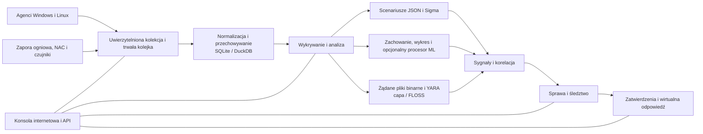

<p align="center"></p>

# VATEX LUMINA xSERA

<p align="center"><strong>Zobacz sygnał. Zrozum historię. Koordynuj reakcję.</strong></p>

<p align="center">
  <a href="../../LICENSE"></a>
  
  
  
</p>

<details open><summary><strong>🌐 Języki</strong></summary>

[English](README.en.md) · [한국어](README.ko.md) · [Español](README.es.md) · [Português (Brasil)](README.pt-BR.md) · [Français](README.fr.md) · [Deutsch](README.de.md) · [Italiano](README.it.md) · [Nederlands](README.nl.md) · [Polski](README.pl.md) · [Türkçe](README.tr.md) · [Русский](README.ru.md) · [Українська](README.uk.md) · [العربية](README.ar.md) · [हिन्दी](README.hi.md) · [বাংলা](README.bn.md) · [Bahasa Indonesia](README.id.md) · [Tiếng Việt](README.vi.md) · [ไทย](README.th.md) · [日本語](README.ja.md) · [简体中文](README.zh-CN.md)

</details>

xSERA to zorientowany na procesor projekt serwera XDR i agenta punktu końcowego, który łączy przepływy pracy gromadzenia danych telemetrycznych, wykrywania, badania i reagowania. Konsola internetowa łączy operacje, wyszukiwanie, wykrywanie treści i przypadki.

> **Stan rozwoju i walidacji**
>
> Repozytorium zawiera źródła oparte na wersji 0.20.0 i późniejszych zmianach. Jest przeznaczony do rozwoju i oceny, a nie do deklaracji ogólnej dostępności. Poniższe instrukcje uruchamiania blokują działania modyfikujące rzeczywiste hosty. Przykłady odpowiedzi wykorzystują urządzenia wirtualne; rzeczywiste integracje i działania hosta wymagają osobnej konfiguracji i walidacji w terenie.

> 🌐 Ten przetłumaczony plik README został wygenerowany przy użyciu tłumaczenia maszynowego i nie był sprawdzany przez profesjonalnego tłumacza. W przypadku różnic w brzmieniu, odniesieniem jest angielski plik README. Interfejs produktu i inna dokumentacja nie muszą być koniecznie dostępne w tym języku.

## 🧭 Architektura

Od niezależnych wydarzeń po dowody i sprawę wykonalną:



Potwierdzenie przyjęcia oznacza, że zdarzenie dotarło do trwałej kolejki; nie oznacza to, że indeksowanie lub wykrywanie zostało zakończone. Wyniki ML i dopasowania YARA stanowią dowód do zbadania, a nie dowód złośliwości lub uprawnienia do blokowania hosta.

## 🧩 Co znajduje się w tym repozytorium

| Komponent | Ścieżka | Cel |
| --- | --- | --- |
| Serwer i API | `sapientia/` | Przepływy pracy: pozyskiwanie, uwierzytelnianie, przechowywanie, wyszukiwanie, wykrywanie, przypadki i odpowiedzi. |
| Konsola internetowa | `sapientia/web/` | Operacje, wyszukiwanie zdarzeń, zasady, dane ML, dochodzenia i reagowanie. |
| Agent punktu końcowego | `sapientia/endpoint_agent/` | Gromadzenie, rejestracja i komunikacja z serwerem w systemach Windows i Linux. |
| Treść wykrywania | `sapientia/catalogs/` | Natywne reguły JSON, informacje ATT&CK oraz zawartość YARA/capa z pochodzeniem i licencjami. |
| Narzędzia i przykłady wdrożeń | `tools/`, `deploy/` | Pakowanie agentów, opcjonalne spedytory czujników, wirtualna telemetria i przykłady usług. |
| Dokumentacja i testy | `docs/`, `tests/` | Umowy operacyjne, pochodzenie treści i testy regresyjne. |

Dołączona biblioteka zawiera 950 oryginalnych zasad scenariuszy. Włączenie nie oznacza, że ​​wszystkie zasady są włączone w przypadku nowej instalacji. Syntetyczne przykłady szkoleniowe nie określają dokładności wykrywania w świecie rzeczywistym. [Datasets](../../docs/console-datasets-0.15.md)

## 🚀 Szybki start

Poniższe przykłady uruchamiają lokalną instancję z jednym serwerem. Do zainstalowania pakietów wymagany jest język Python 3.12 i dostęp do sieci. Na potrzeby planowania produkcji skonfiguruj oddzielnie kontrolę dostępu, TLS i kopie zapasowe.

### Okna

Uruchom w PowerShellu:

```powershell
git clone https://github.com/lastime1650/VateX_LUMINA_xSERA.git
cd VateX_LUMINA_xSERA
py -3.12 -m venv .venv
.\.venv\Scripts\python.exe -m pip install -r requirements-lock.txt
.\.venv\Scripts\python.exe -m pip install --no-deps -e .
.\start.cmd
```

Jeśli program uruchamiający Python nie może znaleźć wersji 3.12, użyj pełnej ścieżki do zainstalowanego pliku wykonywalnego Python 3.12, aby utworzyć środowisko wirtualne. Otwórz konsolę lokalną i utwórz pierwsze konto administratora: **http://127.0.0.1:8787**

Skrypt uruchamiania systemu Windows tworzy certyfikaty TLS agenta lokalnego w katalogu private/loopback-tls/ i używa portu 8788 przeznaczonego wyłącznie do użytku lokalnego. Certyfikaty te nie są systemem zaufania do wdrażania zdalnego.

### Linuksa

```bash
git clone https://github.com/lastime1650/VateX_LUMINA_xSERA.git
cd VateX_LUMINA_xSERA
python3.12 -m venv .venv
.venv/bin/python -m pip install -r requirements-lock.txt
.venv/bin/python -m pip install --no-deps -e .
export SAPIENTIA_BLOCK_NATIVE_RESPONSE=1
.venv/bin/python -m sapientia --data ./data serve --host 127.0.0.1 --port 8787
```

Przykład systemu Linux uruchamia konsolę i lokalne pozyskiwanie protokołu HTTP; nie uruchamia odbiornika agenta TLS. Zdalni agenci wymagają jawnie skonfigurowanego odbiornika TLS, zaufanego urzędu certyfikacji, podpisanych pakietów, zarządzanego zewnętrznie klucza podpisywania i oddzielnego zaufanego klucza publicznego. Przed wdrożeniem przeczytaj dokumentację agenta. [Agent signing](../../docs/agent-package-integrity.md) · [Agent](../../sapientia/endpoint_agent/README.txt)

Otwórz konsolę lokalną i utwórz pierwsze konto administratora: **http://127.0.0.1:8787**

Dane są domyślnie przechowywane w data/. Nie udostępniaj kluczy danych/, prywatnych/, pozyskiwania ani kluczy prywatnych certyfikatów. Nie udostępniaj lokalnej konsoli HTTP w Internecie; dostęp zewnętrzny wymaga sprawdzonego protokołu TLS i jawnej kontroli dostępu.

## 🔎 Od telemetrii po reakcję

1. Podłącz źródła. Utwórz indeks i klucz ograniczonego pozyskiwania w konsoli lub zarejestruj podpisanego agenta. Skonfiguruj obsługiwane wejścia i parsery dla zapory sieciowej, NAC i dzienników czujników.
2. Pozyskiwanie wydarzeń. Wyślij kod JSON do punktu końcowego zdarzeń przy użyciu klucza zastrzeżonego. Podaj klucze tajne za pomocą zmiennej środowiskowej lub menedżera kluczy tajnych. Ten przykład jest lokalny:

   ```bash
   curl -X POST http://127.0.0.1:8787/api/v1/events \
     -H "Authorization: Bearer $XSERA_INGEST_KEY" \
     -H "Content-Type: application/json" \
     --data '{"events":[{"event_id":"demo-001","index":"main","source":"demo","sourcetype":"json","host":"endpoint-01","severity":"info","message":"Example telemetry","raw":{"event":{"action":"process_created"}}}]}'
   ```

   Zastąp zmienną środowiskową prawidłowym kluczem ograniczonego pozyskiwania. Pomyślna odpowiedź kolejki nie gwarantuje, że ta próbka wykryje lub wykryje przypadek.

3. Skonfiguruj wykrywanie. Przejrzyj i włącz natywne reguły scenariusza JSON. Reguły Sigma śledzą import, konwersję, walidację, niezależny przegląd i aktywację, a następnie działają w tym samym natywnym silniku reguł JSON. Zbiory danych i modele CPU ML wymagają jawnego szkolenia, oceny i zatwierdzenia.
4. Zbadaj przypadki. Zbadaj sygnały detekcji, zdarzenia źródłowe i dowody korelacji. Żądane pliki binarne procesów można analizować za pomocą YARA; capa i FLOSS to opcjonalne silniki instalowane oddzielnie.
5. Przejrzyj odpowiedź. Sprawdź zatwierdzenia podręczników, wykonanie i wyniki. Profil uruchamiania blokuje rzeczywiste działania modyfikujące hosta, a dołączona odpowiedź wirtualna nie jest rzeczywistym działaniem urządzenia.

## 🧪 Opcjonalne silniki i limity walidacyjne

Serwer podstawowy działa bez PyTorch. CPU ML, konwersja Sigma YAML, capa/FLOSS i czujniki zewnętrzne wymagają opcjonalnych zależności lub osobnej instalacji i konfiguracji. Postępuj zgodnie z ich procedurami weryfikacji i niezależnego zatwierdzania.

W poprzedniej migawce wersji 0.20.0 syntetyczne obciążenie wynoszące około 50 zdarzeń na sekundę skutkowało wykryciem P95 wynoszącym 35,95 sekundy i utworzeniem przypadku P95 trwającym 25,95 sekundy, co oznacza brak osiągnięcia odpowiednich celów wynoszących 2 i 5 sekund. To repozytorium zawiera kolejne zmiany źródłowe, więc wcześniejsza pełna regresja nie potwierdza tego zatwierdzenia. Dokładność wykrywania, fałszywe alarmy, ciągłe obciążenie i rzeczywiste reakcje wymagają oddzielnej walidacji w terenie.

## 📚 Dalsza dokumentacja

Te połączone dokumenty mogą być dostępne wyłącznie w języku koreańskim lub angielskim.

[Sigma / fusion](../../docs/fusion-sigma-0.18.txt) · [YARA](../../docs/yara-0.16.txt) · [CPU ML](../../docs/CPU_ML_RUNTIME.md) · [Datasets](../../docs/console-datasets-0.15.md) · [Virtual response](../../docs/VIRTUAL_RESPONSE_OPERATIONAL_QUALIFICATION.md) · [Agent signing](../../docs/agent-package-integrity.md) · [Agent](../../sapientia/endpoint_agent/README.txt) · [Security](../../SECURITY.md)

## ⚖️ Licencja i bezpieczeństwo

Kod będący własnością projektu oraz oryginalne zasady i kod agenta, dla którego potwierdzono prawa do redystrybucji, są dostępne w Apache-2.0. Zasady stron trzecich, materiały i biblioteki ATT&CK zachowują swoje własne warunki. Przejrzyj powiadomienia i informacje o licencjach innych firm.

[Apache-2.0](../../LICENSE) · [NOTICE](../../NOTICE) · [Third-party notices](../../THIRD_PARTY_NOTICES.md) · [SECURITY](../../SECURITY.md)

Zgłaszaj luki w zabezpieczeniach za pośrednictwem prywatnego kanału raportowania opisanego w polityce bezpieczeństwa. Nie publikuj referencji ani danych klientów w miejscach publicznych.

README referencje projektowe: [Wazuh](https://github.com/wazuh/wazuh/blob/main/README.md) · [Velociraptor](https://github.com/Velocidex/velociraptor/blob/master/README.md)
