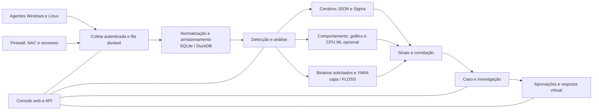

<p align="center"></p>

# VATEX LUMINA xSERA

<p align="center"><strong>Veja o sinal. Entenda a história. Coordene a resposta.</strong></p>

<p align="center">
  <a href="../../LICENSE"></a>
  
  
  
</p>

<details open><summary><strong>🌐 Idiomas</strong></summary>

[English](README.en.md) · [한국어](README.ko.md) · [Español](README.es.md) · [Português (Brasil)](README.pt-BR.md) · [Français](README.fr.md) · [Deutsch](README.de.md) · [Italiano](README.it.md) · [Nederlands](README.nl.md) · [Polski](README.pl.md) · [Türkçe](README.tr.md) · [Русский](README.ru.md) · [Українська](README.uk.md) · [العربية](README.ar.md) · [हिन्दी](README.hi.md) · [বাংলা](README.bn.md) · [Bahasa Indonesia](README.id.md) · [Tiếng Việt](README.vi.md) · [ไทย](README.th.md) · [日本語](README.ja.md) · [简体中文](README.zh-CN.md)

</details>

xSERA é um projeto de servidor XDR e agente de endpoint orientado a CPU que conecta fluxos de trabalho de coleta, detecção, investigação e resposta de telemetria. O console web reúne operações, pesquisa, detecção de conteúdo e casos.

> **Status de desenvolvimento e validação**
>
> Este repositório contém fontes baseadas na versão 0.20.0 e alterações subsequentes. Destina-se ao desenvolvimento e avaliação, não a uma declaração de disponibilidade geral. As instruções de inicialização abaixo bloqueiam ações que modificam os hosts reais. Os exemplos de resposta utilizam dispositivos virtuais; integrações reais e ações de host precisam de configuração separada e validação de campo.

> 🌐 Este README traduzido foi gerado com tradução automática e não foi revisado por um tradutor profissional. O README em inglês é a referência se o texto for diferente. A interface do produto e outras documentações não estão necessariamente disponíveis neste idioma.

## 🧭 Arquitetura

De eventos independentes a evidências e um caso acionável:



Uma confirmação de ingestão significa que o evento atingiu a fila durável; isso não significa que a indexação ou detecção esteja completa. As pontuações de ML e as correspondências YARA são evidências para investigação, não prova de maldade ou autoridade para bloquear um host.

## 🧩 O que há neste repositório

| Componente | Caminho | Objetivo |
| --- | --- | --- |
| Servidor e API | `sapientia/` | Fluxos de trabalho de ingestão, autenticação, armazenamento, pesquisa, detecção, casos e resposta. |
| Consola Web | `sapientia/web/` | Operações, pesquisa de eventos, regras, dados de ML, investigações e respostas. |
| Agente de terminal | `sapientia/endpoint_agent/` | Coleta, registro e comunicação do servidor Windows e Linux. |
| Conteúdo de detecção | `sapientia/catalogs/` | Regras JSON nativas, informações ATT&CK e conteúdo YARA/capa com procedência e licenças. |
| Ferramentas e exemplos de implantação | `tools/`, `deploy/` | Pacote de agentes, encaminhadores de sensores opcionais, telemetria virtual e exemplos de serviços. |
| Documentação e testes | `docs/`, `tests/` | Contratos operacionais, proveniência de conteúdo e testes de regressão. |

A biblioteca incluída inclui 950 regras de cenários originais. A inclusão não significa que todas as políticas sejam habilitadas em uma nova instalação. Os exemplos de treinamento sintético não estabelecem a precisão da detecção no mundo real. [Datasets](../../docs/console-datasets-0.15.md)

## 🚀 Início rápido

Os exemplos abaixo iniciam uma instância local de servidor único. Eles exigem Python 3.12 e acesso à rede para instalar pacotes. Para planejamento de produção, configure controles de acesso, TLS e backups separadamente.

### Janelas

Execute no PowerShell:

```powershell
git clone https://github.com/lastime1650/VateX_LUMINA_xSERA.git
cd VateX_LUMINA_xSERA
py -3.12 -m venv .venv
.\.venv\Scripts\python.exe -m pip install -r requirements-lock.txt
.\.venv\Scripts\python.exe -m pip install --no-deps -e .
.\start.cmd
```

Se o iniciador do Python não conseguir encontrar a versão 3.12, use o caminho completo para o executável do Python 3.12 instalado para criar o ambiente virtual. Abra o console local e crie a primeira conta de administrador: **http://127.0.0.1:8787**

O script de inicialização do Windows cria certificados TLS de agente local em private/loopback-tls/ e usa a porta 8788 somente local. Esses certificados não são um sistema confiável para implantação remota.

### Linux

```bash
git clone https://github.com/lastime1650/VateX_LUMINA_xSERA.git
cd VateX_LUMINA_xSERA
python3.12 -m venv .venv
.venv/bin/python -m pip install -r requirements-lock.txt
.venv/bin/python -m pip install --no-deps -e .
export SAPIENTIA_BLOCK_NATIVE_RESPONSE=1
.venv/bin/python -m sapientia --data ./data serve --host 127.0.0.1 --port 8787
```

O exemplo do Linux inicia o console e a ingestão de HTTP local; ele não inicia um ouvinte do agente TLS. Os agentes remotos exigem um ouvinte TLS configurado explicitamente, uma autoridade de certificação confiável, pacotes assinados, uma chave de assinatura gerenciada externamente e uma chave pública confiável separada. Leia a documentação do agente antes da implantação. [Agent signing](../../docs/agent-package-integrity.md) · [Agent](../../sapientia/endpoint_agent/README.txt)

Abra o console local e crie a primeira conta de administrador: **http://127.0.0.1:8787**

Os dados são armazenados em data/ por padrão. Não confirme dados/, privadas/, chaves de ingestão ou chaves privadas de certificado. Não exponha o console HTTP local à Internet; o acesso externo requer TLS validado e controle de acesso explícito.

## 🔎 Da telemetria à resposta

1. Conecte fontes. Crie um índice e uma chave de ingestão restrita no console ou inscreva um agente assinado. Configure entradas e analisadores suportados para firewall, NAC e logs de sensores.
2. Ingerir eventos. Envie JSON para o endpoint de eventos usando a chave restrita. Forneça segredos por meio de uma variável de ambiente ou de um gerenciador de segredos. Este exemplo é local:

   ```bash
   curl -X POST http://127.0.0.1:8787/api/v1/events \
     -H "Authorization: Bearer $XSERA_INGEST_KEY" \
     -H "Content-Type: application/json" \
     --data '{"events":[{"event_id":"demo-001","index":"main","source":"demo","sourcetype":"json","host":"endpoint-01","severity":"info","message":"Example telemetry","raw":{"event":{"action":"process_created"}}}]}'
   ```

   Substitua a variável de ambiente por uma chave de ingestão restrita válida. Uma resposta de fila bem-sucedida não garante que esta amostra produzirá uma detecção ou caso.

3. Configurar a detecção. Revise e habilite regras de cenário JSON nativo. As regras Sigma seguem importação, conversão, validação, revisão independente e ativação e, em seguida, são executadas no mesmo mecanismo de regras JSON nativo. Os conjuntos de dados e modelos de CPU ML requerem treinamento, avaliação e aprovação explícitos.
4. Investigue casos. Examine os sinais de detecção, eventos de origem e evidências de correlação. Os binários do processo solicitado podem ser analisados ​​com YARA; capa e FLOSS são motores opcionais instalados separadamente.
5. Revise a resposta. Inspecione as aprovações, a execução e os resultados do playbook. O perfil de inicialização bloqueia ações reais de modificação do host e a resposta virtual incluída não é uma ação real do dispositivo.

## 🧪 Mecanismos opcionais e limites de validação

O servidor base funciona sem PyTorch. CPU ML, conversão Sigma YAML, capa/FLOSS e sensores externos requerem dependências opcionais ou instalação e configuração separadas. Siga seus procedimentos de verificação e aprovação independente.

Em um instantâneo da versão 0.20.0 anterior, uma carga sintética de cerca de 50 eventos por segundo produziu detecção P95 de 35,95 segundos e criação de caso P95 de 25,95 segundos, perdendo os respectivos alvos de 2 e 5 segundos. Este repositório contém alterações de origem subsequentes, portanto, a regressão completa anterior não certifica este commit. A precisão da detecção, falsos positivos, carga sustentada e respostas reais requerem validação de campo separada.

## 📚 Documentação adicional

Esses documentos vinculados podem estar disponíveis apenas em coreano ou inglês.

[Sigma / fusion](../../docs/fusion-sigma-0.18.txt) · [YARA](../../docs/yara-0.16.txt) · [CPU ML](../../docs/CPU_ML_RUNTIME.md) · [Datasets](../../docs/console-datasets-0.15.md) · [Virtual response](../../docs/VIRTUAL_RESPONSE_OPERATIONAL_QUALIFICATION.md) · [Agent signing](../../docs/agent-package-integrity.md) · [Agent](../../sapientia/endpoint_agent/README.txt) · [Security](../../SECURITY.md)

## ⚖️ Licença e segurança

O código de propriedade do projeto e as regras originais e o código do agente para os quais os direitos de redistribuição foram confirmados são fornecidos no Apache-2.0. As regras de terceiros, os materiais e as bibliotecas da ATT&CK mantêm seus próprios termos. Revise os avisos e as informações de licença de terceiros.

[Apache-2.0](../../LICENSE) · [NOTICE](../../NOTICE) · [Third-party notices](../../THIRD_PARTY_NOTICES.md) · [SECURITY](../../SECURITY.md)

Relate vulnerabilidades por meio do canal de denúncia privado descrito na política de segurança. Não publique credenciais ou dados de clientes em edições públicas.

Referências de design README: [Wazuh](https://github.com/wazuh/wazuh/blob/main/README.md) · [Velociraptor](https://github.com/Velocidex/velociraptor/blob/master/README.md)
