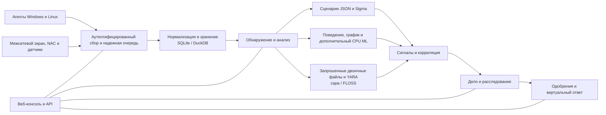

<p align="center"></p>

# VATEX LUMINA xSERA

<p align="center"><strong>Смотрите сигнал. Поймите историю. Координируйте ответ.</strong></p>

<p align="center">
  <a href="../../LICENSE"></a>
  
  
  
</p>

<details open><summary><strong>🌐 Языки</strong></summary>

[English](README.en.md) · [한국어](README.ko.md) · [Español](README.es.md) · [Português (Brasil)](README.pt-BR.md) · [Français](README.fr.md) · [Deutsch](README.de.md) · [Italiano](README.it.md) · [Nederlands](README.nl.md) · [Polski](README.pl.md) · [Türkçe](README.tr.md) · [Русский](README.ru.md) · [Українська](README.uk.md) · [العربية](README.ar.md) · [हिन्दी](README.hi.md) · [বাংলা](README.bn.md) · [Bahasa Indonesia](README.id.md) · [Tiếng Việt](README.vi.md) · [ไทย](README.th.md) · [日本語](README.ja.md) · [简体中文](README.zh-CN.md)

</details>

xSERA — это проект XDR-сервера и агента конечных точек, ориентированный на ЦП, который объединяет рабочие процессы сбора, обнаружения, расследования и реагирования телеметрии. Веб-консоль объединяет операции, поиск, обнаружение контента и дела.

> **Статус разработки и проверки**
>
> Этот репозиторий содержит исходный код на основе версии 0.20.0 и последующих изменений. Он предназначен для разработки и оценки, а не для декларации общедоступности. Приведенные ниже инструкции по запуску блокируют действия, изменяющие фактические хосты. В примерах ответов используются виртуальные устройства; реальные интеграции и действия хоста требуют отдельной настройки и проверки полей.

> 🌐 Этот переведенный файл README был создан с помощью машинного перевода и не проверялся профессиональным переводчиком. Если формулировки отличаются, можно использовать английский README. Интерфейс продукта и другая документация не обязательно доступны на этом языке.

## 🧭 Архитектура

От независимых событий к доказательствам и действенному делу:



Подтверждение приема означает, что событие достигло постоянной очереди; это не означает, что индексация или обнаружение завершены. Оценки ML и совпадения YARA являются доказательством для расследования, а не доказательством злонамеренности или полномочий блокировать хост.

## 🧩 Что находится в этом репозитории

| Компонент | Путь | Цель |
| --- | --- | --- |
| Сервер и API | `sapientia/` | Рабочие процессы приема, аутентификации, хранения, поиска, обнаружения, обращений и ответов. |
| Веб-консоль | `sapientia/web/` | Операции, поиск событий, правила, данные ОД, расследования и реагирование. |
| Агент конечной точки | `sapientia/endpoint_agent/` | Сбор, регистрация и связь с сервером для Windows и Linux. |
| Содержание обнаружения | `sapientia/catalogs/` | Собственные правила JSON, информация ATT&CK и контент YARA/capa с указанием происхождения и лицензий. |
| Инструменты и примеры развертывания | `tools/`, `deploy/` | Упаковка агентов, дополнительные датчики пересылки, виртуальная телеметрия и примеры услуг. |
| Документация и тесты | `docs/`, `tests/` | Операционные контракты, происхождение контента и регрессионные тесты. |

Входящая в комплект библиотека включает 950 оригинальных правил сценариев. Включение не означает, что каждая политика включается при новой установке. Примеры синтетического обучения не обеспечивают реальную точность обнаружения. [Datasets](../../docs/console-datasets-0.15.md)

## 🚀 Быстрый старт

В приведенных ниже примерах запускается локальный односерверный экземпляр. Для установки пакетов им требуется Python 3.12 и доступ к сети. Для планирования производства настройте элементы управления доступом, TLS и резервное копирование отдельно.

### Окна

Запустите в PowerShell:

```powershell
git clone https://github.com/lastime1650/VateX_LUMINA_xSERA.git
cd VateX_LUMINA_xSERA
py -3.12 -m venv .venv
.\.venv\Scripts\python.exe -m pip install -r requirements-lock.txt
.\.venv\Scripts\python.exe -m pip install --no-deps -e .
.\start.cmd
```

Если средство запуска Python не может найти версию 3.12, используйте полный путь к установленному исполняемому файлу Python 3.12 для создания виртуальной среды. Откройте локальную консоль и создайте первую учетную запись администратора: **http://127.0.0.1:8787**

Сценарий запуска Windows создает сертификаты TLS локального агента в файле Private/loopback-tls/ и использует только локальный порт 8788. Эти сертификаты не являются системой доверия для удаленного развертывания.

### Линукс

```bash
git clone https://github.com/lastime1650/VateX_LUMINA_xSERA.git
cd VateX_LUMINA_xSERA
python3.12 -m venv .venv
.venv/bin/python -m pip install -r requirements-lock.txt
.venv/bin/python -m pip install --no-deps -e .
export SAPIENTIA_BLOCK_NATIVE_RESPONSE=1
.venv/bin/python -m sapientia --data ./data serve --host 127.0.0.1 --port 8787
```

Пример Linux запускает консоль и локальный прием HTTP; он не запускает прослушиватель агента TLS. Удаленным агентам требуется явно настроенный прослушиватель TLS, доверенный центр сертификации, подписанные пакеты, ключ подписи, управляемый извне, и отдельный доверенный открытый ключ. Перед развертыванием прочтите документацию по агенту. [Agent signing](../../docs/agent-package-integrity.md) · [Agent](../../sapientia/endpoint_agent/README.txt)

Откройте локальную консоль и создайте первую учетную запись администратора: **http://127.0.0.1:8787**

По умолчанию данные хранятся в data/. Не сохраняйте данные/, частные/, ключи приема или закрытые ключи сертификата. Не открывайте локальную консоль HTTP для доступа в Интернет; внешний доступ требует проверенного TLS и явного контроля доступа.

## 🔎 От телеметрии к реагированию

1. Подключите источники. Создайте индекс и ключ ограниченного приема в консоли или зарегистрируйте подписанный агент. Настройте поддерживаемые входы и анализаторы для журналов брандмауэра, NAC и датчиков.
2. Принимать события. Отправьте JSON в конечную точку событий, используя ограниченный ключ. Предоставляйте секреты через переменную среды или менеджера секретов. Этот пример является локальным:

   ```bash
   curl -X POST http://127.0.0.1:8787/api/v1/events \
     -H "Authorization: Bearer $XSERA_INGEST_KEY" \
     -H "Content-Type: application/json" \
     --data '{"events":[{"event_id":"demo-001","index":"main","source":"demo","sourcetype":"json","host":"endpoint-01","severity":"info","message":"Example telemetry","raw":{"event":{"action":"process_created"}}}]}'
   ```

   Замените переменную среды допустимым ключом ограниченного приема. Успешный ответ очереди не гарантирует, что этот образец приведет к обнаружению или случаю.

3. Настройте обнаружение. Просмотрите и включите собственные правила сценариев JSON. Правила Sigma следуют за импортом, преобразованием, проверкой, независимой проверкой и активацией, а затем запускаются в том же собственном механизме правил JSON. Наборы данных и модели CPU ML требуют тщательного обучения, оценки и утверждения.
4. Расследовать дела. Изучите сигналы обнаружения, исходные события и доказательства корреляции. Запрошенные двоичные файлы процессов можно проанализировать с помощью YARA; capa и FLOSS — дополнительные двигатели, устанавливаемые отдельно.
5. Просмотрите ответ. Проверяйте утверждения, исполнение и результаты сценариев. Профиль запуска блокирует фактические действия по изменению хоста, а включенный виртуальный ответ не является реальным действием устройства.

## 🧪 Дополнительные механизмы и пределы проверки

Базовый сервер работает без PyTorch. CPU ML, преобразование Sigma YAML, capa/FLOSS и внешние датчики требуют дополнительных зависимостей или отдельной установки и настройки. Следуйте их процедурам проверки и независимого одобрения.

В предыдущем моментальном снимке выпуска 0.20.0 синтетическая нагрузка около 50 событий в секунду приводила к обнаружению P95 за 35,95 секунды и созданию дела P95 за 25,95 секунды, при этом не достигались соответствующие целевые значения в 2 и 5 секунд. Этот репозиторий содержит последующие изменения исходного кода, поэтому более ранняя полная регрессия не подтверждает эту фиксацию. Точность обнаружения, ложные срабатывания, длительная нагрузка и фактические ответы требуют отдельной проверки на местах.

## 📚 Дополнительная документация

Эти связанные документы могут быть доступны только на корейском или английском языке.

[Sigma / fusion](../../docs/fusion-sigma-0.18.txt) · [YARA](../../docs/yara-0.16.txt) · [CPU ML](../../docs/CPU_ML_RUNTIME.md) · [Datasets](../../docs/console-datasets-0.15.md) · [Virtual response](../../docs/VIRTUAL_RESPONSE_OPERATIONAL_QUALIFICATION.md) · [Agent signing](../../docs/agent-package-integrity.md) · [Agent](../../sapientia/endpoint_agent/README.txt) · [Security](../../SECURITY.md)

## ⚖️ Лицензия и безопасность

Код, принадлежащий проекту, а также исходные правила и код агента, для которых были подтверждены права на распространение, предоставляются в рамках Apache-2.0. Сторонние правила, материалы ATT&CK и библиотеки сохраняют свои собственные условия. Просмотрите уведомления и информацию о сторонних лицензиях.

[Apache-2.0](../../LICENSE) · [NOTICE](../../NOTICE) · [Third-party notices](../../THIRD_PARTY_NOTICES.md) · [SECURITY](../../SECURITY.md)

Сообщайте об уязвимостях через частный канал отчетности, описанный в политике безопасности. Не публикуйте учетные данные или данные клиентов в публичных выпусках.

Ссылки на дизайн README: [Wazuh](https://github.com/wazuh/wazuh/blob/main/README.md) · [Velociraptor](https://github.com/Velocidex/velociraptor/blob/master/README.md)
