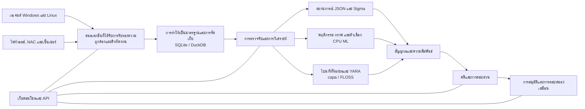

<p align="center"></p>

# VATEX LUMINA xSERA

<p align="center"><strong>ดูสัญญาณ. เข้าใจเรื่องราว. ประสานการตอบรับ.</strong></p>

<p align="center">
  <a href="../../LICENSE"></a>
  
  
  
</p>

<details open><summary><strong>🌐 ภาษา</strong></summary>

[English](README.en.md) · [한국어](README.ko.md) · [Español](README.es.md) · [Português (Brasil)](README.pt-BR.md) · [Français](README.fr.md) · [Deutsch](README.de.md) · [Italiano](README.it.md) · [Nederlands](README.nl.md) · [Polski](README.pl.md) · [Türkçe](README.tr.md) · [Русский](README.ru.md) · [Українська](README.uk.md) · [العربية](README.ar.md) · [हिन्दी](README.hi.md) · [বাংলা](README.bn.md) · [Bahasa Indonesia](README.id.md) · [Tiếng Việt](README.vi.md) · [ไทย](README.th.md) · [日本語](README.ja.md) · [简体中文](README.zh-CN.md)

</details>

xSERA เป็นโปรเจ็กต์เซิร์ฟเวอร์ XDR ที่เน้น CPU และเอเจนต์ปลายทางที่เชื่อมต่อเวิร์กโฟลว์การรวบรวม การตรวจจับ การตรวจสอบ และการตอบสนองทางไกล เว็บคอนโซลนำการดำเนินการ การค้นหา การตรวจจับเนื้อหา และเคสต่างๆ เข้าด้วยกัน

> **สถานะการพัฒนาและการตรวจสอบ**
>
> พื้นที่เก็บข้อมูลนี้มีแหล่งที่มาตามเวอร์ชัน 0.20.0 และการเปลี่ยนแปลงที่ตามมา มีจุดมุ่งหมายเพื่อการพัฒนาและประเมินผล ไม่ใช่การประกาศความพร้อมใช้งานทั่วไป คำแนะนำการเปิดใช้งานด้านล่างจะบล็อกการกระทำที่แก้ไขโฮสต์จริง ตัวอย่างการตอบสนองใช้อุปกรณ์เสมือน การบูรณาการจริงและการดำเนินการของโฮสต์จำเป็นต้องมีการกำหนดค่าแยกต่างหากและการตรวจสอบภาคสนาม

> 🌐 README ที่แปลนี้สร้างขึ้นด้วยการแปลด้วยเครื่องและไม่ได้รับการตรวจสอบโดยนักแปลมืออาชีพ README ภาษาอังกฤษเป็นข้อมูลอ้างอิงหากถ้อยคำแตกต่างออกไป อินเทอร์เฟซผลิตภัณฑ์และเอกสารประกอบอื่นๆ ไม่จำเป็นต้องมีในภาษานี้

## 🧭 สถาปัตยกรรม

จากเหตุการณ์อิสระสู่หลักฐานและคดีที่สามารถดำเนินการได้:



การรับทราบการนำเข้าหมายถึงกิจกรรมถึงคิวถาวร ไม่ได้หมายความว่าการจัดทำดัชนีหรือการตรวจจับเสร็จสมบูรณ์ คะแนน ML และการจับคู่ YARA เป็นหลักฐานสำหรับการสอบสวน ไม่ใช่ข้อพิสูจน์ถึงความประสงค์ร้ายหรืออำนาจในการบล็อกโฮสต์

## 🧩 อะไรอยู่ในคลังนี้.

| ส่วนประกอบ | เส้นทาง | วัตถุประสงค์ |
| --- | --- | --- |
| เซิร์ฟเวอร์และ API | `sapientia/` | การนำเข้า การรับรองความถูกต้อง การจัดเก็บ การค้นหา การตรวจหา เคส และเวิร์กโฟลว์การตอบสนอง |
| เว็บคอนโซล | `sapientia/web/` | การปฏิบัติการ การค้นหาเหตุการณ์ กฎ ข้อมูล ML การสืบสวน และการตอบโต้ |
| ตัวแทนปลายทาง | `sapientia/endpoint_agent/` | การรวบรวม Windows และ Linux การลงทะเบียน และการสื่อสารเซิร์ฟเวอร์ |
| เนื้อหาการตรวจจับ | `sapientia/catalogs/` | กฎ JSON ดั้งเดิม ข้อมูล ATT&CK และเนื้อหา YARA/capa พร้อมแหล่งที่มาและใบอนุญาต |
| เครื่องมือและตัวอย่างการใช้งาน | `tools/`, `deploy/` | บรรจุภัณฑ์ของตัวแทน ตัวส่งต่อเซ็นเซอร์เสริม ตัวอย่างการวัดและการบริการทางไกลเสมือน |
| เอกสารและการทดสอบ | `docs/`, `tests/` | สัญญาการดำเนินงาน การทดสอบแหล่งที่มาของเนื้อหา และการทดสอบการถดถอย |

ไลบรารีแบบรวมประกอบด้วยกฎสถานการณ์ดั้งเดิม 950 กฎ การรวมไม่ได้หมายความว่าทุกนโยบายจะเปิดใช้งานในการติดตั้งใหม่ ตัวอย่างการฝึกอบรมสังเคราะห์ไม่ได้สร้างความแม่นยำในการตรวจจับในโลกแห่งความเป็นจริง [Datasets](../../docs/console-datasets-0.15.md)

## 🚀 เริ่มต้นอย่างรวดเร็ว

ตัวอย่างด้านล่างเริ่มต้นอินสแตนซ์เซิร์ฟเวอร์เดียวในเครื่อง พวกเขาต้องการ Python 3.12 และการเข้าถึงเครือข่ายเพื่อติดตั้งแพ็คเกจ สำหรับการวางแผนการผลิต ให้กำหนดค่าการควบคุมการเข้าถึง TLS และการสำรองข้อมูลแยกกัน

### หน้าต่าง

ทำงานใน PowerShell:

```powershell
git clone https://github.com/lastime1650/VateX_LUMINA_xSERA.git
cd VateX_LUMINA_xSERA
py -3.12 -m venv .venv
.\.venv\Scripts\python.exe -m pip install -r requirements-lock.txt
.\.venv\Scripts\python.exe -m pip install --no-deps -e .
.\start.cmd
```

หากตัวเรียกใช้งาน Python ไม่พบเวอร์ชัน 3.12 ให้ใช้พาธแบบเต็มไปยังไฟล์ปฏิบัติการ Python 3.12 ที่ติดตั้งไว้เพื่อสร้างสภาพแวดล้อมเสมือน เปิดคอนโซลท้องถิ่นและสร้างบัญชีผู้ดูแลระบบบัญชีแรก: **http://127.0.0.1:8787**

สคริปต์เรียกใช้งาน Windows สร้างใบรับรอง TLS ของเอเจนต์ในเครื่องใน private/loopback-tls/ และใช้พอร์ตเฉพาะในเครื่อง 8788 ใบรับรองเหล่านี้ไม่ใช่ระบบที่เชื่อถือได้สำหรับการปรับใช้ระยะไกล

### ลินุกซ์

```bash
git clone https://github.com/lastime1650/VateX_LUMINA_xSERA.git
cd VateX_LUMINA_xSERA
python3.12 -m venv .venv
.venv/bin/python -m pip install -r requirements-lock.txt
.venv/bin/python -m pip install --no-deps -e .
export SAPIENTIA_BLOCK_NATIVE_RESPONSE=1
.venv/bin/python -m sapientia --data ./data serve --host 127.0.0.1 --port 8787
```

ตัวอย่าง Linux เริ่มต้นคอนโซลและการนำเข้า HTTP ในเครื่อง มันไม่ได้เริ่มต้น Listener ตัวแทน TLS ตัวแทนระยะไกลจำเป็นต้องมีผู้ฟัง TLS ที่กำหนดค่าไว้อย่างชัดเจน, CA ที่เชื่อถือได้, แพ็คเกจที่เซ็นชื่อ, คีย์การเซ็นชื่อที่ได้รับการจัดการจากภายนอก และคีย์สาธารณะที่เชื่อถือได้แยกต่างหาก อ่านเอกสารตัวแทนก่อนที่จะปรับใช้ [Agent signing](../../docs/agent-package-integrity.md) · [Agent](../../sapientia/endpoint_agent/README.txt)

เปิดคอนโซลท้องถิ่นและสร้างบัญชีผู้ดูแลระบบบัญชีแรก: **http://127.0.0.1:8787**

ข้อมูลถูกเก็บไว้ใน data/ ตามค่าเริ่มต้น อย่าส่งข้อมูล/, ส่วนตัว/, คีย์การนำเข้าหรือคีย์ส่วนตัวของใบรับรอง อย่าเปิดเผยคอนโซล HTTP ในเครื่องกับอินเทอร์เน็ต การเข้าถึงจากภายนอกต้องมี TLS ที่ได้รับการตรวจสอบและการควบคุมการเข้าถึงที่ชัดเจน

## 🔎 จากการตรวจวัดระยะไกลไปจนถึงการตอบสนอง

1. เชื่อมต่อแหล่งที่มา สร้างดัชนีและคีย์การส่งผ่านข้อมูลแบบจำกัดในคอนโซล หรือลงทะเบียนตัวแทนที่ลงนาม กำหนดค่าอินพุตและตัวแยกวิเคราะห์ที่รองรับสำหรับไฟร์วอลล์, NAC และบันทึกเซ็นเซอร์
2. นำเข้าเหตุการณ์ ส่ง JSON ไปยังจุดสิ้นสุดของเหตุการณ์โดยใช้คีย์ที่จำกัด จัดหาข้อมูลลับผ่านตัวแปรสภาพแวดล้อมหรือผู้จัดการข้อมูลลับ ตัวอย่างนี้เป็นแบบท้องถิ่น:

   ```bash
   curl -X POST http://127.0.0.1:8787/api/v1/events \
     -H "Authorization: Bearer $XSERA_INGEST_KEY" \
     -H "Content-Type: application/json" \
     --data '{"events":[{"event_id":"demo-001","index":"main","source":"demo","sourcetype":"json","host":"endpoint-01","severity":"info","message":"Example telemetry","raw":{"event":{"action":"process_created"}}}]}'
   ```

   แทนที่ตัวแปรสภาพแวดล้อมด้วยคีย์การส่งผ่านข้อมูลแบบจำกัดที่ถูกต้อง การตอบกลับคิวที่สำเร็จไม่ได้รับประกันว่าตัวอย่างนี้จะสร้างการตรวจจับหรือเคส

3. กำหนดค่าการตรวจจับ ตรวจสอบและเปิดใช้งานกฎสถานการณ์ JSON ดั้งเดิม กฎ Sigma เป็นไปตามการนำเข้า การแปลง การตรวจสอบความถูกต้อง การตรวจสอบและการเปิดใช้งานโดยอิสระ จากนั้นจึงทำงานในกลไกกฎ JSON ดั้งเดิมเดียวกัน ชุดข้อมูลและโมเดล CPU ML ต้องการการฝึกอบรม การประเมิน และการอนุมัติที่ชัดเจน
4. สอบสวนกรณีต่างๆ ตรวจสอบสัญญาณการตรวจจับ เหตุการณ์แหล่งที่มา และหลักฐานความสัมพันธ์ ไบนารีกระบวนการที่ร้องขอสามารถวิเคราะห์ได้ด้วย YARA capa และ FLOSS เป็นเครื่องยนต์เสริมที่ติดตั้งแยกกัน
5. ตรวจสอบการตอบกลับ ตรวจสอบการอนุมัติ Playbook การดำเนินการ และผลลัพธ์ โปรไฟล์การเปิดตัวจะบล็อกการดำเนินการแก้ไขโฮสต์จริง และการตอบสนองเสมือนที่รวมไว้นั้นไม่ใช่การทำงานของอุปกรณ์จริง

## 🧪 เอ็นจิ้นเสริมและขีดจำกัดการตรวจสอบ

เซิร์ฟเวอร์ฐานทำงานโดยไม่มี PyTorch CPU ML, การแปลง Sigma YAML, capa/FLOSS และเซ็นเซอร์ภายนอกจำเป็นต้องมีการพึ่งพาเพิ่มเติมหรือการติดตั้งและการกำหนดค่าแยกต่างหาก ปฏิบัติตามขั้นตอนการตรวจสอบและการอนุมัติที่เป็นอิสระ

ในภาพรวมการเปิดตัว 0.20.0 ก่อนหน้านี้ โหลดสังเคราะห์ประมาณ 50 เหตุการณ์ต่อวินาทีสร้างการตรวจจับ P95 ที่ 35.95 วินาที และการสร้างเคส P95 ที่ 25.95 วินาที โดยพลาดเป้าหมายตามลำดับ 2 และ 5 วินาที พื้นที่เก็บข้อมูลนี้มีการเปลี่ยนแปลงแหล่งที่มาที่ตามมา ดังนั้นการถดถอยแบบเต็มก่อนหน้านี้จึงไม่รับรองการคอมมิตนี้ ความแม่นยำในการตรวจจับ ผลบวกลวง โหลดอย่างต่อเนื่อง และการตอบสนองจริง จำเป็นต้องมีการตรวจสอบภาคสนามแยกต่างหาก

## 📚 เอกสารเพิ่มเติม

เอกสารที่เชื่อมโยงเหล่านี้อาจมีเฉพาะในภาษาเกาหลีหรือภาษาอังกฤษเท่านั้น

[Sigma / fusion](../../docs/fusion-sigma-0.18.txt) · [YARA](../../docs/yara-0.16.txt) · [CPU ML](../../docs/CPU_ML_RUNTIME.md) · [Datasets](../../docs/console-datasets-0.15.md) · [Virtual response](../../docs/VIRTUAL_RESPONSE_OPERATIONAL_QUALIFICATION.md) · [Agent signing](../../docs/agent-package-integrity.md) · [Agent](../../sapientia/endpoint_agent/README.txt) · [Security](../../SECURITY.md)

## ⚖️ ใบอนุญาตและความปลอดภัย

รหัสที่เป็นของโปรเจ็กต์และกฎดั้งเดิมและรหัสตัวแทนที่ยืนยันสิทธิ์ในการแจกจ่ายซ้ำนั้นมีให้ภายใต้ Apache-2.0 กฎของบุคคลที่สาม สื่อของ ATT&CK และไลบรารีจะคงเงื่อนไขของตนเอง ตรวจสอบประกาศและข้อมูลใบอนุญาตของบุคคลที่สาม

[Apache-2.0](../../LICENSE) · [NOTICE](../../NOTICE) · [Third-party notices](../../THIRD_PARTY_NOTICES.md) · [SECURITY](../../SECURITY.md)

รายงานช่องโหว่ผ่านช่องทางการรายงานส่วนตัวที่อธิบายไว้ในนโยบายความปลอดภัย ห้ามเผยแพร่ข้อมูลประจำตัวหรือข้อมูลลูกค้าในประเด็นสาธารณะ

การอ้างอิงการออกแบบ README: [Wazuh](https://github.com/wazuh/wazuh/blob/main/README.md) · [Velociraptor](https://github.com/Velocidex/velociraptor/blob/master/README.md)
