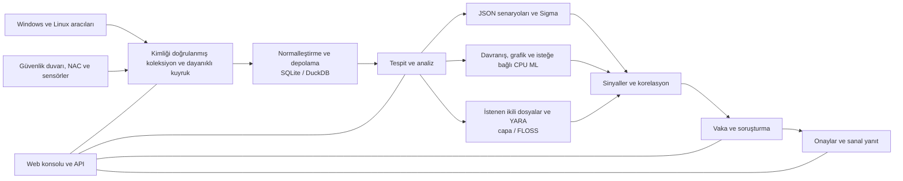

<p align="center"></p>

# VATEX LUMINA xSERA

<p align="center"><strong>Sinyale bakın. Hikayeyi anlayın. Yanıtı koordine edin.</strong></p>

<p align="center">
  <a href="../../LICENSE"></a>
  
  
  
</p>

<details open><summary><strong>🌐 Diller</strong></summary>

[English](README.en.md) · [한국어](README.ko.md) · [Español](README.es.md) · [Português (Brasil)](README.pt-BR.md) · [Français](README.fr.md) · [Deutsch](README.de.md) · [Italiano](README.it.md) · [Nederlands](README.nl.md) · [Polski](README.pl.md) · [Türkçe](README.tr.md) · [Русский](README.ru.md) · [Українська](README.uk.md) · [العربية](README.ar.md) · [हिन्दी](README.hi.md) · [বাংলা](README.bn.md) · [Bahasa Indonesia](README.id.md) · [Tiếng Việt](README.vi.md) · [ไทย](README.th.md) · [日本語](README.ja.md) · [简体中文](README.zh-CN.md)

</details>

xSERA, telemetri toplama, algılama, araştırma ve yanıt iş akışlarını birbirine bağlayan CPU odaklı bir XDR sunucusu ve uç nokta aracısı projesidir. Web konsolu işlemleri, aramayı, tespit içeriğini ve vakaları bir araya getirir.

> **Geliştirme ve doğrulama durumu**
>
> Bu depo, 0.20.0 sürümüne ve sonraki değişikliklere dayalı kaynağı içerir. Genel kullanılabilirlik beyanı değil, geliştirme ve değerlendirme amaçlıdır. Aşağıdaki başlatma talimatları, gerçek ana bilgisayarları değiştiren eylemleri engeller. Yanıt örneklerinde sanal cihazlar kullanılır; gerçek entegrasyonlar ve ana bilgisayar eylemleri ayrı yapılandırmaya ve alan doğrulamasına ihtiyaç duyar.

> 🌐 Tercüme edilen bu README, makine çevirisi ile oluşturulmuştur ve profesyonel bir çevirmen tarafından incelenmemiştir. İfadeler farklıysa İngilizce README referanstır. Ürün arayüzü ve diğer belgelerin bu dilde mevcut olması zorunlu değildir.

## 🧭 Mimarlık

Bağımsız olaylardan kanıtlara ve dava edilebilir bir davaya:



Besleme onayı, etkinliğin kalıcı kuyruğa ulaştığı anlamına gelir; indekslemenin veya algılamanın tamamlandığı anlamına gelmez. ML puanları ve YARA eşleşmeleri, kötü niyetli olduğunun veya bir ana bilgisayarı engelleme yetkisinin kanıtı değil, soruşturma kanıtıdır.

## 🧩 Bu depoda neler var

| Bileşen | Yol | Amaç |
| --- | --- | --- |
| Sunucu ve API | `sapientia/` | Alma, kimlik doğrulama, depolama, arama, tespit, vakalar ve yanıt iş akışları. |
| Web konsolu | `sapientia/web/` | Operasyonlar, olay arama, kurallar, ML verileri, araştırmalar ve yanıt. |
| Uç nokta aracısı | `sapientia/endpoint_agent/` | Windows ve Linux toplama, kayıt ve sunucu iletişimi. |
| Algılama içeriği | `sapientia/catalogs/` | Yerel JSON kuralları, ATT&CK bilgileri ve kaynak ve lisanslarla birlikte YARA/capa içeriği. |
| Araçlar ve dağıtım örnekleri | `tools/`, `deploy/` | Aracı paketleme, isteğe bağlı sensör ileticileri, sanal telemetri ve hizmet örnekleri. |
| Dokümantasyon ve testler | `docs/`, `tests/` | İşletim sözleşmeleri, içerik kaynağı ve regresyon testleri. |

Birlikte verilen kitaplık 950 orijinal senaryo kuralı içerir. Dahil edilmesi, her politikanın yeni bir yüklemede etkinleştirildiği anlamına gelmez. Sentetik eğitim örnekleri gerçek dünyadaki algılama doğruluğunu sağlamaz. [Datasets](../../docs/console-datasets-0.15.md)

## 🚀 Hızlı başlangıç

Aşağıdaki örnekler yerel tek sunuculu bir örneği başlatır. Paketleri yüklemek için Python 3.12 ve ağ erişimine ihtiyaç duyarlar. Üretim planlaması için erişim kontrollerini, TLS'yi ve yedeklemeleri ayrı ayrı yapılandırın.

### Windows

PowerShell'de çalıştırın:

```powershell
git clone https://github.com/lastime1650/VateX_LUMINA_xSERA.git
cd VateX_LUMINA_xSERA
py -3.12 -m venv .venv
.\.venv\Scripts\python.exe -m pip install -r requirements-lock.txt
.\.venv\Scripts\python.exe -m pip install --no-deps -e .
.\start.cmd
```

Python başlatıcısı 3.12 sürümünü bulamazsa sanal ortamı oluşturmak için yüklü Python 3.12 yürütülebilir dosyasının tam yolunu kullanın. Yerel konsolu açın ve ilk yönetici hesabını oluşturun: **http://127.0.0.1:8787**

Windows başlatma komut dosyası, özel/döngü-tls/ konumunda yerel aracı TLS sertifikaları oluşturur ve yalnızca yerel bağlantı noktası 8788'i kullanır. Bu sertifikalar, uzaktan dağıtım için bir güven sistemi değildir.

### Linux

```bash
git clone https://github.com/lastime1650/VateX_LUMINA_xSERA.git
cd VateX_LUMINA_xSERA
python3.12 -m venv .venv
.venv/bin/python -m pip install -r requirements-lock.txt
.venv/bin/python -m pip install --no-deps -e .
export SAPIENTIA_BLOCK_NATIVE_RESPONSE=1
.venv/bin/python -m sapientia --data ./data serve --host 127.0.0.1 --port 8787
```

Linux örneği konsolu ve yerel HTTP alımını başlatır; TLS aracısı dinleyicisini başlatmaz. Uzak aracılar, açıkça yapılandırılmış bir TLS dinleyicisine, güvenilir CA'ya, imzalı paketlere, harici olarak yönetilen bir imzalama anahtarına ve ayrı bir güvenilir ortak anahtara ihtiyaç duyar. Dağıtımdan önce aracı belgelerini okuyun. [Agent signing](../../docs/agent-package-integrity.md) · [Agent](../../sapientia/endpoint_agent/README.txt)

Yerel konsolu açın ve ilk yönetici hesabını oluşturun: **http://127.0.0.1:8787**

Veriler varsayılan olarak data/ dosyasında saklanır. Veri/, özel/, besleme anahtarlarını veya sertifika özel anahtarlarını teslim etmeyin. Yerel HTTP konsolunu internete maruz bırakmayın; harici erişim, doğrulanmış TLS ve açık erişim kontrolü gerektirir.

## 🔎 Telemetriden yanıta

1. Kaynakları bağlayın. Konsolda bir dizin ve kısıtlı besleme anahtarı oluşturun veya imzalı bir aracıyı kaydedin. Güvenlik duvarı, NAC ve sensör günlükleri için desteklenen girişleri ve ayrıştırıcıları yapılandırın.
2. Olayları alın. Kısıtlı anahtarı kullanarak JSON'u olayların uç noktasına gönderin. Bir ortam değişkeni veya gizli yönetici aracılığıyla sırları sağlayın. Bu örnek yereldir:

   ```bash
   curl -X POST http://127.0.0.1:8787/api/v1/events \
     -H "Authorization: Bearer $XSERA_INGEST_KEY" \
     -H "Content-Type: application/json" \
     --data '{"events":[{"event_id":"demo-001","index":"main","source":"demo","sourcetype":"json","host":"endpoint-01","severity":"info","message":"Example telemetry","raw":{"event":{"action":"process_created"}}}]}'
   ```

   Ortam değişkenini geçerli bir kısıtlı besleme anahtarıyla değiştirin. Başarılı bir kuyruk yanıtı, bu örneğin bir algılama veya vaka üreteceğini garanti etmez.

3. Algılamayı yapılandırın. Yerel JSON senaryosu kurallarını inceleyin ve etkinleştirin. Sigma kuralları içe aktarmayı, dönüştürmeyi, doğrulamayı, bağımsız incelemeyi ve etkinleştirmeyi takip eder ve ardından aynı yerel JSON kural motorunda çalışır. CPU ML veri kümeleri ve modelleri açık eğitim, değerlendirme ve onay gerektirir.
4. Vakaları araştırın. Tespit sinyallerini, kaynak olaylarını ve korelasyon kanıtlarını inceleyin. İstenilen süreç ikili dosyaları YARA ile analiz edilebilir; capa ve FLOSS ayrı ayrı monte edilen isteğe bağlı motorlardır.
5. Yanıtı inceleyin. Başucu kitabı onaylarını, yürütmeyi ve sonuçları inceleyin. Başlatma profili, ana makineyi değiştiren gerçek eylemleri engeller ve dahil edilen sanal yanıt, gerçek bir cihaz eylemi değildir.

## 🧪 İsteğe bağlı motorlar ve doğrulama sınırları

Temel sunucu PyTorch olmadan çalışır. CPU ML, Sigma YAML dönüşümü, kapasite/FLOSS ve harici sensörler isteğe bağlı bağımlılıklar veya ayrı kurulum ve yapılandırma gerektirir. Doğrulama ve bağımsız onay prosedürlerini izleyin.

Önceki bir 0.20.0 sürümü anlık görüntüsünde, saniyede yaklaşık 50 olaydan oluşan bir sentetik yük, 35,95 saniyelik algılama P95'i ve 25,95 saniyelik vaka oluşturma P95'i üretmiş ve ilgili hedeflerin 2 ve 5 saniyesini kaçırmıştı. Bu depo sonraki kaynak değişikliklerini içerir, dolayısıyla daha önceki tam regresyon bu taahhüdü onaylamaz. Tespit doğruluğu, yanlış pozitifler, sürekli yük ve gerçek yanıtlar ayrı saha doğrulaması gerektirir.

## 📚 Daha fazla belge

Bu bağlantılı belgeler yalnızca Korece veya İngilizce olarak mevcut olabilir.

[Sigma / fusion](../../docs/fusion-sigma-0.18.txt) · [YARA](../../docs/yara-0.16.txt) · [CPU ML](../../docs/CPU_ML_RUNTIME.md) · [Datasets](../../docs/console-datasets-0.15.md) · [Virtual response](../../docs/VIRTUAL_RESPONSE_OPERATIONAL_QUALIFICATION.md) · [Agent signing](../../docs/agent-package-integrity.md) · [Agent](../../sapientia/endpoint_agent/README.txt) · [Security](../../SECURITY.md)

## ⚖️ Lisans ve güvenlik

Projeye ait kod ve yeniden dağıtım haklarının onaylandığı orijinal kurallar ve aracı kodu Apache-2.0 kapsamında sağlanmaktadır. Üçüncü taraf kuralları, ATT&CK materyalleri ve kitaplıkları kendi koşullarını korur. Bildirimleri ve üçüncü taraf lisans bilgilerini inceleyin.

[Apache-2.0](../../LICENSE) · [NOTICE](../../NOTICE) · [Third-party notices](../../THIRD_PARTY_NOTICES.md) · [SECURITY](../../SECURITY.md)

Güvenlik açıklarını, güvenlik politikasında açıklanan özel raporlama kanalı aracılığıyla bildirin. Kimlik bilgilerini veya müşteri verilerini kamuya açık konularda yayınlamayın.

README tasarım referansları: [Wazuh](https://github.com/wazuh/wazuh/blob/main/README.md) · [Velociraptor](https://github.com/Velocidex/velociraptor/blob/master/README.md)
