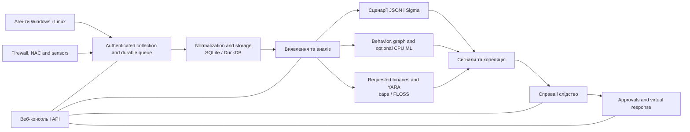

<p align="center"></p>

# VATEX LUMINA xSERA

<p align="center"><strong>Дивіться сигнал. Зрозумійте історію. Скоординуйте відповідь.</strong></p>

<p align="center">
  <a href="../../LICENSE"></a>
  
  
  
</p>

<details open><summary><strong>🌐 Мови</strong></summary>

[English](README.en.md) · [한국어](README.ko.md) · [Español](README.es.md) · [Português (Brasil)](README.pt-BR.md) · [Français](README.fr.md) · [Deutsch](README.de.md) · [Italiano](README.it.md) · [Nederlands](README.nl.md) · [Polski](README.pl.md) · [Türkçe](README.tr.md) · [Русский](README.ru.md) · [Українська](README.uk.md) · [العربية](README.ar.md) · [हिन्दी](README.hi.md) · [বাংলা](README.bn.md) · [Bahasa Indonesia](README.id.md) · [Tiếng Việt](README.vi.md) · [ไทย](README.th.md) · [日本語](README.ja.md) · [简体中文](README.zh-CN.md)

</details>

xSERA — це орієнтований на ЦП сервер XDR і проект агента кінцевої точки, який об’єднує робочі процеси збору телеметрії, виявлення, дослідження та відповіді. Веб-консоль об’єднує операції, пошук, вміст виявлення та випадки.

> **Development and validation status**
>
> Цей репозиторій містить джерело на основі версії 0.20.0 і подальших змін. Він призначений для розробки та оцінки, а не для заяви про загальну доступність. Наведені нижче інструкції щодо запуску блокують дії, які змінюють фактичні хости. The response examples use virtual devices; реальні інтеграції та дії хоста потребують окремої конфігурації та перевірки полів.

> 🌐 Цей переклад README було згенеровано за допомогою машинного перекладу та не було перевірено професійним перекладачем. Англійська README є посиланням, якщо формулювання відрізняється. Інтерфейс продукту та інша документація не обов’язково доступні цією мовою.

## 🧭 Архітектура

Від незалежних подій до доказів і судової справи:



Підтвердження прийому означає, що подія досягла тривалої черги; це не означає, що індексування чи виявлення завершено. Оцінки ML і збіги YARA є доказами для розслідування, а не доказом зловмисності чи права блокувати хост.

## 🧩 What is in this repository

| компонент | шлях | призначення |
| --- | --- | --- |
| Сервер і API | `sapientia/` | Процеси прийому, автентифікації, зберігання, пошуку, виявлення, випадків і відповіді. |
| Веб-консоль | `sapientia/web/` | Операції, пошук подій, правила, дані ML, розслідування та реагування. |
| Агент кінцевої точки | `sapientia/endpoint_agent/` | Windows і Linux збір, реєстрація та зв'язок із сервером. |
| Вміст виявлення | `sapientia/catalogs/` | Власні правила JSON, інформація ATT&CK і вміст YARA/capa з походженням і ліцензіями. |
| Інструменти та приклади розгортання | `tools/`, `deploy/` | Упаковка агента, додаткові пристрої пересилання датчиків, віртуальна телеметрія та приклади обслуговування. |
| Документація та тести | `docs/`, `tests/` | Операційні контракти, походження вмісту та регресійні тести. |

Бібліотека включає 950 оригінальних правил сценарію. Включення не означає, що кожну політику ввімкнено під час нової інсталяції. Синтетичні навчальні приклади не встановлюють точність виявлення в реальному світі. [Datasets](../../docs/console-datasets-0.15.md)

## 🚀 Швидкий старт

Наведені нижче приклади запускають локальний односерверний екземпляр. Для встановлення пакетів їм потрібен Python 3.12 і доступ до мережі. Для планування виробництва налаштуйте керування доступом, TLS і резервне копіювання окремо.

### вікна

Запуск у PowerShell:

```powershell
git clone https://github.com/lastime1650/VateX_LUMINA_xSERA.git
cd VateX_LUMINA_xSERA
py -3.12 -m venv .venv
.\.venv\Scripts\python.exe -m pip install -r requirements-lock.txt
.\.venv\Scripts\python.exe -m pip install --no-deps -e .
.\start.cmd
```

Якщо програма запуску Python не може знайти версію 3.12, використовуйте повний шлях до встановленого виконуваного файлу Python 3.12, щоб створити віртуальне середовище. Відкрийте локальну консоль і створіть перший обліковий запис адміністратора: **http://127.0.0.1:8787**

Сценарій запуску Windows створює сертифікати TLS локального агента в private/loopback-tls/ і використовує лише локальний порт 8788. Ці сертифікати не є системою довіри для віддаленого розгортання.

### Linux

```bash
git clone https://github.com/lastime1650/VateX_LUMINA_xSERA.git
cd VateX_LUMINA_xSERA
python3.12 -m venv .venv
.venv/bin/python -m pip install -r requirements-lock.txt
.venv/bin/python -m pip install --no-deps -e .
export SAPIENTIA_BLOCK_NATIVE_RESPONSE=1
.venv/bin/python -m sapientia --data ./data serve --host 127.0.0.1 --port 8787
```

У прикладі Linux запускається консоль і локальне всмоктування HTTP; він не запускає слухач агента TLS. Для віддалених агентів потрібен явно налаштований слухач TLS, довірений ЦС, підписані пакети, керований зовнішнім ключ підпису та окремий довірений відкритий ключ. Прочитайте документацію агента перед розгортанням. [Agent signing](../../docs/agent-package-integrity.md) · [Agent](../../sapientia/endpoint_agent/README.txt)

Відкрийте локальну консоль і створіть перший обліковий запис адміністратора: **http://127.0.0.1:8787**

За замовчуванням дані зберігаються в data/. Не передавайте дані/, приватні/, ключі прийому або закриті ключі сертифікатів. Не підключайте локальну консоль HTTP до Інтернету; для зовнішнього доступу потрібен перевірений TLS і явний контроль доступу.

## 🔎 Від телеметрії до відповіді

1. Підключіть джерела. Створіть індекс і обмежений ключ прийому на консолі або зареєструйте підписаного агента. Налаштуйте підтримувані входи та аналізатори для брандмауера, NAC і журналів датчиків.
2. Завантажити події. Надішліть JSON до кінцевої точки подій за допомогою обмеженого ключа. Додайте секрети через змінну середовища або менеджер секретів. Цей приклад локальний:

   ```bash
   curl -X POST http://127.0.0.1:8787/api/v1/events \
     -H "Authorization: Bearer $XSERA_INGEST_KEY" \
     -H "Content-Type: application/json" \
     --data '{"events":[{"event_id":"demo-001","index":"main","source":"demo","sourcetype":"json","host":"endpoint-01","severity":"info","message":"Example telemetry","raw":{"event":{"action":"process_created"}}}]}'
   ```

   Замініть змінну середовища дійсним обмеженим ключем передавання. Успішна відповідь черги не гарантує, що цей зразок створить виявлення або випадок.

3. Налаштувати виявлення. Перегляньте та ввімкніть власні правила сценарію JSON. Правила Sigma слідують за імпортом, перетворенням, перевіркою, незалежною перевіркою та активацією, а потім виконуються в тій самій системі правил JSON. Набори даних і моделі CPU ML вимагають чіткого навчання, оцінки та затвердження.
4. Розслідувати справи. Вивчіть сигнали виявлення, вихідні події та докази кореляції. Запитані двійкові файли процесу можна проаналізувати за допомогою YARA; capa та FLOSS є додатковими двигунами, які встановлюються окремо.
5. Перегляньте відповідь. Перевірте схвалення посібника, виконання та результати. Профіль запуску блокує фактичні дії модифікації хоста, а включена віртуальна відповідь не є реальною дією пристрою.

## 🧪 Додаткові двигуни та обмеження перевірки

Базовий сервер працює без PyTorch. CPU ML, перетворення Sigma YAML, capa/FLOSS і зовнішні датчики потребують додаткових залежностей або окремого встановлення та налаштування. Дотримуйтеся процедур їх перевірки та незалежного затвердження.

In a previous 0.20.0 release snapshot, a synthetic load of about 50 events per second produced detection P95 of 35.95 seconds and case-creation P95 of 25.95 seconds, missing the respective targets of 2 and 5 seconds. Це сховище містить наступні вихідні зміни, тому попередня повна регресія не засвідчує цю фіксацію. Точність виявлення, помилкові спрацьовування, постійне навантаження та фактичні відповіді вимагають окремої перевірки поля.

## 📚 Подальша документація

Ці пов’язані документи можуть бути доступні лише корейською або англійською мовами.

[Sigma / fusion](../../docs/fusion-sigma-0.18.txt) · [YARA](../../docs/yara-0.16.txt) · [CPU ML](../../docs/CPU_ML_RUNTIME.md) · [Datasets](../../docs/console-datasets-0.15.md) · [Virtual response](../../docs/VIRTUAL_RESPONSE_OPERATIONAL_QUALIFICATION.md) · [Agent signing](../../docs/agent-package-integrity.md) · [Agent](../../sapientia/endpoint_agent/README.txt) · [Security](../../SECURITY.md)

## ⚖️ Ліцензія та безпека

Код проекту, оригінальні правила та код агента, для яких було підтверджено права на розповсюдження, надаються в Apache-2.0. Правила третіх сторін, матеріали та бібліотеки ATT&CK зберігають власні умови. Перегляньте повідомлення та інформацію про ліцензії третіх сторін.

[Apache-2.0](../../LICENSE) · [NOTICE](../../NOTICE) · [Third-party notices](../../THIRD_PARTY_NOTICES.md) · [SECURITY](../../SECURITY.md)

Повідомляйте про вразливості через приватний канал повідомлень, описаний у політиці безпеки. Не публікуйте облікові дані або дані клієнтів у публічних випусках.

Посилання на дизайн README: [Wazuh](https://github.com/wazuh/wazuh/blob/main/README.md) · [Velociraptor](https://github.com/Velocidex/velociraptor/blob/master/README.md)
