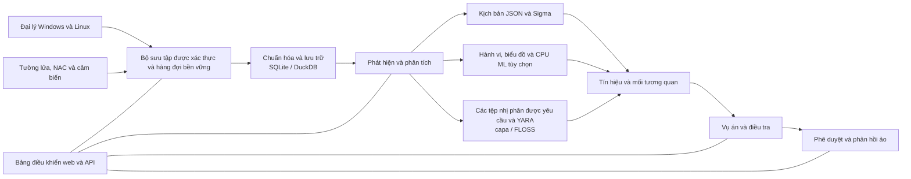

<p align="center"></p>

# VATEX LUMINA xSERA

<p align="center"><strong>Xem tín hiệu. Hiểu câu chuyện. Điều phối phản ứng.</strong></p>

<p align="center">
  <a href="../../LICENSE"></a>
  
  
  
</p>

<details open><summary><strong>🌐 Ngôn ngữ</strong></summary>

[English](README.en.md) · [한국어](README.ko.md) · [Español](README.es.md) · [Português (Brasil)](README.pt-BR.md) · [Français](README.fr.md) · [Deutsch](README.de.md) · [Italiano](README.it.md) · [Nederlands](README.nl.md) · [Polski](README.pl.md) · [Türkçe](README.tr.md) · [Русский](README.ru.md) · [Українська](README.uk.md) · [العربية](README.ar.md) · [हिन्दी](README.hi.md) · [বাংলা](README.bn.md) · [Bahasa Indonesia](README.id.md) · [Tiếng Việt](README.vi.md) · [ไทย](README.th.md) · [日本語](README.ja.md) · [简体中文](README.zh-CN.md)

</details>

xSERA là dự án tác nhân điểm cuối và máy chủ XDR định hướng CPU, kết nối các quy trình thu thập, phát hiện, điều tra và phản hồi từ xa. Bảng điều khiển web kết hợp các hoạt động, tìm kiếm, nội dung phát hiện và các trường hợp.

> **Trạng thái phát triển và xác nhận**
>
> Kho lưu trữ này chứa nguồn dựa trên phiên bản 0.20.0 và những thay đổi tiếp theo. Nó nhằm mục đích phát triển và đánh giá, không phải là tuyên bố về tính khả dụng chung. Hướng dẫn khởi chạy bên dưới chặn các hành động sửa đổi máy chủ thực tế. Các ví dụ phản hồi sử dụng thiết bị ảo; tích hợp thực và hành động của máy chủ cần cấu hình và xác thực trường riêng biệt.

> 🌐 README đã dịch này được tạo bằng bản dịch máy và chưa được dịch giả chuyên nghiệp xem xét. README tiếng Anh là tài liệu tham khảo nếu cách diễn đạt khác nhau. Giao diện sản phẩm và tài liệu khác không nhất thiết phải có sẵn bằng ngôn ngữ này.

## 🧭 Kiến trúc

Từ các sự kiện độc lập đến bằng chứng và vụ án có thể kiện tụng:



Xác nhận nhập có nghĩa là sự kiện đã đạt đến hàng đợi lâu dài; điều đó không có nghĩa là việc lập chỉ mục hoặc phát hiện đã hoàn tất. Điểm ML và kết quả trùng khớp YARA là bằng chứng để điều tra, không phải bằng chứng về tính độc hại hoặc quyền chặn máy chủ.

## 🧩 Có gì trong kho lưu trữ này

| thành phần | Đường dẫn | Mục đích |
| --- | --- | --- |
| Máy chủ và API | `sapientia/` | Quy trình nhập, xác thực, lưu trữ, tìm kiếm, phát hiện, trường hợp và phản hồi. |
| Bảng điều khiển web | `sapientia/web/` | Hoạt động, tìm kiếm sự kiện, quy tắc, dữ liệu ML, điều tra và phản hồi. |
| Đại lý điểm cuối | `sapientia/endpoint_agent/` | Bộ sưu tập Windows và Linux, đăng ký và liên lạc với máy chủ. |
| Nội dung phát hiện | `sapientia/catalogs/` | Quy tắc JSON gốc, thông tin ATT&CK và nội dung YARA/capa có nguồn gốc và giấy phép. |
| Các công cụ và ví dụ triển khai | `tools/`, `deploy/` | Đóng gói đại lý, chuyển tiếp cảm biến tùy chọn, ví dụ dịch vụ và đo từ xa ảo. |
| Tài liệu và thử nghiệm | `docs/`, `tests/` | Hợp đồng vận hành, xuất xứ nội dung và kiểm tra hồi quy. |

Thư viện đi kèm bao gồm 950 quy tắc kịch bản gốc. Việc đưa vào không có nghĩa là mọi chính sách đều được bật khi cài đặt mới. Các ví dụ đào tạo tổng hợp không thiết lập độ chính xác phát hiện trong thế giới thực. [Datasets](../../docs/console-datasets-0.15.md)

## 🚀 Bắt đầu nhanh

Các ví dụ bên dưới bắt đầu một phiên bản máy chủ đơn cục bộ. Họ yêu cầu Python 3.12 và quyền truy cập mạng để cài đặt gói. Để lập kế hoạch sản xuất, hãy định cấu hình các biện pháp kiểm soát truy cập, TLS và bản sao lưu riêng biệt.

### cửa sổ

Chạy trong PowerShell:

```powershell
git clone https://github.com/lastime1650/VateX_LUMINA_xSERA.git
cd VateX_LUMINA_xSERA
py -3.12 -m venv .venv
.\.venv\Scripts\python.exe -m pip install -r requirements-lock.txt
.\.venv\Scripts\python.exe -m pip install --no-deps -e .
.\start.cmd
```

Nếu trình khởi chạy Python không thể tìm thấy phiên bản 3.12, hãy sử dụng đường dẫn đầy đủ đến tệp thực thi Python 3.12 đã cài đặt để tạo môi trường ảo. Mở bảng điều khiển cục bộ và tạo tài khoản quản trị viên đầu tiên: **http://127.0.0.1:8787**

Tập lệnh khởi chạy Windows tạo chứng chỉ TLS tác nhân cục bộ ở dạng riêng tư/loopback-tls/ và sử dụng cổng chỉ cục bộ 8788. Các chứng chỉ này không phải là hệ thống tin cậy để triển khai từ xa.

### Linux

```bash
git clone https://github.com/lastime1650/VateX_LUMINA_xSERA.git
cd VateX_LUMINA_xSERA
python3.12 -m venv .venv
.venv/bin/python -m pip install -r requirements-lock.txt
.venv/bin/python -m pip install --no-deps -e .
export SAPIENTIA_BLOCK_NATIVE_RESPONSE=1
.venv/bin/python -m sapientia --data ./data serve --host 127.0.0.1 --port 8787
```

Ví dụ về Linux khởi động bảng điều khiển và quá trình nhập HTTP cục bộ; nó không khởi động trình nghe tác nhân TLS. Các tác nhân từ xa yêu cầu trình nghe TLS được cấu hình rõ ràng, CA đáng tin cậy, các gói đã ký, khóa ký được quản lý bên ngoài và khóa chung đáng tin cậy riêng biệt. Đọc tài liệu về đại lý trước khi triển khai. [Agent signing](../../docs/agent-package-integrity.md) · [Agent](../../sapientia/endpoint_agent/README.txt)

Mở bảng điều khiển cục bộ và tạo tài khoản quản trị viên đầu tiên: **http://127.0.0.1:8787**

Dữ liệu được lưu trữ trong data/ theo mặc định. Không cam kết dữ liệu/, riêng tư/, khóa nhập hoặc khóa riêng của chứng chỉ. Không hiển thị bảng điều khiển HTTP cục bộ trên internet; truy cập bên ngoài yêu cầu TLS được xác thực và kiểm soát truy cập rõ ràng.

## 🔎 Từ đo từ xa đến phản hồi

1. Kết nối các nguồn. Tạo một chỉ mục và khóa nhập hạn chế trong bảng điều khiển hoặc đăng ký một đại lý đã ký. Định cấu hình đầu vào và trình phân tích cú pháp được hỗ trợ cho tường lửa, NAC và nhật ký cảm biến.
2. Nhập sự kiện. Gửi JSON đến điểm cuối của sự kiện bằng khóa bị hạn chế. Cung cấp bí mật thông qua biến môi trường hoặc trình quản lý bí mật. Ví dụ này là địa phương:

   ```bash
   curl -X POST http://127.0.0.1:8787/api/v1/events \
     -H "Authorization: Bearer $XSERA_INGEST_KEY" \
     -H "Content-Type: application/json" \
     --data '{"events":[{"event_id":"demo-001","index":"main","source":"demo","sourcetype":"json","host":"endpoint-01","severity":"info","message":"Example telemetry","raw":{"event":{"action":"process_created"}}}]}'
   ```

   Thay thế biến môi trường bằng một khóa nhập bị hạn chế hợp lệ. Phản hồi hàng đợi thành công không đảm bảo rằng mẫu này sẽ tạo ra phát hiện hoặc trường hợp.

3. Cấu hình phát hiện. Xem lại và kích hoạt các quy tắc kịch bản JSON gốc. Các quy tắc Sigma tuân theo quá trình nhập, chuyển đổi, xác thực, đánh giá và kích hoạt độc lập, sau đó chạy trong cùng một công cụ quy tắc JSON gốc. Các bộ dữ liệu và mô hình CPU ML yêu cầu đào tạo, đánh giá và phê duyệt rõ ràng.
4. Điều tra các vụ án. Kiểm tra các tín hiệu phát hiện, nguồn sự kiện và bằng chứng tương quan. Các nhị phân quy trình được yêu cầu có thể được phân tích bằng YARA; capa và FLOSS là các công cụ tùy chọn được cài đặt riêng.
5. Xem xét phản hồi. Kiểm tra việc phê duyệt, thực thi và kết quả của playbook. Cấu hình khởi chạy chặn các hành động sửa đổi máy chủ thực tế và phản hồi ảo đi kèm không phải là hành động thực của thiết bị.

## 🧪 Động cơ tùy chọn và giới hạn xác nhận

Máy chủ cơ sở chạy mà không có PyTorch. CPU ML, chuyển đổi Sigma YAML, capa/FLOSS và cảm biến bên ngoài yêu cầu các phụ thuộc tùy chọn hoặc cài đặt và cấu hình riêng biệt. Thực hiện theo các thủ tục xác minh và phê duyệt độc lập của họ.

Trong ảnh chụp nhanh bản phát hành 0.20.0 trước đó, tải tổng hợp khoảng 50 sự kiện mỗi giây đã tạo ra P95 phát hiện là 35,95 giây và P95 tạo trường hợp là 25,95 giây, thiếu các mục tiêu tương ứng là 2 và 5 giây. Kho lưu trữ này chứa các thay đổi nguồn tiếp theo, do đó hồi quy đầy đủ trước đó không chứng nhận cam kết này. Độ chính xác của phát hiện, kết quả dương tính giả, tải liên tục và phản hồi thực tế yêu cầu xác thực trường riêng biệt.

## 📚 Tài liệu bổ sung

Những tài liệu được liên kết này có thể chỉ có sẵn bằng tiếng Hàn hoặc tiếng Anh.

[Sigma / fusion](../../docs/fusion-sigma-0.18.txt) · [YARA](../../docs/yara-0.16.txt) · [CPU ML](../../docs/CPU_ML_RUNTIME.md) · [Datasets](../../docs/console-datasets-0.15.md) · [Virtual response](../../docs/VIRTUAL_RESPONSE_OPERATIONAL_QUALIFICATION.md) · [Agent signing](../../docs/agent-package-integrity.md) · [Agent](../../sapientia/endpoint_agent/README.txt) · [Security](../../SECURITY.md)

## ⚖️ Giấy phép và bảo mật

Mã do dự án sở hữu cũng như các quy tắc ban đầu và mã tác nhân mà quyền phân phối lại đã được xác nhận đều được cung cấp theo Apache-2.0. Các quy tắc của bên thứ ba, tài liệu và thư viện ATT&CK vẫn giữ nguyên các điều khoản của riêng họ. Xem lại các thông báo và thông tin giấy phép của bên thứ ba.

[Apache-2.0](../../LICENSE) · [NOTICE](../../NOTICE) · [Third-party notices](../../THIRD_PARTY_NOTICES.md) · [SECURITY](../../SECURITY.md)

Báo cáo các lỗ hổng thông qua kênh báo cáo riêng tư được mô tả trong chính sách bảo mật. Không công bố thông tin xác thực hoặc dữ liệu khách hàng trong các ấn phẩm công khai.

Tài liệu tham khảo thiết kế README: [Wazuh](https://github.com/wazuh/wazuh/blob/main/README.md) · [Velociraptor](https://github.com/Velocidex/velociraptor/blob/master/README.md)
