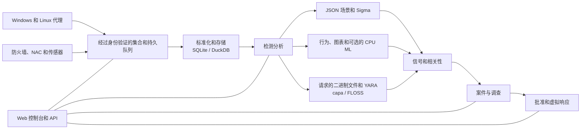

<p align="center"></p>

# VATEX LUMINA xSERA

<p align="center"><strong>看信号。了解故事。协调响应。</strong></p>

<p align="center">
  <a href="../../LICENSE"></a>
  
  
  
</p>

<details open><summary><strong>🌐 语言</strong></summary>

[English](README.en.md) · [한국어](README.ko.md) · [Español](README.es.md) · [Português (Brasil)](README.pt-BR.md) · [Français](README.fr.md) · [Deutsch](README.de.md) · [Italiano](README.it.md) · [Nederlands](README.nl.md) · [Polski](README.pl.md) · [Türkçe](README.tr.md) · [Русский](README.ru.md) · [Українська](README.uk.md) · [العربية](README.ar.md) · [हिन्दी](README.hi.md) · [বাংলা](README.bn.md) · [Bahasa Indonesia](README.id.md) · [Tiếng Việt](README.vi.md) · [ไทย](README.th.md) · [日本語](README.ja.md) · [简体中文](README.zh-CN.md)

</details>

xSERA 是一个面向 CPU 的 XDR 服务器和端点代理项目，用于连接遥测收集、检测、调查和响应工作流程。 Web控制台将操作、搜索、检测内容和案例集中在一起。

> **开发和验证状态**
>
> 该存储库包含基于版本 0.20.0 和后续更改的源代码。它旨在用于开发和评估，而不是普遍可用性的声明。下面的启动说明会阻止修改实际主机的操作。响应示例使用虚拟设备；真正的集成和主机操作需要单独的配置和现场验证。

> 🌐 本翻译自述文件是通过机器翻译生成的，未经专业翻译人员审阅。如果措辞不同，请参考英文自述文件。产品界面和其他文档不一定以该语言提供。

## 🧭 系统架构

从独立事件到证据和可诉讼案件：



摄取确认意味着事件到达持久队列；这并不意味着索引或检测已完成。 ML 分数和 YARA 匹配是调查的证据，而不是恶意或阻止主机的权限的证据。

## 🧩 这个存储库中有什么

| 组件 | 路径 | 目的 |
| --- | --- | --- |
| 服务器和API | `sapientia/` | 摄取、身份验证、存储、搜索、检测、案例和响应工作流程。 |
| 网页控制台 | `sapientia/web/` | 操作、事件搜索、规则、ML 数据、调查和响应。 |
| 端点代理 | `sapientia/endpoint_agent/` | Windows 和 Linux 收集、注册和服务器通信。 |
| 检测内容 | `sapientia/catalogs/` | 原生 JSON 规则、ATT&CK 信息以及带有来源和许可证的 YARA/capa 内容。 |
| 工具和部署示例 | `tools/`, `deploy/` | 代理打包、可选传感器转发器、虚拟遥测和服务示例。 |
| 文档和测试 | `docs/`, `tests/` | 运营合同、内容来源和回归测试。 |

捆绑库包含 950 条原始场景规则。包含并不意味着在全新安装时启用所有策略。综合训练示例并不能建立现实世界的检测准确性。 [Datasets](../../docs/console-datasets-0.15.md)

## 🚀 快速启动

下面的示例启动本地单服务器实例。它们需要 Python 3.12 和网络访问才能安装包。对于生产规划，单独配置访问控制、TLS 和备份。

### 窗户

在 PowerShell 中运行：

```powershell
git clone https://github.com/lastime1650/VateX_LUMINA_xSERA.git
cd VateX_LUMINA_xSERA
py -3.12 -m venv .venv
.\.venv\Scripts\python.exe -m pip install -r requirements-lock.txt
.\.venv\Scripts\python.exe -m pip install --no-deps -e .
.\start.cmd
```

如果 Python 启动程序找不到版本 3.12，请使用已安装的 Python 3.12 可执行文件的完整路径来创建虚拟环境。打开本地控制台并创建第一个管理员帐户： **http://127.0.0.1:8787**

Windows 启动脚本在 private/loopback-tls/ 中创建本地代理 TLS 证书，并使用仅限本地的端口 8788。这些证书不是用于远程部署的信任系统。

### Linux

```bash
git clone https://github.com/lastime1650/VateX_LUMINA_xSERA.git
cd VateX_LUMINA_xSERA
python3.12 -m venv .venv
.venv/bin/python -m pip install -r requirements-lock.txt
.venv/bin/python -m pip install --no-deps -e .
export SAPIENTIA_BLOCK_NATIVE_RESPONSE=1
.venv/bin/python -m sapientia --data ./data serve --host 127.0.0.1 --port 8787
```

Linux 示例启动控制台和本地 HTTP 摄取；它不会启动 TLS 代理侦听器。远程代理需要显式配置的 TLS 侦听器、受信任的 CA、签名的包、外部管理的签名密钥和单独的受信任的公钥。部署前请阅读代理文档。 [Agent signing](../../docs/agent-package-integrity.md) · [Agent](../../sapientia/endpoint_agent/README.txt)

打开本地控制台并创建第一个管理员帐户： **http://127.0.0.1:8787**

数据默认存储在data/中。不要提交数据/私钥/摄取密钥或证书私钥。不要将本地 HTTP 控制台暴露到互联网；外部访问需要经过验证的 TLS 和显式访问控制。

## 🔎 从遥测到响应

1. 连接来源。在控制台中创建索引和受限摄取密钥，或注册签名代理。配置防火墙、NAC 和传感器日志支持的输入和解析器。
2. 摄取事件。使用受限密钥将 JSON 发送到事件端点。通过环境变量或秘密管理器提供秘密。这个例子是本地的：

   ```bash
   curl -X POST http://127.0.0.1:8787/api/v1/events \
     -H "Authorization: Bearer $XSERA_INGEST_KEY" \
     -H "Content-Type: application/json" \
     --data '{"events":[{"event_id":"demo-001","index":"main","source":"demo","sourcetype":"json","host":"endpoint-01","severity":"info","message":"Example telemetry","raw":{"event":{"action":"process_created"}}}]}'
   ```

   将环境变量替换为有效的限制摄取密钥。成功的队列响应并不能保证此示例将产生检测或案例。

3. 配置检测。查看并启用本机 JSON 场景规则。 Sigma 规则遵循导入、转换、验证、独立审查和激活，然后在相同的本机 JSON 规则引擎中运行。 CPU ML 数据集和模型需要明确的培训、评估和批准。
4. 调查案件。检查检测信号、源事件和相关证据。可以使用 YARA 分析请求的进程二进制文件； capa 和 FLOSS 是单独安装的可选引擎。
5. 查看回复。检查剧本的批准、执行和结果。启动配置文件会阻止实际的主机修改操作，并且包含的​​虚拟响应不是真正的设备操作。

## 🧪 可选引擎和验证限制

基础服务器在没有 PyTorch 的情况下运行。 CPU ML、Sigma YAML 转换、capa/FLOSS 和外部传感器需要可选的依赖项或单独的安装和配置。遵循他们的验证和独立批准程序。

在之前的 0.20.0 版本快照中，每秒约 50 个事件的合成负载产生的检测 P95 为 35.95 秒，案例创建 P95 为 25.95 秒，分别未达到 2 秒和 5 秒的目标。此存储库包含后续源更改，因此早期的完整回归无法证明此提交。检测精度、误报、持续负载和实际响应需要单独的现场验证。

## 📚 进一步的文档

这些链接文档可能仅提供韩语或英语版本。

[Sigma / fusion](../../docs/fusion-sigma-0.18.txt) · [YARA](../../docs/yara-0.16.txt) · [CPU ML](../../docs/CPU_ML_RUNTIME.md) · [Datasets](../../docs/console-datasets-0.15.md) · [Virtual response](../../docs/VIRTUAL_RESPONSE_OPERATIONAL_QUALIFICATION.md) · [Agent signing](../../docs/agent-package-integrity.md) · [Agent](../../sapientia/endpoint_agent/README.txt) · [Security](../../SECURITY.md)

## ⚖️ 许可和安全

Apache-2.0下提供了项目拥有的代码以及已确认再分发权的原始规则和代理代码。第三方规则、ATT&CK 材料和库保留自己的条款。查看通知和第三方许可信息。

[Apache-2.0](../../LICENSE) · [NOTICE](../../NOTICE) · [Third-party notices](../../THIRD_PARTY_NOTICES.md) · [SECURITY](../../SECURITY.md)

通过安全策略中描述的私人报告渠道报告漏洞。请勿在公共问题中发布凭据或客户数据。

自述文件设计参考: [Wazuh](https://github.com/wazuh/wazuh/blob/main/README.md) · [Velociraptor](https://github.com/Velocidex/velociraptor/blob/master/README.md)
